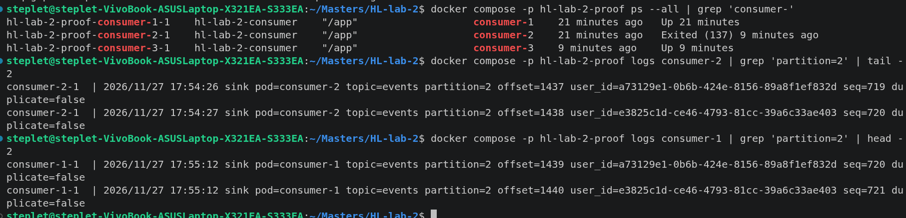
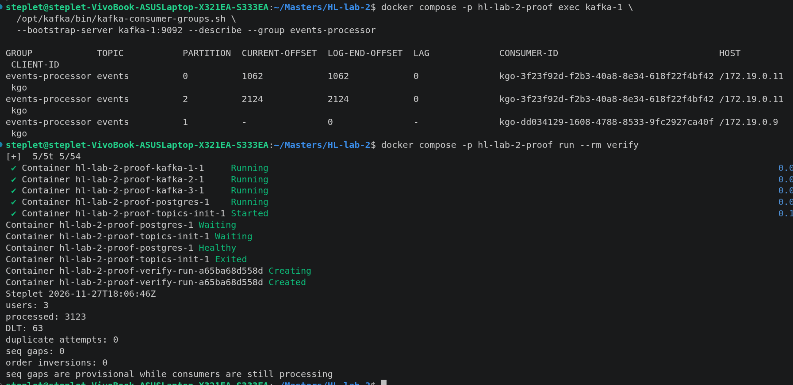
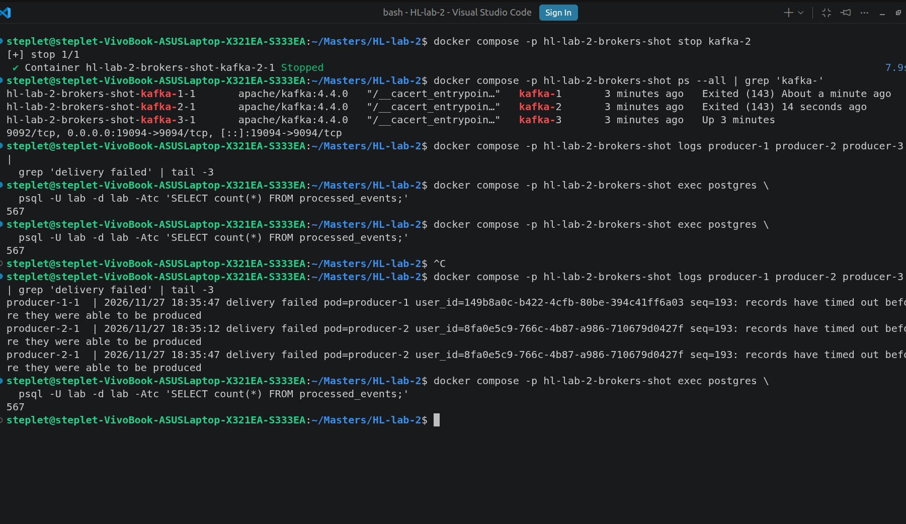
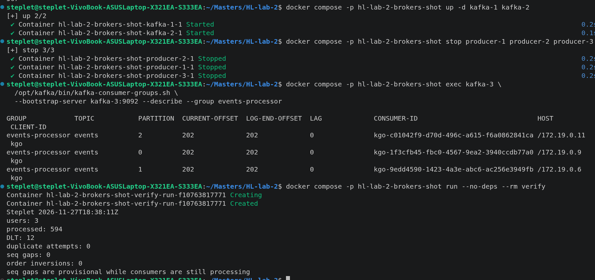
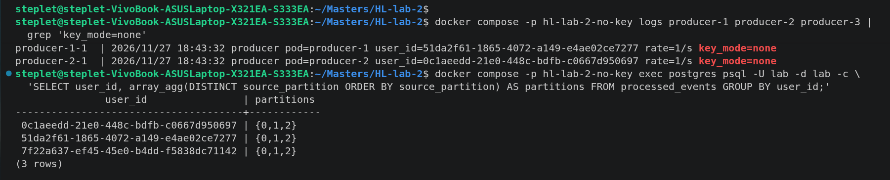
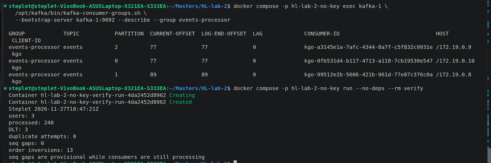

# Kafka lab

## Кластер

```sh
docker compose up -d
docker compose ps
docker compose exec kafka-1 /opt/kafka/bin/kafka-topics.sh --bootstrap-server kafka-1:9092 --describe --topic events
docker compose exec kafka-1 /opt/kafka/bin/kafka-topics.sh --bootstrap-server kafka-1:9092 --describe --topic events.dlt
```

Три узла Kafka работают в режиме KRaft с совмещёнными ролями broker и controller. Внутри сети Compose клиенты подключаются к `kafka-1:9092,kafka-2:9092,kafka-3:9092`; с хоста — к `localhost:19092,localhost:19093,localhost:19094`. Сервис `topics-init` создаёт топики при запуске; автоматическое создание отключено.

## Продюсеры

Три продюсера по умолчанию отправляют по 10 событий в секунду каждый; для отдельного запуска скорость можно задать через `EVENTS_PER_SECOND`. Один pod создаёт события одного `user_id`; при новом запуске pod получает новый UUID пользователя и начинает `seq` с 1. Каждое 50-е событие помечено `poison=true` (2%). Для сравнения распределения по партициям можно запустить стек с `KEY_MODE=none docker compose up -d --build`; по умолчанию ключ сообщения — `user_id`.

Клиент `franz-go` использует идемпотентную отправку по умолчанию. `acks=all` задан явно. Если доставка не удалась, продюсер записывает ошибку в журнал и повторяет то же событие с теми же `event_id` и `seq`; следующий номер он создаёт только после подтверждения записи. При SIGTERM продюсер перестаёт создавать события и ждёт отправки буфера до 40 секунд.

## Консьюмеры и sink

Три консьюмера составляют группу `events-processor` и записывают обработанные события в PostgreSQL. При первом запуске группа читает с начала топика (`earliest`); после этого использует сохранённые offsets. Автокоммит отключён: offset подтверждается после записи в sink или успешной отправки poison-события в `events.dlt`. Уникальный ключ `event_id` подавляет повторную запись; число таких попыток хранится в `duplicate_attempts`.

По умолчанию каждое событие обрабатывается с задержкой 500 мс; для отдельного запуска её можно задать через `PROCESSING_DELAY_MS`. Poison-событие трижды вызывает ошибку обработки, затем отправляется в `events.dlt` с причиной и исходными топиком, партицией и offset в заголовках.

## Проверка

```sh
docker compose run --rm --build verify
```

Первая строка содержит GitHub-логин и время запуска проверки. `verify` читает уникальные `event_id` из DLT и записи PostgreSQL. Для каждого пользователя он считает отсутствующие `seq` от 1 до максимального наблюдаемого номера; poison-события из DLT считаются присутствующими. Инверсии — пары записанных в sink событий одного пользователя, у которых порядок `seq` обратен порядку записи в PostgreSQL. Повторные доставки показывает счётчик `duplicate_attempts`.

Если консьюмеры ещё обрабатывают очередь, `seq gaps` может включать временные пропуски. Для окончательной проверки остановите продюсеры и дождитесь, когда группа дочитает накопленные события.

## Эксперимент 1. Аварийная остановка консьюмера

**Гипотеза.** Думаю, после остановки консьюмера другой заберёт его партицию и продолжит обработку. Событие может прийти повторно, если оно уже записано в PostgreSQL, но offset ещё не подтверждён.

**Что сделали.** Три продюсера отправляли по 1 событию в секунду, задержка обработки составляла 200 мс. `consumer-2` читал непустую партицию 2. Мы завершили его через `SIGKILL`.

**Результат.** `consumer-2` завершился с кодом 137. Последним он записал offset 1438. После ребаланса `consumer-1` получил партицию 2 и начал с offset 1439 — обработка продолжилась. Пока продюсеры работали, `verify` показал рост записей в sink с 2079 до 2316; DLT вырос с 42 до 45. Дублей, пропусков `seq` и инверсий не было. В этом запуске повторная доставка не возникла: она зависит от момента сбоя.

Затем мы остановили продюсеров и дождались `LAG=0` для партиций 0 и 2; партиция 1 была пустой. Итоговый `verify` показал 3123 записи в sink, 63 в DLT, 0 дублей, 0 пропусков `seq` и 0 инверсий. Очередь дочитана, а в проверенных последовательностях нет пропусков.

**Скриншоты:**





## Эксперимент 2. Отказ брокеров

**Гипотеза.** Думаю, после остановки одного брокера запись и чтение продолжатся: две копии партиций останутся в ISR. После остановки второго запись прекратится из-за `min.insync.replicas=2`, а у KRaft не будет большинства для управления кластером.

**Что сделали.** Запустили три продюсера по 1 событию в секунду и три консьюмера с задержкой 200 мс. Сначала остановили `kafka-1`, затем `kafka-2`. После наблюдения вернули оба брокера и остановили продюсеров, чтобы консьюмеры дочитали очередь.

**Результат.** После остановки одного брокера кластер продолжил работу: лидер его партиции сменился, в ISR остались две копии. После остановки второго работал только `kafka-3`. Число записей в sink не менялось — два запроса подряд показали 567. Продюсеры сообщили о таймауте доставки `seq=193` и ждали восстановления, не переходя к следующему номеру.

После возврата брокеров консьюмеры дочитали очередь: `LAG=0` у всех трёх партиций. Итоговый `verify` показал 594 записи в sink, 12 событий в DLT, 0 дублей, 0 пропусков `seq` и 0 инверсий. Гипотеза подтвердилась для записи; оставшийся брокер мог отвечать на чтение уже сохранённых метаданных, хотя новые события не записывались.

**Скриншоты:**





## Эксперимент 3. Отправка без ключа

**Гипотеза.** Думаю, без ключа события одного пользователя попадут в разные партиции, поэтому `verify` найдёт нарушения порядка.

**Что сделали.** В отдельном Compose-проекте запустили три продюсера с `KEY_MODE=none` и скоростью 1 событие в секунду на pod. Задержка консьюмеров была 200 мс — как в опыте с ключом `user_id`. Затем остановили продюсеров и дождались `LAG=0`.

**Результат.** С ключом `user_id` проверка показывала 0 инверсий. Без ключа события каждого из трёх пользователей оказались во всех трёх партициях, а `verify` нашёл 13 инверсий при 240 записях в sink. При этом 3 poison-события оказались в DLT, пропусков `seq` и дублей не было. Например, для одного пользователя `seq=5` из партиции 0 записался в sink раньше `seq=4` из партиции 2. Kafka сохраняет порядок внутри партиции; обработка разных партиций идёт параллельно, поэтому общий порядок событий пользователя без ключа нарушается.

**Скриншоты:**




