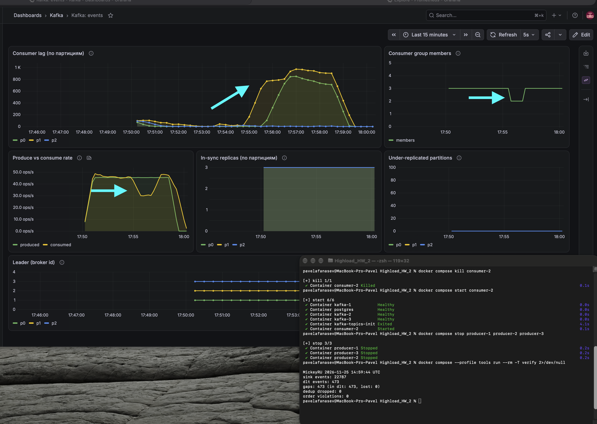
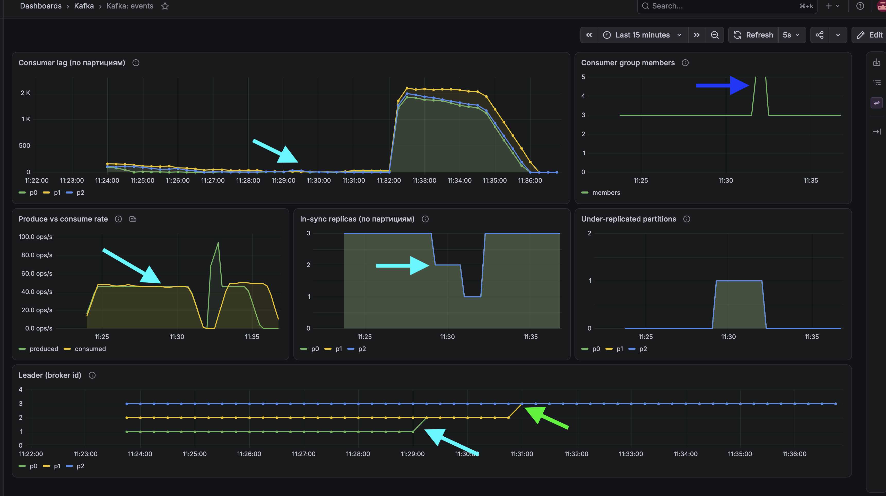
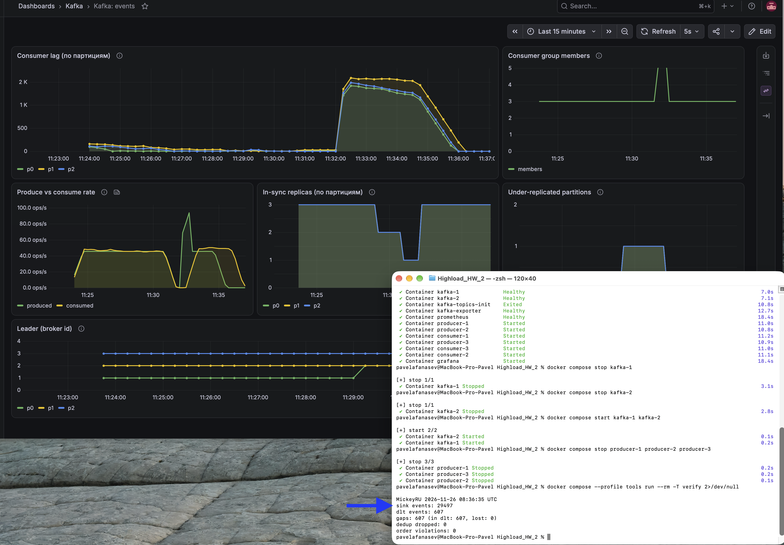
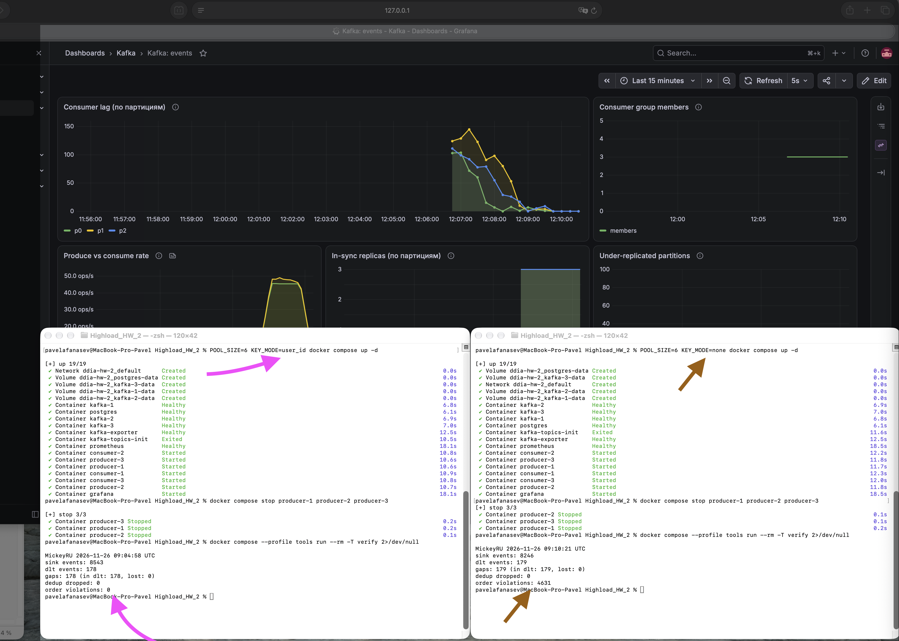

# HW2. Очередь Kafka — DDIA, осень 2026

## 1. Что это

Продюсеры пишут поток событий в Kafka, консьюмеры группы
`events-processor` обрабатывают его и сохраняют результат в PostgreSQL.
События, которые не удалось обработать, уходят в `events.dlt`; утилита
`verify` проверяет непрерывность `seq`, дубли и порядок, а Grafana
показывает лаг, ISR и лидеров партиций.

| Компонент | Реализация |
|---|---|
| Кластер Kafka | `apache/kafka:4.4.0`, режим KRaft |
| Топики | `events` (основной поток), `events.dlt` (dead letter) |
| Продюсеры | C++20 + librdkafka, `acks=all`, `enable.idempotence=true` |
| Консьюмеры | C++20 + librdkafka, группа `events-processor`, ручной коммит оффсетов |
| Sink | PostgreSQL 18, идемпотентная запись по `event_id` |
| DLT | `events.dlt`, причина ошибки и исходные topic/partition/offset в заголовках |
| Проверка | CLI `verify`: пропуски `seq`, покрытие DLT, дубли, нарушения порядка |
| Мониторинг | `kafka-exporter` → Prometheus → Grafana |
| Инфраструктура | Docker Compose v2, CMake + Ninja, зависимости через vcpkg |

Стек C++: `librdkafka` (C++ API), `nlohmann-json`, `stduuid`, `libpqxx`.
Образы: `apache/kafka:4.4.0`, `postgres:18-alpine`,
`prom/prometheus:v3.15.0`, `grafana/grafana:13.2.4`,
`danielqsj/kafka-exporter:v1.11.0`.

Поток данных:

```text
3 продюсера
producer-1 ─┐
producer-2 ─┼──▶ Kafka: 3 брокера
producer-3 ─┘    events: 3 партиции (p0, p1, p2)
                 key=user_id, RF=3, minISR=2
                        │
                        ▼
       3 консьюмера, по одной партиции на под
       consumer-1   consumer-2   consumer-3
           │            │            │
           └────────────┼────────────┘
                        │
          ┌─────────────┴─────────────┐
          ▼                           ▼
  PostgreSQL sink              events.dlt
          └─────────────┬─────────────┘
                        ▼
                     verify

kafka-exporter ──▶ Prometheus ──▶ Grafana
```

## 2. Модель события и сообщения

| Поле / свойство | Тип | Смысл |
|---|---|---|
| `event_id` | UUID v4 | уникальный id события; ключ идемпотентности в sink |
| `user_id` | string | пользователь; закреплён ровно за одним продюсером |
| `type` | enum | `page_view` / `add_to_cart` / `purchase` |
| `seq` | uint64 | порядковый номер события пользователя, с 1 без пропусков |
| `produced_at` | ISO8601 UTC | время генерации |
| `payload` | JSON | произвольный payload; у poison — `{"broken": true}` |
| Ключ сообщения | string | `user_id`; в эксперименте 4.3 — без ключа |

- `event_id` — UUID v4, генерируется в продюсере через `stduuid`
  (`uuid_random_generator`). Случайность v4 нужна только для уникальности.
- `seq` — порядок внутри пользователя, а не глобальный. Каждый `user_id`
  генерирует ровно один продюсер, поэтому `seq` для пользователя определён
  однозначно.
- `produced_at` — информационное поле; порядок задаётся `seq`, а не временем.
- Poison моделируется в продюсере: для каждого события независимо
  разыгрывается число от 1 до 100, и если оно не больше `POISON_PERCENT`
  (2), в `payload` попадает `{"broken": true}`. То есть каждое событие
  становится poison с шансом 2%; при 45 событиях/с это около 0.9 события/с,
  фактическая доля в прогоне колеблется вокруг 2%.

## 3. Архитектура и ключевые решения

### 3.1. Kafka

`events` и `events.dlt` — по 3 партиции, RF=3; у `events`
`min.insync.replicas=2`. Топики создаёт одноразовый `kafka-topics-init`,
автосоздание отключено.

### 3.2. Продюсеры

- По 15 событий/с на продюсера; суммарно 45 событий/с.
- 60 пользователей (`u-0..u-59`), по 20 на под; пользователь закреплён
  за одним подом, поэтому `seq` не конкурируют между продюсерами.
- `acks=all`, `enable.idempotence=true`; ошибки доставки логируются;
  по SIGTERM буфер досылается (flush до 20 с).
- 2% событий — poison (раздел 2).

### 3.3. Консьюмеры и нагрузка

- Консьюмеры в группе `events-processor`; в стабильном состоянии
  каждому поду достаётся одна партиция.
- `PROCESSING_DELAY_MS=50`; оффсет коммитится после записи в sink; на
  ребалансе коммитится уже обработанное; poison после 3 попыток с паузой
  100 мс уходит в DLT; `auto.offset.reset=earliest`.

| Что | Расчёт | Значение |
|---|---|---|
| Вход | 3 × 15 событий/с | 45 событий/с |
| Ёмкость по задержке | 3 × (1000 / 50) | 60 событий/с |
| Реальная ёмкость (оценка) | 3 × ~17–19 (INSERT + commitSync) | ~51–57 событий/с |
| Утилизация в норме | 45 / 60 | 75% по теории, ~80–88% по факту |
| После отказа одного пода | 2 × ~17–19 | ~34–38 событий/с, лаг растёт |

Теоретическая ёмкость считается по `PROCESSING_DELAY_MS`; фактическая ниже
из-за записи в Postgres и синхронного коммита на каждое событие. В норме
45 событий/с проходят с небольшим лагом; после `kill -9` одного пода
остаётся ~34–38 событий/с, поэтому лаг начинает расти — это и проверяется
в разделе 7.1.

### 3.4. Sink и DLT

Sink — PostgreSQL. Запись идемпотентна по `event_id`
(`INSERT ... ON CONFLICT DO NOTHING`); попытки вставки существующего id
считаются в `consumer_stats.dedup_dropped`. В DLT сохраняются исходные
topic/partition/offset и текст ошибки в заголовках.

### 3.5. Мониторинг

`kafka-exporter` — сервис-экспортер, который отдаёт метрики Kafka в формате
Prometheus. Grafana показывает лаг по партициям, участников группы,
скорость производства/потребления, ISR, under-replicated partitions и
лидеров. Счётчики приложения (`applied`, `dedup_dropped`) лежат в Postgres
и проверяются через `verify`.

## 4. Гарантии доставки

- **At-least-once.** Оффсет коммитится после записи в sink; при падении между
  записью и коммитом сообщение будет доставлено повторно.
- **Идемпотентный sink.** Повторная доставка не создаёт вторую строку:
  `event_id` — первичный ключ, конфликт игнорируется.
- **Порядок — только внутри пользователя.** `key=user_id` отправляет все
  события пользователя в одну партицию, где их последовательно обрабатывает
  один консьюмер. Глобального порядка нет.
- **Один продюсер на пользователя.** Множества `user_id` не пересекаются,
  поэтому `seq` не конкурируют между подами.
- **Отказ одного брокера.** `RF=3`, `min.insync.replicas=2` и `acks=all`
  позволяют писать, пока живы 2 из 3 реплик.
- **Отказ двух брокеров.** Теряется кворум контроллеров: кластер не может
  выбирать лидеров и обслуживать метаданные. Короткий отказ переживается,
  но это отдельный сценарий, а не проверка одной реплики.
- **Poison не блокирует партицию.** После 3 попыток событие уходит в DLT,
  оффсет коммитится, партиция продолжает обрабатываться.

## 5. Запуск

Нужны Docker 24+ (Compose v2) и Python 3.10+.

```bash
cp .env.example .env
python3 scripts/configure.py
docker compose up -d --build
```

`.env` содержит пароли и в git не попадает; `.env.example` — шаблон.
`GITHUB_LOGIN` в `.env` нужен для первой строки `verify`.

Grafana: <http://localhost:3000/d/kafka-events>, логин `admin`, пароль —
`GRAFANA_ADMIN_PASSWORD` из `.env`.

| Порт | Что |
|---|---|
| `3000` | Grafana |
| `9090` | Prometheus |
| `5434` | PostgreSQL |
| `29092` / `39092` / `49092` | Kafka host-listener для `kafka-1/2/3` |

`docker compose down` сохраняет данные, `down -v` удаляет тома. Для
экспериментов нужен `down -v`: иначе старые строки в Postgres, DLT и
оффсеты группы смешаются с новым прогоном, а `seq` после рестарта продюсера
начнётся с 1 и `verify` покажет ложные нарушения порядка.

## 6. Проверка

`verify` — отдельный сервис compose. Первая строка — GitHub-логин и текущее
время UTC; по ним проверяются скриншоты. Дальше:

| Строка | Что означает |
|---|---|
| `sink events` | сколько строк в `events` |
| `dlt events` | сколько уникальных `(user_id, seq)` в `events.dlt` |
| `gaps` | пропуски `seq` до максимального наблюдённого значения |
| `in dlt` | пропуски, покрытые poison-событиями в DLT |
| `lost` | пропуски, которых нет ни в sink, ни в DLT |
| `dedup dropped` | сколько попыток вставки отброшено идемпотентностью |
| `order violations` | сколько раз событие с меньшим `seq` попало в sink после события с большим |

Если `lost > 0`, `verify` возвращает код 1 и печатает пользователей с
потерями. Перед снятием результата нужно остановить продюсеров и дождаться
`LAG=0`, иначе sink и DLT снимаются в разные моменты.

## 7. Эксперименты

Общая методика: гипотеза пишется до запуска; каждый эксперимент начинается
с чистого состояния; нагрузка работает 2–3 минуты; перед `verify`
продюсеры останавливаются и лаг доводится до нуля. На эксперимент — не
более двух скриншотов, на них должны читаться логин и время. Скриншоты
кладутся в `docs/img/` и вставляются в README.

### 7.1. Отказ консьюмера (`kill -9`)

**Гипотеза (заполнить до запуска):**
> ...

**Ход:** убить `consumer-2` без graceful shutdown. Посмотреть, какие
партиции переехали на живые поды, с какого оффсета продолжилась обработка,
как изменился лаг и появились ли дубли. Старый member id живёт до
`session.timeout.ms` (~45 с): сразу после kill в группе ещё 3 участника, а
если поднять под раньше истечения, будет 4–5. Для чистого 3→2→3 подождать
45–60 секунд, затем вернуть под и дождаться стабильной группы.

**Наблюдения:** ...

**Скриншоты:**




**Результат verify:**

```text
...
```

**Вывод:** ...

**Расхождения с гипотезой:** ...

### 7.2. Отказ брокеров

**Гипотеза (заполнить до запуска):**
> ...

**Ход:** остановить `kafka-1`, посмотреть на нового лидера и ISR; затем
остановить `kafka-2` и зафиксировать поведение продюсеров и консьюмеров.
Вернуть брокеров и проверить, что `ISR` снова 3. Два брокера не держать
выключенными дольше 60–90 секунд: у продюсера `delivery.timeout.ms` 120 с,
после этого буфер начнёт терять события.

После восстановления лидеры могут остаться на последнем выжившем брокере:
Kafka не возвращает лидерство автоматически при старте брокера, а
периодический авто-ребаланс срабатывает не сразу. Если нужно вернуть
баланс, выполняется preferred leader election.

**Наблюдения:** ...

**Скриншоты:**





**Результат verify:**

```text
...
```

**Вывод:** ...

**Расхождения с гипотезой:** ...

### 7.3. `KEY_MODE=user_id` против `KEY_MODE=none`

**Гипотеза (заполнить до запуска):**
> ...

Оба прогона делаются с `POOL_SIZE=12` (по 4 пользователя на продюсера;
на время эксперимента значение меняется в `.env`). При 60 пользователях
события одного пользователя идут раз в ~1.3 с, и инверсии могут не
появиться; при 12 пользователях интервал меньше разброса задержек между
партициями, поэтому эффект воспроизводится.

| Прогон | sink events | dlt events | lost | dedup dropped | order violations |
|---|---|---|---|---|---|
| `KEY_MODE=user_id` | ... | ... | ... | ... | ... |
| `KEY_MODE=none` | ... | ... | ... | ... | ... |

**Скриншоты:**




**Вывод:** ...

**Расхождения с гипотезой:** ...

## 8. Ограничения

- `seq` продюсера хранится в памяти. Рестарт продюсера в рамках прогона
  сбрасывает `seq` в 1; поэтому каждый эксперимент начинается с `down -v`.
- `verify` ищет пропуски только до максимального наблюдённого `seq`.
  Потеря «хвоста» событий пользователя так не детектируется.
- При двух выключенных брокерах теряется кворум контроллеров, а не только
  `min.insync.replicas`; это отдельный сценарий.
- `dedup dropped` может быть 0 даже после отказа: окно между записью в sink
  и коммитом оффсета очень маленькое. Это нормальный результат.
- Мониторинг построен на метриках `kafka-exporter`; счётчики приложения
  лежат в Postgres и не экспортируются в Prometheus.
- Стенд локальный: без TLS/SASL, порты привязаны к `127.0.0.1`.

## 9. Структура репозитория

```text
src/
  producer_main.cpp   точка входа продюсера
  producer.cpp/.hpp   librdkafka producer, delivery callback
  consumer_main.cpp   точка входа консьюмера
  consumer.cpp/.hpp   consume loop, retry, DLT, rebalance callback
  sink.cpp/.hpp       Postgres sink, идемпотентная вставка
  dlt.cpp/.hpp        отправка в events.dlt с заголовками
  verify_main.cpp     CLI-проверка
  event.cpp/.hpp      модель события и JSON
  config.cpp/.hpp     чтение env, разбиение user_id по подам
db/init.sql           таблицы events и consumer_stats
docs/img/             скриншоты экспериментов
monitoring/           Prometheus, provisioning Grafana, дашборд
scripts/configure.py  генерация паролей в .env
compose.yaml          Kafka, приложения, Postgres, мониторинг
Dockerfile            сборка C++ через vcpkg
```
