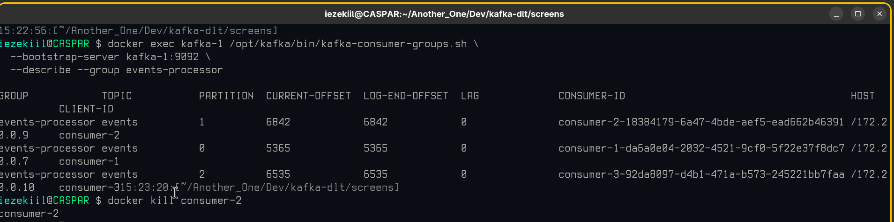
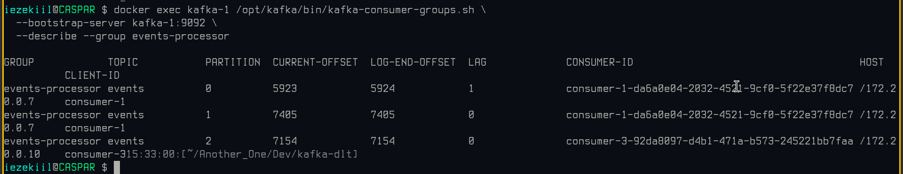
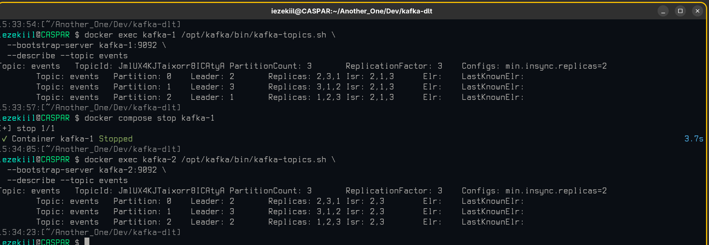
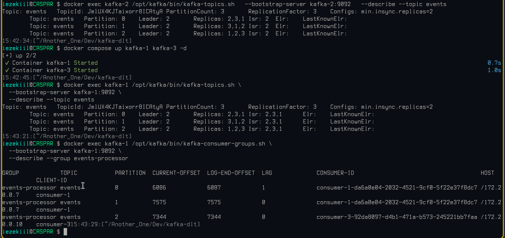
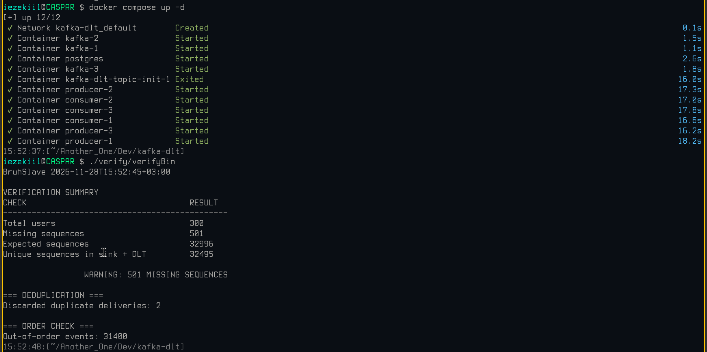

# HW2: Kafka producer и consumer

## Запуск

Для запуска стенда потребуется Docker Compose и Go (для локальной сборки и запуска `verify`).

```bash
cp env-example .env
docker compose up -d --build
```

Kafka запускается в режиме KRaft, без ZooKeeper. Перед запуском приложений выполняется инициализация брокеров и топиков. Продюсеры начинают отправлять сообщения после готовности Kafka, консьюмеры — после готовности Kafka и PostgreSQL.

В стенде используются три Kafka-брокера, три продюсера и три консьюмера. Продюсеры генерируют события с разными `user_id`, а консьюмеры обрабатывают их и сохраняют в PostgreSQL.


Посмотреть логи:

```bash
docker compose logs -f producer-1 producer-2 producer-3
docker compose logs -f consumer-1 consumer-2 consumer-3
```

## Продюсеры

В стенде работают три экземпляра producer. Каждый генерирует события для своих пользователей и отправляет их в Kafka.

У события есть `event_id`, `user_id`, `seq`, тип события, время создания и payload. `event_id` генерируется отдельно для каждого события, а `seq` последовательно увеличивается для конкретного пользователя.

Продюсеры отправляют сообщения с `acks=all`. Используется идемпотентность, ограничение параллельных запросов и повторные попытки отправки с backoff. Следующий номер `seq` для пользователя назначается после подтверждения предыдущего сообщения.

Для эксперимента с порядком сообщений предусмотрены два режима:

- `KEY_MODE=user_id` — Kafka key соответствует `user_id`. Все события пользователя попадают в одну партицию.
- `KEY_MODE=none` — ключ не передаётся, сообщения распределяются без привязки к пользователю.

Часть сообщений специально генерируется с `poison=true`. Они используются для проверки повторных попыток обработки и отправки неисправимых событий в Dead Letter Topic.


## Консьюмеры и обработка сообщений

Три консьюмера работают в одной группе `events-processor`. Kafka распределяет партиции между участниками группы, поэтому каждая партиция в конкретный момент обрабатывается одним участником группы.

Сообщения внутри партиции обрабатываются последовательно. После получения события консьюмер проверяет его и записывает в PostgreSQL.

Автокоммит отключён. Оффсет подтверждается после успешной обработки сообщения. Это позволяет повторно получить сообщение, если консьюмер завершится до коммита.

Такой сценарий допускает повторную доставку: например, запись в PostgreSQL уже состоялась, а Kafka offset ещё не успел закоммититься. Для этого используется дедупликация по `event_id` — повторная вставка не создаёт новую строку, а количество отброшенных повторов учитывается отдельно.

Для обработки ошибок предусмотрены retries. Если событие не удалось обработать после нескольких попыток, оно отправляется в `events.dlt`. В DLT сохраняется информация об ошибке, исходном топике, partition и offset.

Валидные сообщения не отправляются в DLT из-за временной недоступности PostgreSQL. В таком случае обработка не подтверждается, и сообщение может быть доставлено повторно после восстановления.

## Проверка результатов

Для проверки состояния обработки используется `verifyBin`. Он проверяет данные в PostgreSQL и Dead Letter Topic, чтобы пропуски последовательностей не считались потерей, если соответствующие события находятся в DLT.

Запуск:

```bash
cd verify
go build -o verifyBin .
```

```bash
DATABASE_URL="postgres://kafka:<POSTGRES PASSWORD>@localhost:5432/<POSTGRES DB>" \
BROKERS="localhost:9092" \
./verifyBin
```

Проверка включает:

- последовательности `seq` для пользователей;
- пропущенные последовательности с учётом событий в sink и DLT;
- количество повторных доставок, отброшенных дедупликацией;
- нарушения порядка записи событий одного пользователя.

`Out-of-order event pairs` — количество пар событий одного пользователя, для которых событие с меньшим `seq` оказалось записано позже события с большим `seq`. Это именно количество инверсий между парами, а не количество потерянных сообщений.

Показатели зависят от момента запуска проверки. Пока продюсеры и консьюмеры работают, база продолжает изменяться, поэтому для сравнения результатов экспериментов лучше использовать завершённые прогоны или остановить генерацию сообщений.


## Эксперименты

Эксперименты проводились на работающем стенде с тремя брокерами Kafka, тремя producer и тремя consumer. Перед каждым сценарием проверялись исходное состояние и доступность сервисов.

Для каждого опыта заранее сформулирована гипотеза, после чего фиксировались наблюдения и результаты проверки.

### 1. Аварийное завершение консьюмера

**Гипотеза:** при аварийном завершении одного консьюмера Kafka перераспределит его партиции между оставшимися участниками группы. Обработка продолжится с последнего закоммиченного offset. Возможны повторные доставки, но потери сообщений возникнуть не должны.

Для проверки один из консьюмеров был принудительно завершён с помощью `kill -9`. Docker перезапустил контейнер согласно restart policy.

После отказа партиции продолжили обслуживаться оставшимися участниками consumer group. В зафиксированном состоянии все партиции имели `lag=0`.


**Результат:** после завершения консьюмера обработка продолжилась, контейнер восстановился, отставания по оффсетам в зафиксированном состоянии не было. Количество зарегистрированных повторов не увеличилось. Сценарий соответствует ожидаемому поведению consumer group при отказе участника.






### 2. Остановка Kafka-брокеров

**Гипотеза:** при отказе одного брокера кластер продолжит работу, если для партиций остаётся достаточное количество синхронных реплик. При отказе двух брокеров доступность кластера и подтверждение новых сообщений будут ограничены. После восстановления брокеров реплики синхронизируются, обработка продолжится.

В топике `events` используются три партиции, replication factor равен 3, `min.insync.replicas=2`.

Сначала был остановлен `kafka-1`.

```bash
docker compose stop kafka-1
```

После остановки одного брокера все три партиции оставались доступными. ISR сократился до двух реплик, лидер одной из партиций сменился.

Затем был остановлен второй брокер.

```bash
docker compose stop kafka-3
```

При оставшемся одном брокере запросы Kafka Admin API завершались ошибками соединения и таймаутами. В этот момент полноценная проверка состояния кластера была затруднена.

После возвращения всех брокеров:

```bash
docker compose start kafka-1 kafka-2 kafka-3
```

ISR восстановился до трёх реплик для каждой партиции.

| Partition | Leader | Replicas | ISR |
|----------|--------|----------|-----|
| 0 | 2 | 2, 3, 1 | 2, 1, 3 |
| 1 | 3 | 3, 1, 2 | 2, 1, 3 |
| 2 | 1 | 1, 2, 3 | 2, 1, 3 |

После восстановления брокеров consumer group снова обрабатывала все партиции. В зафиксированном состоянии lag был равен нулю.

**Результат:** кластер выдержал отказ одного брокера благодаря оставшимся ISR и настройке `min.insync.replicas=2`. При отказе двух брокеров нормальная работа кластера деградировала. После возвращения брокеров репликация и обработка восстановились.

В ходе опыта не был зафиксирован конкретный ответ producer `NOT_ENOUGH_REPLICAS`, поэтому вывод о невозможности подтверждения записи при недостаточном ISR основан на настройках Kafka, а не на непосредственно сохранённом сообщении об ошибке producer.





### 3. Kafka key и порядок событий

**Гипотеза:** ключ `user_id` направляет события одного пользователя в одну партицию, сохраняя порядок чтения Kafka. Без ключа события могут распределяться между разными партициями и обрабатываться параллельно, что приводит к нарушениям порядка записи в sink.

Распределение событий по партициям до переключения режима:

| Partition | Events in sink |
|---|---:|
| 0 | 15 295 |
| 1 | 15 471 |
| 2 | 17 015 |
| Total | 47 781 |

| Показатель | Первый замер | Последующий замер |
|---|---:|---:|
| Missing sequences | 501 | 507 |
| Duplicate deliveries | 2 | 2 |
| Out-of-order event pairs | 1 470 987 | 2 376 057 |

При публикации без ключа число нарушений порядка увеличивалось между проверками, в то время как количество пропусков и дублей оставалось практически неизменным. После эксперимента режим `KEY_MODE=user_id` был восстановлен.

| Показатель | Результат после восстановления |
|---|---:|
| Missing sequences | 501 |
| Duplicate deliveries | 2 |
| Out-of-order event pairs | 2 326 703 |

Метрики являются накопительными и отражают всю историю обработки, а не отдельные прогоны каждого режима.

**Результат:** публикация с `user_id` сохраняет порядок сообщений пользователя внутри партиции Kafka. Без ключа сообщения могут распределяться между разными партициями, что при параллельной обработке приводит к нарушениям порядка записи в PostgreSQL. Наблюдения подтверждают этот механизм, но не являются изолированным количественным сравнением режимов.



*Скрипт был выполнен после, данные изменились*


## Итоги

В ходе работы реализованы producer и consumer на Go, работающие с Kafka в режиме KRaft. События публикуются с подтверждениями `acks=all`, обрабатываются consumer group и сохраняются в PostgreSQL.

Для обработки повторной доставки используется дедупликация по `event_id`. Неисправимые сообщения после повторных попыток отправляются в Dead Letter Topic. Оффсеты подтверждаются после успешной обработки, что позволяет восстанавливать работу после отказов с возможностью повторной доставки.

Эксперименты показали:

- отказ одного консьюмера приводит к перераспределению партиций и восстановлению обработки;
- отказ одного брокера не останавлияет работу кластера при достаточном ISR;
- отказ двух брокеров приводит к деградации доступности;
- ключ Kafka влияет на распределение событий и возможность сохранять порядок одного пользователя;
- повторная доставка не обязательно приводит к повторной записи в sink благодаря дедупликации.
