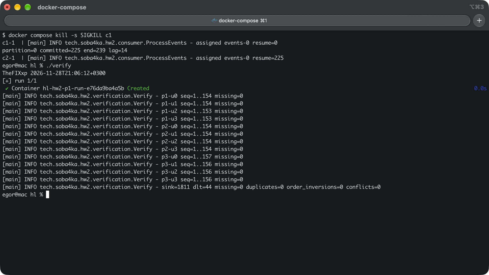
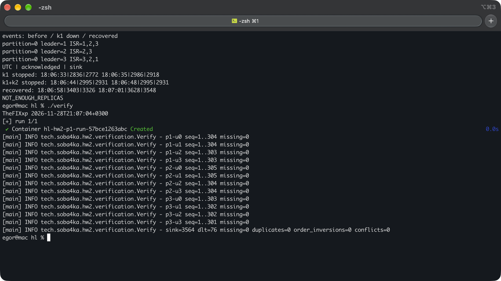
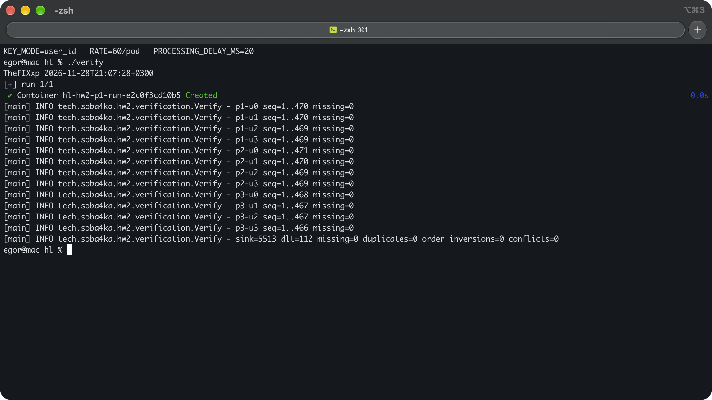
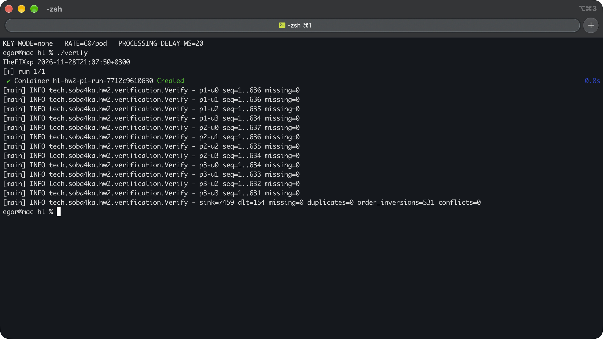

# HW2 · Очередь Kafka

Java 21, Kafka 3.9.1 в режиме KRaft и PostgreSQL 16. Три продюсера публикуют пользовательские события в `events`. Три консьюмера группы `events-processor` записывают результат обработки в PostgreSQL. События, обработка которых трижды завершилась ошибкой, попадают в `events.dlt`.

## Запуск и проверка

Для запуска достаточно Docker с Compose. Из корня репозитория:

```sh
docker compose build p1
docker compose up -d --no-build
docker compose ps -a
```

Все шесть Java-процессов используют один образ. Аргумент запуска выбирает роль приложения. Для работы с Kafka используются `KafkaProducer` и `KafkaConsumer`, для PostgreSQL — JDBC. Сервис `init` создаёт оба топика с тремя партициями, фактором репликации 3 и минимальным ISR 2, затем завершается с кодом 0. Автосоздание отключено. Внутренние адреса брокеров — `k1:9092,k2:9092,k3:9092`, с хоста — `localhost:19092,localhost:19093,localhost:19094`. Данные брокеров и PostgreSQL находятся в именованных томах.

```sh
docker compose stop p1 p2 p3
docker compose exec -T k3 /opt/kafka/bin/kafka-consumer-groups.sh \
  --bootstrap-server k3:9092 --describe --group events-processor
# Когда LAG равен 0 для всех трёх партиций:
./verify
docker compose start p1 p2 p3
```

Переменные окружения для `docker compose up -d`:

| Переменная | По умолчанию | Назначение |
|---|---:|---|
| `RATE` | 24 | Целевая скорость каждого продюсера, событий/с. Ожидание подтверждений может ограничить фактическую скорость. |
| `PROCESSING_DELAY_MS` | 20 | Задержка каждой попытки обработки события, мс |
| `KEY_MODE` | `user_id` | Ключ пользователя или `none` для отправки без ключа |

`docker compose stop` останавливает стенд с сохранением данных. Следующий запуск продолжает те же последовательности и счётчики.

## События и гарантии доставки

```json
{"event_id":"683c901d-e19d-410d-b2b9-52bd5f1768ae","user_id":"p2-u1","type":"add_to_cart","seq":1,"produced_at":"2026-11-28T17:00:00Z","payload":{"poison":false}}
```

У каждого продюсера четыре собственных пользователя. Для каждого пользователя `seq` начинается с 1. Тип случайно выбирается из `page_view`, `add_to_cart`, `purchase`. Поле `payload.poison` принимает значение `true` с вероятностью 2%.

Продюсер сохраняет JSON в поле `generated.pending` перед отправкой. После подтверждения Kafka он увеличивает последний подтверждённый `seq` и очищает `pending`. При сбое между этими действиями повторная попытка использует прежний UUID. Отправки последовательны, включены `acks=all` и `enable.idempotence=true`. При SIGTERM процесс завершает текущую отправку и закрывает клиент. Ошибки видны в журнале, неподтверждённое событие остаётся доступным для повтора.

Консьюмер отключает автокоммит. Он обрабатывает до 12 записей за `poll` и подтверждает для каждой партиции позицию после последней успешно обработанной записи. Перед отзывом партиций он коммитит готовые позиции. Для группы без сохранённого offset выбран `earliest`, чтобы обработать весь доступный журнал. В sink сохраняются UUID, пользователь, seq, под, топик, партиция и offset. Уникальность UUID и счётчик конфликтов в той же транзакции обеспечивают дедупликацию. После третьей ошибки консьюмер дожидается подтверждения публикации в DLT. Заголовки `reason`, `topic`, `partition`, `offset` позволяют найти исходную запись.

## Как читать verify

Проверку запускают после остановки продюсеров и обработки очереди. Для каждого пользователя CLI сравнивает диапазон от 1 до последнего подтверждённого продюсером `seq` с объединением sink и DLT. Так видны и потери в конце последовательности. DLT читается отдельным клиентом до конечных оффсетов, повтор одного UUID в DLT учитывается один раз. Проверяются признак poison и заголовки. Пропуски и конфликты дают ненулевой код выхода.

`duplicates` считает попытки повторной записи в sink. `order_inversions` считает все пары одного пользователя, в которых меньший `seq` записан позже большего. Порядок записей задаёт `write_no`: транзакции одного пользователя получают его под одной блокировкой PostgreSQL. `conflicts` показывает повтор позиции пользователя между результатами и позиции вне ожидаемых диапазонов.

## Эксперименты

Все три эксперимента проведены на одном Compose-стенде с чистыми томами. Счётчики накапливаются между этапами. На снимках окна видны логин, локальное время и вывод текущей версии `./verify` для всех 12 пользователей.

### 1. SIGKILL консьюмера

**Гипотеза.** После потери участника другой консьюмер получит его партицию и начнёт с последнего зафиксированного offset. Если убитый процесс успел записать часть пачки, возможны дубли. После обработки очереди ожидаются ноль пропусков и сохранение порядка.

```sh
docker compose kill -s SIGKILL c1
docker compose exec -T k3 /opt/kafka/bin/kafka-consumer-groups.sh \
  --bootstrap-server k3:9092 --describe --group events-processor
docker compose logs c2 c3 | grep -E 'assigned|revoked'
docker compose stop p1 p2 p3
# После обработки остатка очереди:
./verify
docker compose start c1
```

**Результат.** После SIGKILL у партиции 0 были committed offset 225 и конец журнала 239 (lag 14). После ребаланса `c2` начал обработку с offset 225. В sink записано 1 811 событий, в DLT — 44. Пропуски — 0, повторные записи, отброшенные по UUID, — 0. Повторная доставка возможна, если процесс погиб между записью в sink и коммитом offset.



### 2. Последовательная остановка брокеров

**Гипотеза.** После остановки одного брокера две синхронные реплики позволят подтверждать запись. Если остановить второй, останется одна реплика при минимальном ISR 2 и исчезнет большинство контроллеров KRaft. Продюсеры будут повторять отправки. Консьюмеры смогут доработать доступные записи, затем рост sink прекратится.

```sh
docker compose start p1 p2 p3
describe() {
  docker compose exec -T k3 /opt/kafka/bin/kafka-topics.sh \
    --bootstrap-server k3:9092 --describe --topic events
}
counts() {
  docker compose exec -T db psql -U hw -Atc \
    'select now(),sum(seq),(select count(*) from sink) from generated'
}
describe
docker compose stop k1
describe
counts; sleep 2; counts
docker compose stop -t 3 k2
counts; sleep 4; counts
docker compose logs --tail 3 p1
docker compose start k1 k2
# После восстановления ISR:
describe
counts; sleep 3; counts
docker compose stop p1 p2 p3
# После обработки остатка очереди:
./verify
```

**Результат.** После остановки `k1` у партиции 0 появился новый лидер `k2`, в ISR остались брокеры 2 и 3. Пара счётчиков «подтверждено продюсерами / записано в sink» выросла с 2836/2772 до 2986/2918. После остановки `k2` два замера с интервалом 4 с дали 2995/2931 и 2995/2931. Продюсеры повторяли отправку с ошибкой `NOT_ENOUGH_REPLICAS`. После возврата брокеров ISR всех трёх партиций восстановился до трёх реплик, счётчики выросли с 3403/3326 до 3628/3548. Итоговая проверка учла 3 564 события в sink и 76 в DLT, пропусков — 0.



### 3. Маршрутизация по user_id и без ключа

**Гипотеза.** С ключом все события пользователя попадут в одну партицию и сохранят порядок. Без ключа соседние события смогут обрабатываться разными консьюмерами. При накоплении очереди более позднее событие может попасть в sink первым.

Для обоих запусков задано 60 событий/с на продюсер, задержка обработки 20 мс, длительность нагрузки около 12 с. В режиме `none` отправляется null-ключ и применяется `RoundRobinPartitioner`, чтобы распределение по партициям было воспроизводимым.

```sh
for mode in user_id none; do
  KEY_MODE=$mode RATE=60 docker compose up -d --no-deps p1 p2 p3
  sleep 12
  docker compose stop p1 p2 p3
  # Перед следующим режимом дождаться завершения обработки:
  until ./verify; do sleep 2; done
done
```

| Режим | Новых событий | Всего в sink | Всего в DLT | Пропуски | Отброшенные дубли | Инверсии |
|---|---:|---:|---:|---:|---:|---:|
| `user_id` | 1985 | 5513 | 112 | 0 | 0 | 0 |
| `none` | 1988 | 7459 | 154 | 0 | 0 | 531 |

**Результат.** С ключом `user_id` порядок сохранился для всех 12 пользователей. При отправке без ключа проверка обнаружила 531 пару событий с обратным порядком записи. События пользователя попадали в разные партиции, и скорость обработки каждой очереди определяла порядок записей в sink. Пропуски в обоих режимах — 0.




