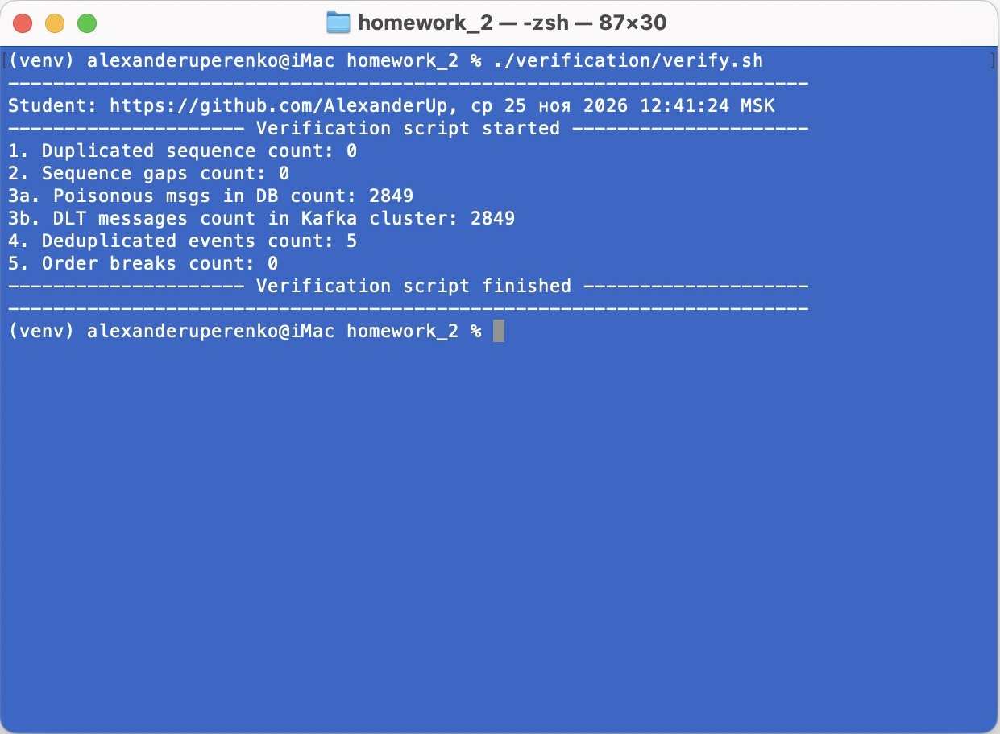
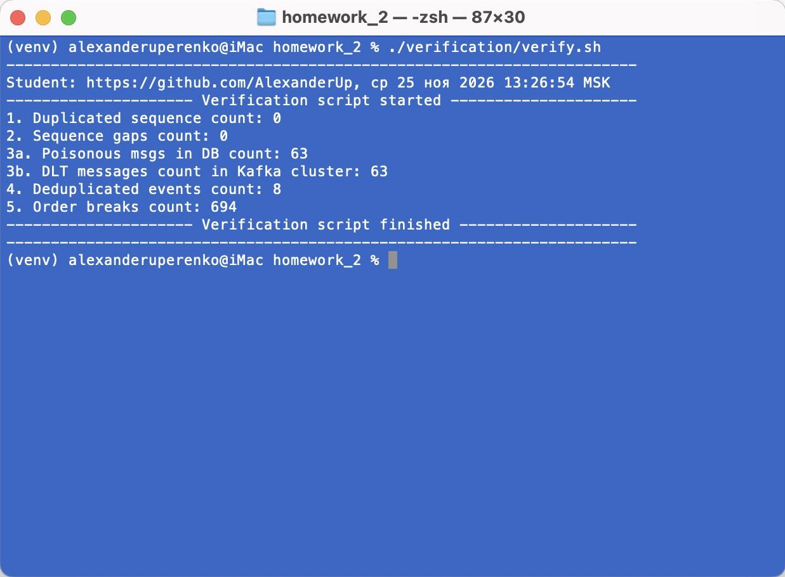

# HOMEWORK 2. Очереди в Kafka

Учебный сервис для работы с Kafka-кластером. Отдельные сервисы-продюсеры генерируют и сохраняют в Кафку сообщения, отдельные сервисы-консюмеры их вычитывают, эмулируют обработку и сохряняют ее результат в `sink`, после чего коммитят сообщение в топике. В случае невозможности обработки сообщения отправляют его в `Dead Letter Topic`.

## Описание
- `producers` - три сервиса, генерирующих сообщения и сохраняющих их в топик `events`.
- `consumers` - три серивиса, вычитывающих сообщения из топика `events` и сохраняющих результат обработки в `sink`. В случае трех неуспешных обработок сообщения, пересылают его в `events.dlt` и коммитят его offset, чтобы было возможно обрабатывать дальнейшие сообщения.
- `sink` - база данных `Postgres`, поднятая за `pgbouncer`.
- `kafka` - Kafka-кластер из трех нод.
- `kafbat-ui` - web UI для Kafka.
- `kafka_topic_creator` - сервис для автоматического создания топиков при запуске кластера.
- `db_migrator` - сервис для применения миграций Postgres.

## Формат сообщения
- `event_id`: случайный `UUID`.
- `user_id`: случайный `UUID` (сто условных пользователей на один продюсер).
- `event_type`: эмуляция событий `PAGE_VIEW`, `ADD_TO_CART` и `PURCHASE`.
- `seq`: номер сообщения в последовательности сообщений для конкретного пользователя.
- `produced_at`: время генерации сообщения.
- `payload`: полезная нагрузка сообщения.

## Топики и их параметры

Топики:
- `events`
- `events.dlt`

Для каждого топика заданы следующие параметры:
- `partitions=3`
- `replication-factor=3`
- `config min.insync.replicas=2`

## Sink
Таблица `EventProcessingResult` в базе `PostgreSQL`, поднятой за `pgbouncer`.

- `event_id`: `UUID` события.
- `user_id`: `UUID` пользователя.
- `seq`: номер сообщения в последовательности сообщений для конкретного пользователя.
- `pod_id`: имя последнего обработавшего сообщения консюмера.
- `topic`: топик сообщения.
- `partition`: партиция сообщения.
- `event_offset`: оффсет сообщения в партиции.
- `attempt_count`: количество попыток обработки данного сообщения **разными** консюмерами.
- `error_count`: общее количество ошибок обработки данного сообщения.
- `status`: статус обработки сообщения (`IN_PROGRESS`, `SUCCESS`, `FAIL`).
- `is_committed`: флаг, указывающий, был ли оффсет сообщения закоммичен в Kafka.
- `created_at`: время добавления записи в БД.

Идемпотентность обработки сообщения обеспечивается уникальностью `event_id` в пределах таблицы. Это же поле использовано в качестве первичного ключа (не может быть пустым и обязано быть уникальным, плюс индекс для быстрого поиска). При попытке создания записи с существующим `event_id` будет увеличен счетчик `attempt_count`, который показывает количество попыток обработки одного сообщения разными консюмерами.

## Настройки продюсеров:
- `acks=all`
- `enable.idempotence=true`
- `KEY_MODE=user_id|None`

## Настройки консюмеров:
- `enable_auto_commit=False`
- `auto_offset_reset="earliest"`

## Переменные окружения
- .env
    - `LOG_LEVEL=INFO` - уровень логирования
    - `KAFKA_BOOTSTRAP_SERVERS=kafka-0:9094,kafka-1:9094,kafka-2:9094`
    - `KAFKA_EVENT_TOPIC=events`
    - `KAFKA_EVENT_DLT_TOPIC=events.dlt`
    - `PRODUCER_EVENT_RATE=5` - скорость генерации событий в секунду. 0 - без ограничения скорости.
    - `PRODUCER_POISON_PERCENT=2` - процент ядовитых сообщений.
    - `PRODUCER_KEY_MODE=user_id` - выбор ключа сообщения при отправке в топик.
    - `CONSUMER_GROUP_ID=events-processor` - название группы консюмеров.
    - `CONSUMER_PROCESSING_THRESHOLD=3` - предельное количество неуспешных обработок сообщения.
    - `PROCESSING_DELAY_MS=1000` - задержка обработки в миллисекундах (эмуляция тяжелой обработки).

- pgbouncer.env
    - `DB_USER=postgres`
    - `DB_PASSWORD=postgres`
    - `DB_HOST=postgres` - хост базы данных.
    - `DB_PORT=5432`
    - `DB_NAME=events_database` - название базы данных.
    - `AUTH_TYPE=scram-sha-256` - тип аутентификации.

- postgres.env
    - `POSTGRES_DIALECT=postgresql+psycopg_async` - используемый диалект.
    - `POSTGRES_USER=postgres`
    - `POSTGRES_PASSWORD=postgres_postgres`
    - `POSTGRES_HOST=pgbouncer` - хост для подключения к `pgbouncer`.
    - `POSTGRES_PORT=5432`
    - `POSTGRES_DB=events_database` - название базы данных.


## Сервисы и порты
- `kafka`:
    - 9092: коммуникация между брокерами внутри докера.
    - 9093: коммуникация между контроллерами внутри докера.
    - 9094: порт для клиентов внутри докера.
    - 9095: порт для клиентов извне докера.
- `kafbat-ui`:
    - 8080: порт для доступа к web UI извне докера.
- `postgres`:
    - 5432: стандартный порт.
- `pgbouncer`:
    - 5432: стандартный порт (для создания миграций необходимо открыть его для доступа с хоста).

## Запуск
- Копируем переменные окружения:
```sh
make cp_env
```
- Собираем образ приложения:
```sh
make build
```
- Запускаем кластер Kafka:
```sh
make up_kafka
```
- Запускаем продюсеры:
```sh
make up_producers
```
- Открываем в браузере http://127.0.0.1:8080 и во вкладке Topics смотрим количество сообщений в топике. Когда количество сообщений станет достаточным для демонстрационных целей, останавливаем продюсеры и запускаем консюмеры.
```sh
make down_producers
make up_consumers
```
- В браузере во вкладке `Consumers` наблюдаем за `consumer_lag`, по достижению нулевого значения останавливаем консюмеры.
```sh
make down_consumers
```
- Запускаем скрипт верификации.
```sh
./verification/verify.sh
```
- Останавливаем все сервисы.
```sh
docker compose down
```
- При необходимости удаляем все созданные `volumes`.
```sh
make rm_volumes
```

## Верификация

Запуск скрипта

`./verification/verify.sh`

Скрипт проверяет:
- отсутствие пропусков `seq` для любого `user_id`.
- наличие ядовитых сообщений в `events.dlt` и соответствующих записей в `sink`.
- наличие отброшенных дедупликацией повторных доставок.
- нарушения порядка (сколько раз событие с меньшим `seq` было записано в `sink` позже события с большим `seq` для одного `user_id`).

## Гипотезы и эксперименты

1. Смерть одного консюмера.
    - **Гипотеза**: перераспределение партиций между активными консюмерами, обработка партиции упавшего консюмера продолжается с первого в партиции незакоммиченного сообщения.
    - **Эксперимент**: гипотеза подтверждена. Сообщение, во время обработки которого был убит консюмер, повторно передано другому консюмеру, дубликат в sink подавлен, счетчик обработок разными консюмерами инкрементирован. Партиция переназначена другому потребителю.
2. Остановка одного брокера, затем второго.
    - **Гипотеза**: остановка первого брокера не сказывается на обслуживании кластером запросов, остановка второго брокера приводит к отказу.
    - **Эксперимент**: гипотеза подтверждена. Отказ одного брокера не сказывается на работоспособности кластера, отказ второго брокера делает кластер неработоспособным. Основание: настройки кластера `KAFKA_MIN_INSYNC_REPLICAS`, `KAFKA_DEFAULT_REPLICATION_FACTOR`, `acks=all` (все `in-sync` реплики должны подтвердить запись).
3. Запуск продюсеров с `KEY_MODE=none`.
    - **Гипотеза**: без ключа сообщения отправляются пачками в случайную партицию.
    - **Эксперимент**: гипотеза подтвердилась. Все сообщения для одного пользователя без указанного ключа распределены по разным партициям, что приводит к нарушению порядка `seq`. При указанном ключе сообщения все сообщения с таким ключом попадают в одну партицию. Kafka гарантирует соблюдение порядка сообщений только внутри одной партиции.

## Доказательства
1. Данные скрипта верификации для сообщений с ключом.


2. Данные скрипта верификации для сообщений без ключа.

