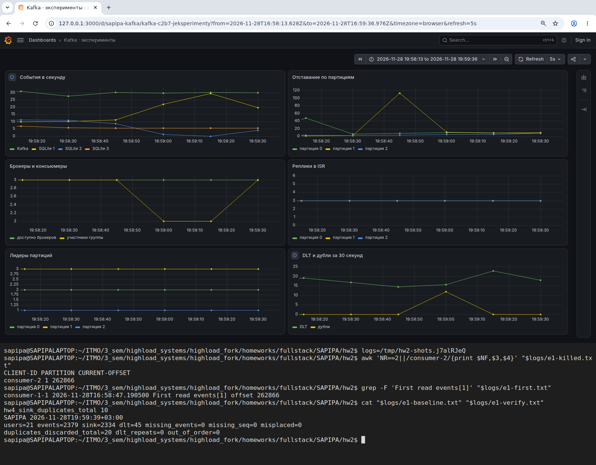
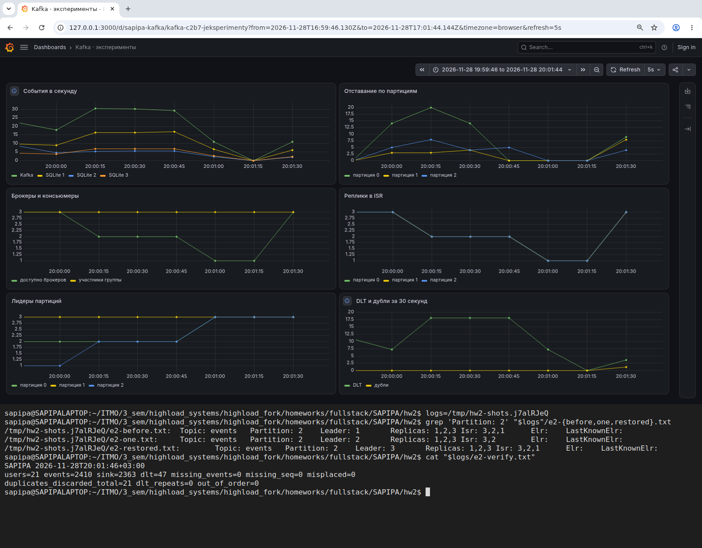
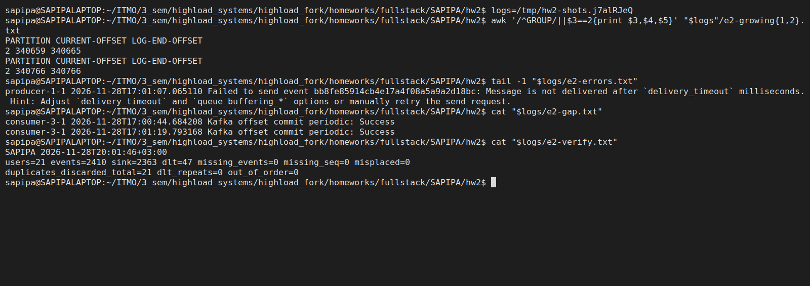
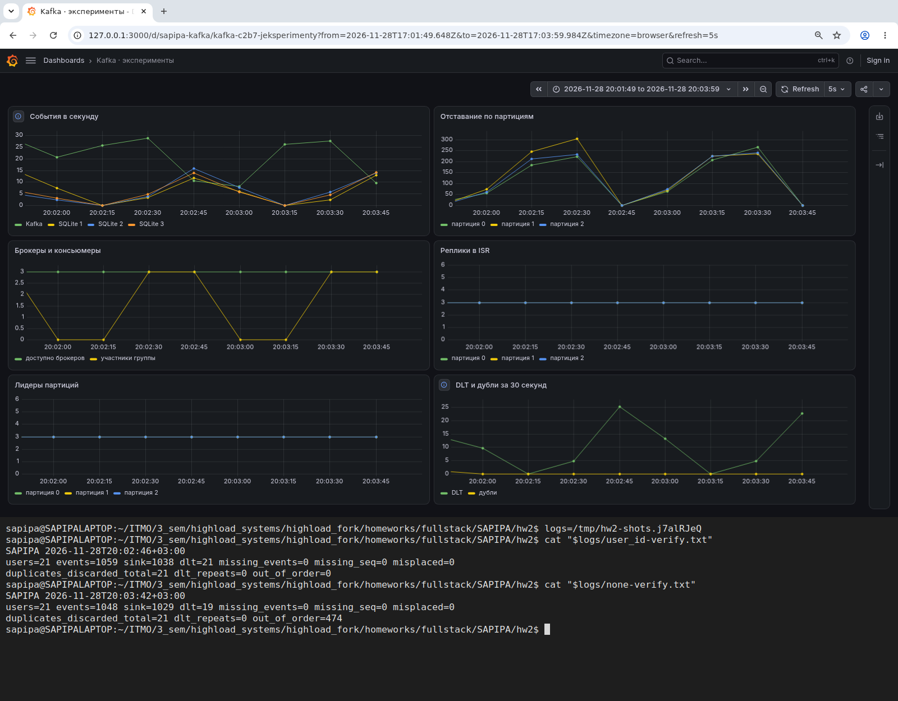

# Очередь Kafka

Три продюсера отправляют в Kafka просмотры страниц, добавления в корзину и покупки. Три консьюмера читают эти события из топика `events` и записывают их в общую базу SQLite. Для событий, которые не удалось обработать за три попытки, есть отдельный топик `events.dlt`.

## Локальный запуск

Стенд запускается из каталога `hw2` одной командой.

```bash
docker compose --profile observability up -d --build
```

`kafka-init` создаёт топики, а `dashboard-generator` готовит графики. Оба контейнера завершаются с кодом 0. Графики доступны в [Grafana](http://127.0.0.1:3000/d/sapipa-kafka/kafka-c2b7-jeksperimenty).

| Настройка | По умолчанию |
| --- | --- |
| `EVENTS_PER_SECOND` | 10 событий в секунду на продюсер |
| `PROCESSING_DELAY_MS` | 10 мс на попытку обработки |
| `KEY_MODE` | `user_id`. Значение `none` включает отправку без ключа |
| `GITHUB_LOGIN` | `SAPIPA`, логин в выводе `./verify` |

## Кластер и события

В кластере три брокера Kafka в режиме KRaft. Автосоздание топиков выключено. У `events` и `events.dlt` по три партиции и по три реплики каждой партиции. Для записи в `events` нужны минимум две синхронные реплики (`min.insync.replicas=2`). Внутри Compose адреса брокеров — `kafka-1:9092`, `kafka-2:9092` и `kafka-3:9092`. С хоста они доступны на `127.0.0.1` через порты `19092`, `19093` и `19094`.

Продюсеры написаны на C++ с userver. У каждого семь своих пользователей. В `user_id` входят имя продюсера, UUID запуска и номер пользователя. После перезапуска продюсер создаёт новых пользователей. Так у каждого пользователя один источник событий и своя последовательность номеров.

| Поле | Что в нём хранится |
| --- | --- |
| `event_id` | UUID события |
| `user_id` | Идентификатор пользователя |
| `type` | `page_view`, `add_to_cart` или `purchase` |
| `seq` | Номер события этого пользователя, начиная с 1 |
| `produced_at` | Время создания в UTC, формат RFC 3339 |
| `payload` | Произвольный JSON. Здесь в нём хранится флаг `poison` |

У каждого 50-го события `payload.poison` равен `true`. Продюсер ждёт подтверждения от всех синхронных реплик (`acks=all`). Идемпотентная отправка включена (`enable.idempotence=true`). При ошибке продюсер пишет причину в лог и повторяет отправку с тем же `event_id`. При `SIGTERM` он прекращает генерацию и дожидается результата текущей отправки. Таймаут доставки — 5 секунд.

## Обработка и проверка

Консьюмеры работают на C++ с userver и читают Kafka через `librdkafka`. Все три входят в группу `events-processor`. В SQLite для каждого события сохраняются `event_id`, `user_id`, `seq`, номер консьюмера, топик, партиция и оффсет. База лежит в общем томе `consumer-state`. При повторной записи того же `event_id` SQLite увеличивает счётчик дублей.

Автокоммит выключен. Консьюмер отмечает оффсет после записи в SQLite. Для «ядовитого» события все три попытки обработки заканчиваются ошибкой. Тогда консьюмер отправляет исходное сообщение в `events.dlt` и ждёт подтверждения Kafka. В заголовках `error`, `source_topic`, `source_partition` и `source_offset` остаются причина ошибки и место исходного сообщения.

Обработанные оффсеты консьюмер коммитит примерно раз в секунду и перед отдачей партиций при ребалансе. Если у группы ещё нет оффсета, `auto.offset.reset=earliest` позволяет прочитать очередь с начала.

Утилита `./verify` написана на Go. Она сверяет исходные события с SQLite и `events.dlt`. Итоговые числа снимаются после остановки продюсеров, когда группа дочитала все три партиции.

| Поле в выводе | Что оно показывает |
| --- | --- |
| `missing_events`, `missing_seq` | Сколько событий и номеров `seq` пропущено с учётом DLT |
| `misplaced` | События с неверным `user_id` или `seq`, обычные события в DLT и «ядовитые» в SQLite |
| `duplicates_discarded_total` | Сколько повторных записей SQLite отбросила за всё время |
| `dlt_repeats` | Сколько раз одно «ядовитое» событие повторно попало в DLT |
| `out_of_order` | Сколько записей пришло в SQLite после большего `seq` того же пользователя |

## Эксперименты

Нагрузка во всех трёх опытах — по 10 событий в секунду на продюсер, задержка обработки — 10 мс. После каждого опыта продюсеры останавливаются, а консьюмеры дочитывают очередь. Только после этого запускается `verify`.

На снимках в терминале открыт вывод, сохранённый во время каждого прогона. В Grafana выбран тот же интервал времени.

### Команды для повторения

После запуска стенда команды ниже выполняются в одном Bash из каталога `hw2`. Функции подключаются один раз.

```bash
source ./experiments.sh
export GITHUB_LOGIN=SAPIPA
```

| Команда | Что делает |
| --- | --- |
| `start_run user_id` или `start_run none` | Останавливает предыдущих продюсеров, сохраняет время в `since` и запускает троих с выбранным ключом. |
| `group` | Показывает владельца каждой партиции, закоммиченный оффсет, конец очереди и отставание (`LAG`). |
| `topic` | Показывает лидера и синхронные реплики (`Isr`) каждой партиции топика `events`. |
| `messages consumer-1` | Выводит лог указанного контейнера с момента `fault`. Можно указать несколько контейнеров. Время в логе — UTC. |
| `duplicates` | Показывает накопительный счётчик дублей в SQLite. |
| `stop_producers`, `wait_lag_zero` | Первая команда останавливает генерацию, вторая ждёт нулевого отставания во всех трёх партициях. |
| `./verify --since "$since"` | Проверяет события пользователей этого прогона. Счётчик дублей остаётся общим для всех прогонов. |

Определения функций хранятся в [experiments.sh](experiments.sh).

### 1. Падение консьюмера

**Гипотеза.** После `SIGKILL` другой консьюмер возьмёт партицию и начнёт с последнего закоммиченного оффсета. События, которые уже попали в SQLite между двумя коммитами, придут повторно.

```bash
start_run user_id
sleep 15
group
duplicates
fault=$(date -u +%Y-%m-%dT%H:%M:%S.%NZ)
docker compose kill --signal SIGKILL consumer-2
group
sleep 22
group
messages consumer-1 consumer-3 | grep 'First read'
```

Первый вызов `group` показывает партицию `consumer-2`. Сразу после остановки в выводе ещё может быть её последний закоммиченный оффсет. После ребаланса у той же партиции появится другой владелец. В его строке `First read` виден точный оффсет возобновления.

```bash
docker compose start consumer-2
sleep 18
stop_producers
wait_lag_zero && ./verify --since "$since"
```

**Результат.** В момент остановки у `consumer-2` был закоммичен оффсет 262866 для `events[1]`. На этом же оффсете начал чтение `consumer-1`. Пока в группе было два участника, отставание выросло. После возврата третьего группа дочитала очередь. Счётчик отброшенных дублей вырос с 10 до 20. Из 2379 событий 2334 попали в SQLite, ещё 45 — в DLT. Пропусков нет.



### 2. Последовательная остановка двух брокеров

**Гипотеза.** С двумя синхронными репликами запись продолжится. После остановки второго брокера продюсеры перестанут получать подтверждения, а после восстановления смогут повторить отправку.

```bash
start_run user_id
sleep 18
topic
fault=$(date -u +%Y-%m-%dT%H:%M:%S.%NZ)
docker compose stop kafka-1
sleep 10
topic
group
sleep 12
group
```

Первым останавливается брокер, который ведёт хотя бы одну партицию. Здесь это `kafka-1`. Два вызова `group` позволяют сравнить `LOG-END-OFFSET`, пока он выключен. По умолчанию команды обращаются к `kafka-3`. Если выбран другой порядок остановки, в `cli` указывается имя брокера, который останется работать.

```bash
docker compose stop kafka-2
sleep 24
messages producer-1 | grep 'Failed to send event' | tail -2
docker compose start kafka-1 kafka-2
topic
```

После запуска брокеров нужно дождаться трёх номеров в `Isr` у каждой партиции и возобновления коммитов. Это видно по `topic` и логу консьюмера.

```bash
messages consumer-3 | grep 'Kafka offset commit periodic' | tail -30
stop_producers
wait_lag_zero && ./verify --since "$since"
```

**Результат.** После остановки `kafka-1` лидером партиции `events[2]` стал брокер 2. В ISR осталось две реплики. Этого хватило для `acks=all` при `min.insync.replicas=2`. Конечный оффсет вырос с 340665 до 340766.

После остановки `kafka-2` остался один брокер. Продюсер повторял отправку одного и того же события и получал таймауты. У `consumer-3` пауза между успешными коммитами составила 35 секунд. После возврата брокеров все три реплики снова вошли в ISR, а группа дочитала очередь. Из 2410 событий 2363 попали в SQLite, ещё 47 — в DLT. База отбросила один дополнительный дубль. Пропусков нет.





### 3. Порядок событий с ключом и без ключа

**Гипотеза.** С ключом `user_id` все события пользователя попадут в одну партицию и сохранят порядок. Без ключа их могут обрабатывать разные консьюмеры, поэтому больший `seq` может появиться в SQLite раньше меньшего.

В каждом режиме продюсеры сначала 20 секунд наполняют очередь при остановленных консьюмерах. Остальные настройки одинаковы.

```bash
stop_producers
wait_lag_zero
for mode in user_id none; do
  docker compose stop consumer-1 consumer-2 consumer-3
  start_run "$mode"
  sleep 20
  docker compose start consumer-1 consumer-2 consumer-3
  sleep 10
  stop_producers
  echo "KEY_MODE=$mode"
  wait_lag_zero && ./verify --since "$since"
done
KEY_MODE=user_id docker compose up -d --no-deps producer-1 producer-2 producer-3
```

**Результат.** С ключом ни одно событие не обогнало предыдущее. Без ключа 474 события попали в SQLite после большего `seq` того же пользователя. Kafka сохраняет порядок внутри партиции. Когда сообщения одного пользователя попадают в разные партиции, порядок записи в базу зависит от того, какой консьюмер закончит обработку первым.

| Ключ | Событий | В SQLite | В DLT | Пропущено `seq` | Нарушений порядка |
| --- | ---: | ---: | ---: | ---: | ---: |
| `user_id` | 1059 | 1038 | 21 | 0 | 0 |
| `none` | 1048 | 1029 | 19 | 0 | 474 |


