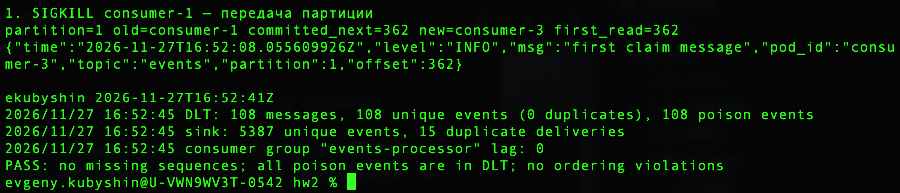
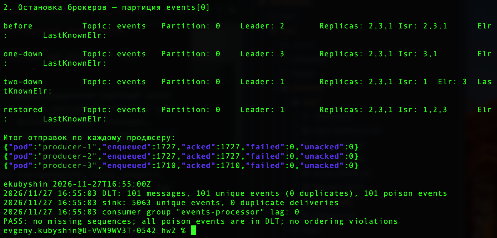
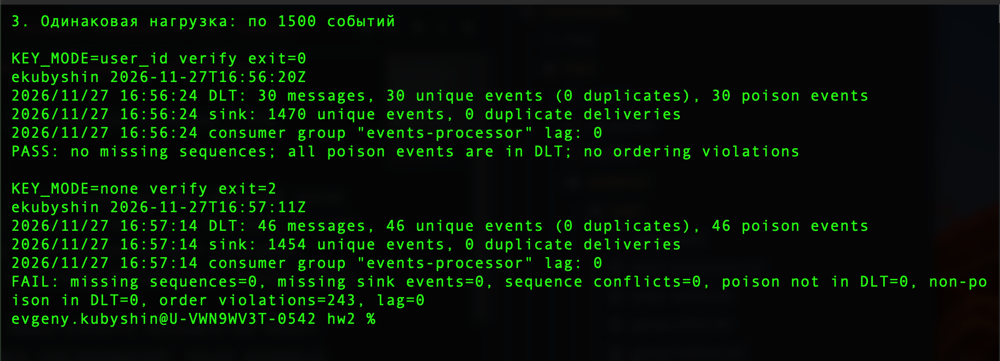

# HW2: Kafka producer и consumer

## Запуск

```bash
cp .env.example .env
docker compose up -d --build
```

Продюсеры и консьюмеры запускаются после успешного завершения `kafka-init`; консьюмеры дополнительно ждут готовности Postgres. Каждый продюсер публикует события в `events` со скоростью `RATE_PER_SEC` событий в секунду. По умолчанию суммарная скорость трёх экземпляров — 300 событий/с. Метрики продюсеров доступны внутри compose-сети на порту `2112`, метрики консьюмеров — на `2113`.

Grafana: http://localhost:3000 (анонимный доступ Viewer; Prometheus: http://localhost:9090). В обоих сервисах адрес привязывается к `127.0.0.1` по умолчанию. Пароли Grafana и Postgres не заданы в compose: если `GRAFANA_ADMIN_PASSWORD` или `POSTGRES_PASSWORD` не заполнены в `.env`, `secrets-init` генерирует их и сохраняет в приватном Docker volume `credentials`. Имя администратора можно задать через `GRAFANA_ADMIN_USER`. Дашборд `Kafka HW2 — producer & consumer` и Prometheus datasource создаются автоматически из файлов provisioning. Для доступа снаружи localhost отключите анонимный режим и задайте уникальный `GRAFANA_ADMIN_PASSWORD`.

Чтобы получить сгенерированные учётные данные администратора Grafana:

```bash
docker run --rm -v highload-hw2_credentials:/credentials:ro alpine:3.24.3 \\
  sh -c 'printf "Grafana user: %s\\nGrafana password: %s\\nPostgres password: %s\\n" "$(cat /credentials/username)" "$(cat /credentials/password)" "$(cat /credentials/postgres-password)"'
```

Секреты сохраняются вместе с данными. При обновлении старого стенда с уже созданными data volumes укажи в `.env` прежние пароли: инициализатор остановится, если данные есть, а credentials volume отсутствует, чтобы не создать несогласованные учётные данные. Чтобы изменить пароль через `.env`, нужно удалить тома командой `docker compose down -v` и поднять стенд заново; команда удалит и данные Kafka, Postgres, Grafana и Prometheus. Пароль Postgres при ручной настройке должен состоять из URL-безопасных символов: букв, цифр, `.`, `_`, `~` или `-`.

Prometheus скрейпит три экземпляра producer и consumer каждые 5 секунд; `kafka-exporter` отдаёт метрики брокеров и consumer lag. Метрики приложения:

- producer: `producer_events_generated_total`, `producer_messages_enqueued_total`, `producer_messages_acked_total`, `producer_messages_failed_total`, `producer_ack_latency_seconds` (histogram), `producer_in_flight_messages`;
- consumer: `consumer_events_processed_total`, `consumer_duplicate_deliveries_total`, `consumer_events_dlt_total`, `consumer_processing_retries_total`, `consumer_group_setups_total`, `consumer_assigned_partitions`, `consumer_partition_offset`, `consumer_processing_duration_seconds` (histogram).

Во всех метриках приложений есть лейбл `pod`; consumer counters также содержат `topic`, а offset gauge — `topic` и `partition`. Latency экспортируется histogram, поэтому дашборд вычисляет квантили через `histogram_quantile` поверх агрегированных `_bucket` (`sum by (le)`). Histogram, в отличие от summary, сохраняет корректность перцентилей при агрегации нескольких подов.

Остановить стенд без удаления данных:

```bash
docker compose down
```

Проверить состояние и логи:

```bash
docker compose ps -a
docker compose logs -f producer-1 producer-2 producer-3
```

## Продюсер

- `producer-1`, `producer-2` и `producer-3` используют один образ и имеют разные `POD_ID`.
- Формат `user_id` — `p{POD_ID}-{RUN_ID}-u{N}`. Поэтому один пользователь принадлежит ровно одному запуску одного пода.
- Формат события: `event_id` (UUID), `user_id`, `type` (`page_view`, `add_to_cart`, `purchase`), `seq` (от 1), `produced_at` (UTC) и `payload` (произвольный JSON). Следующий `seq` доступен под мьютексом пользователя только после ACK предыдущего сообщения.
- События публикуются через Sarama с `acks=all`, идемпотентностью, `MaxOpenRequests=1` и повторными попытками с backoff.
- При `KEY_MODE=user_id` ключ Kafka равен `user_id`, поэтому все события пользователя попадают в одну партицию. При `KEY_MODE=none` ключ не задаётся — этот режим нужен для эксперимента с нарушением порядка.
- Около `POISON_RATE` событий получают поле `payload.poison=true`.
- При `SIGTERM` генерация останавливается, после чего асинхронный продюсер дожидается подтверждения всех буферизованных сообщений в пределах `SHUTDOWN_TIMEOUT`. Ошибка доставки или истечение таймаута дают ненулевой код завершения; неподтверждённая отправка не считается успешной.

Основные настройки продюсера находятся в `.env.example`: скорость, число пользователей, вероятность poison-событий, режим ключа, лимиты retry/flush и `MAX_EVENTS` для конечного прогона.

## Консьюмер и sink

- `consumer-1`, `consumer-2` и `consumer-3` используют одну группу `events-processor`; Kafka распределяет между участниками партиции топика.
- В каждой партиции сообщения обрабатываются последовательно. Консьюмер проверяет JSON-событие и записывает его в `processed_events`.
- Автокоммит отключён. Оффсет отмечается только после успешной записи в Postgres и коммитится с интервалом `COMMIT_INTERVAL` (по умолчанию 1 с), а при завершении обработки партиции/ребалансе выполняется финальный коммит.
- Повторная доставка безопасна: `event_id` — первичный ключ, `INSERT ... ON CONFLICT DO NOTHING` предотвращает повторную запись; повторы регистрируются в `duplicate_deliveries`.
- При отсутствии коммита консьюмер читает с самого раннего доступного оффсета (`OffsetOldest`), чтобы новая группа не пропустила накопленные сообщения. `synchronous_commit=on`: подтверждение Postgres следует за записью WAL на диск, а не опережает её.
- Только объект с верхнеуровневым `"poison": true` помечен генератором как poison. После трёх неудачных попыток обработки неисправимое событие отправляется в DLT; исходный оффсет отмечается после ACK. Если недоступен sink, консьюмер не отправляет валидное событие в DLT и не отмечает его оффсет — следующая сессия повторит запись.
- `PROCESSING_DELAY_MS` — целое число миллисекунд (`50` означает 50 мс). При обновлении замените старый `PROCESSING_DELAY=50ms` в `.env` на `PROCESSING_DELAY_MS=50`. `COMMIT_INTERVAL` остаётся длительностью (`1s`). В Compose имя исходного топика задаёт `EVENTS_TOPIC`, внутри consumer и `verify` — `KAFKA_TOPIC`; `DLT_TOPIC`, `KAFKA_CONSUMER_GROUP` и `KAFKA_BROKERS` общие. Метрики — `:2113/metrics`, readiness — `:2113/healthz`.

## Проверки и линтеры

В каждом Go-модуле (`producer` и `consumer`) есть собственный Makefile. Для продюсера:

```bash
cd producer
make lint-install  # один раз установить golangci-lint v1.64.8
make fmt           # golangci-lint run ./... --fix --timeout 2m
make check         # golangci-lint + go vet + go test
make race          # тесты с race detector
make build
```

Для консьюмера используются те же цели, а также `make build-verify` и `make run-verify`. Для проверки из чистого checkout (Go с поддержкой toolchain из `go.mod`, работающий Docker; первый запуск скачивает зависимости и образы):

```bash
cd homeworks/hw2
make lint && make test
make -C producer race && make -C consumer race
make integration
```

`make integration` запускает отдельный Go-модуль на `testcontainers-go`: обычная запись, два сообщения с одним UUID, poison с заголовками DLT и передача партиции во время незавершённой записи. Тесты проверяют строки Postgres, записи Kafka и фактические committed offsets. Основной Compose-стенд для них не нужен.

## Эксперименты с отказами

Сценарии запускаются из `homeworks/hw2` с Docker Compose v2.24.4+ и `jq`. Каждый создаёт отдельный Compose-проект без опубликованных портов, с собственными образами приложений и томами. Мониторинг не требуется: скрипты снимают метрики с подов. `make reset` основного стенда **не нужен**. После выхода удаляются ресурсы эксперимента; `run.txt`, вывод `verify` и снимки сохраняются в `.cache/experiments/`. Параметры опытов передавайте в окружении shell, а не в `.env`.

```bash
make exp1  # аварийное завершение consumer-1 и возврат в группу
make exp2  # остановка kafka-2 и kafka-3, потеря кворума KRaft
make exp3  # KEY_MODE=none и проверка порядка записей
```

Ниже — контрольный прогон 27 ноября 2026 года. [Гипотезы до запуска](evidence/hypotheses.md) и [снимки Kafka CLI, метрики и полный вывод `verify`](evidence/results.md) сохранены вне Docker. Для воспроизведения использованы `RATE_PER_SEC=35`, `USERS_PER_PRODUCER=6`, `GENERATOR_WORKERS=2`, `POISON_RATE=0.02`, `RUN_SECONDS=9`, `BROKER_OUTAGE_SECONDS=6`, `WAIT_TIMEOUT_SECONDS=100`, `KAFKA_HEAP_OPTS='-Xms128m -Xmx256m'`. В третьем опыте `MAX_EVENTS=500` на под.

### 1. Kill consumer

**Гипотеза:** новый владелец начнёт с закоммиченного оффсета. Между записью в БД и коммитом Kafka возможны повторы, но не потери.

**Наблюдение:** перед `SIGKILL` у `consumer-1` на `events[1]` был `CURRENT-OFFSET=362`: коммит покрывал записи по `361` включительно. После ребаланса первым сообщением у `consumer-3` было именно `362`. В sink — 5 387 уникальных событий и **15 отброшенных повторов**, в DLT — 108 уникальных poison. [Вывод `verify`](evidence/exp1/exp1-verify.txt): `PASS: no missing sequences; all poison events are in DLT; no ordering violations`, lag 0. Повторы не создали дополнительных строк.



### 2. Остановка двух брокеров

**Гипотеза:** при двух синхронных репликах `acks=all` ещё выполним. После второго отказа не остаётся ни двух реплик, ни большинства контроллеров KRaft. После возврата брокеров ожидаем доставку отложенных отправок.

| Фаза | Лидеры `events[0,1,2]` | Размер ISR | ACK / обработка consumer между замерами |
|---|---|---:|---|
| До отказа | 2, 3, 1 | 3 | — |
| Остановлен `kafka-2` | 3, 3, 1 | 2 | ACK: 2 480 → 3 566; обработано: 2 689 → 3 705 |
| Затем остановлен `kafka-3` | 1, 1, 1 по ответу оставшегося брокера | 1 | Оба счётчика остались на 3 869 |
| Оба вернулись | 1, 1, 1 | 3 | ACK и обработка возобновились |

[Итог по продюсерам](evidence/exp2/exp2-producers.txt): `enqueued=acked` — 1 727, 1 727 и 1 710 соответственно; у всех `failed=unacked=0`. Все 5 164 подтверждённых отправки учтены: 5 063 в sink + 101 в DLT. [Вывод `verify`](evidence/exp2/exp2-verify.txt): `PASS`, повторных доставок и пропусков нет, lag 0. Ответ одного брокера на `describe` не означал, что он мог подтвердить запись.



### 3. Публикация без ключа

**Гипотеза:** при одинаковой нагрузке ключ `user_id` сохраняет порядок пользователя в одной партиции. Без ключа разные consumer могут записать больший `seq` раньше меньшего, не потеряв ни одного события.

| Режим | ACK | Уникальных sink / DLT | Пропуски / дубли sink / ошибки DLT | Нарушения порядка | `verify` |
|---|---:|---:|---|---:|---|
| [`user_id`](evidence/exp3/user_id-verify.txt) | 1 500 | 1 470 / 30 | 0 / 0 / 0 | 0 | PASS, код 0 |
| [`none`](evidence/exp3/none-verify.txt) | 1 500 | 1 454 / 46 | 0 / 0 / 0 | **243** | FAIL только по порядку, код 2 |

Число poison случайно, поэтому размеры DLT различаются. В обеих сериях lag, число дублей в DLT и конфликтов `(user_id, seq)` равны нулю. Для `none` скрипт принимает **только** код 2 от `verify`: ни потеря UUID, ни ошибка подключения не считаются подтверждением гипотезы.


