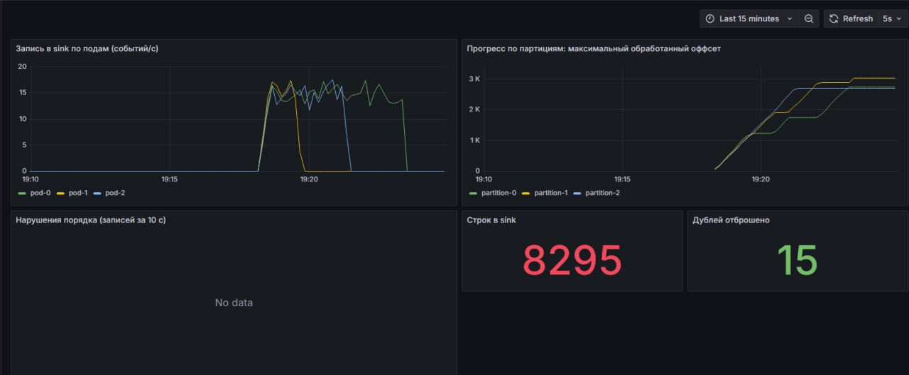
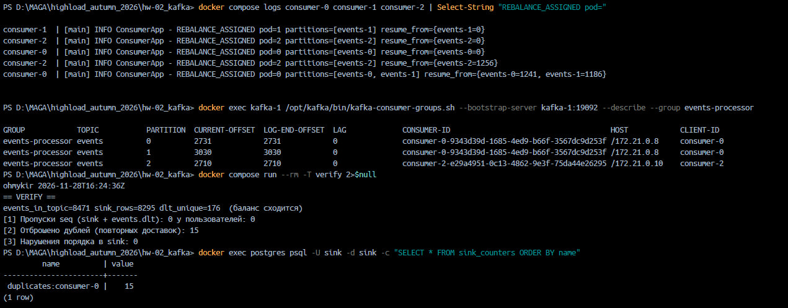
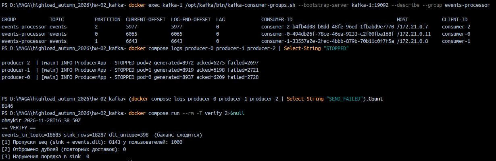
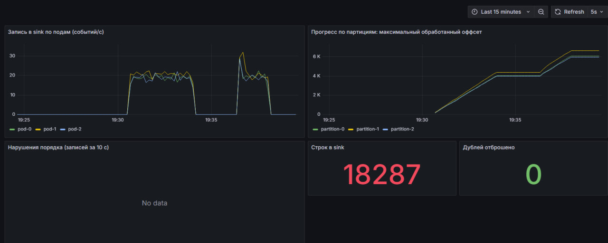
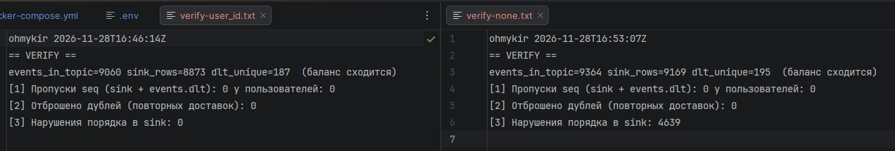
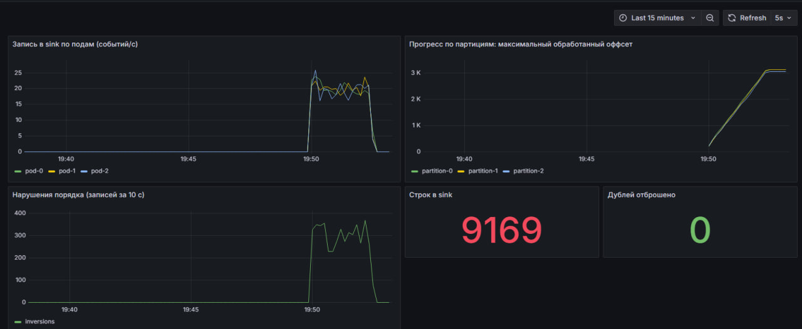

# Очередь Kafka

## Запуск
```
docker compose up -d --build
```
verify:
```
docker compose run --rm -T verify
```
(параметры в .env)

## Эксперимент 1: kill -9 консьюмера
**Гипотеза:**
- Партиция упавшего консьюмера простаивает ≈ session.timeout (6 с) + время ребаланса, лаг этой партиции растёт.
- Новый владелец продолжает с последнего *закоммиченного* оффсета (`resume_from` в логе), 
а не с последнего обработанного: часть событий (до max.poll.records = 50) обрабатывается второй раз.
- Дубли гасит идемпотентная запись: `duplicates` > 0, строк в sink без повторов.
- Пропусков seq нет, нарушений порядка нет (в каждый момент партицию читает один консьюмер).

**Команды:**
```
docker kill -s KILL consumer-1

docker start consumer-1

docker compose stop producer-0 producer-1 producer-2

/*ждем пока LAG всех партиций не станет 0*/

docker compose logs consumer-0 consumer-1 consumer-2 | Select-String "REBALANCE_ASSIGNED pod="
docker exec kafka-1 /opt/kafka/bin/kafka-consumer-groups.sh --bootstrap-server kafka-1:19092 --describe --group events-processor
docker compose run --rm -T verify 2>$null
docker exec postgres psql -U sink -d sink -c "SELECT * FROM sink_counters ORDER BY name"
```

**Результат:**



**Выводы/Наблюдения:** 
- events-1 перешла к consumer-0, консьюмеры получили назначения заново.
- resume_from={events-0=1241, events-1=1186}. Это последний закоммиченный оффсет, а не последний обработанный.
- Дубли: 15. Это события незакоммиченного батча, которые убитый консьюмер успел записать в sink 
и которые второй раз обработал другой. Повторных строк нет.
- Потерь нет: пропусков seq 0, баланс сходится, нарушений порядка 0

## Эксперимент 2: остановка брокеров
**Гипотеза:**
- Остановка одного брокера: кворум (2 из 3) и ISR=2 ≥ min.insync.replicas, записи продолжаются, лидеры партиций переезжают за секунды, failed=0.
- Остановка второго: кворум контроллеров потерян, ISR=1 < 2, acks=all не подтверждается; метаданные недоступны. Продюсеры: in_flight растёт, через delivery.timeout.ms (20 с) SEND_FAILED (TimeoutException: идемпотентный клиент ретраит NotEnoughReplicas). Консьюмеры простаивают.
- После возврата брокеров система восстанавливается сама: ISR=3, консьюмеры дочитывают.
- verify: пропуски seq ≈ число SEND_FAILED (это события, о недоставке которых продюсер сообщил), остальные потерь нет; дубли возможны.

**Команды:** 
```
docker exec kafka-1 /opt/kafka/bin/kafka-topics.sh --bootstrap-server kafka-1:19092 --describe --topic events | Select-String "Partition:"
docker stop -t 10 kafka-3

docker exec kafka-1 /opt/kafka/bin/kafka-topics.sh --bootstrap-server kafka-1:19092 --describe --topic events | Select-String "Partition:"
docker compose logs --tail=1 producer-0 producer-1 producer-

docker stop -t 10 kafka-2

docker compose logs --tail=1 producer-0 producer-1 producer-2
(docker compose logs producer-0 producer-1 producer-2 | Select-String "SEND_FAILED").Count

docker exec kafka-1 /opt/kafka/bin/kafka-topics.sh --bootstrap-server kafka-1:19092 --describe --topic events
/* она зависает, выходим */

docker start kafka-2 kafka-3
docker exec kafka-1 /opt/kafka/bin/kafka-topics.sh --bootstrap-server kafka-1:19092 --describe --topic events | Select-String "Partition:"

docker compose stop producer-0 producer-1 producer-2
/* ждем пока LAG не станет 0 */
docker compose logs producer-0 producer-1 producer-2 | Select-String "STOPPED"
(docker compose logs producer-0 producer-1 producer-2 | Select-String "SEND_FAILED").Count
docker compose run --rm -T verify 2>$null
```

**Результат:**




**Выводы/Наблюдения:**
- Один брокер остановлен: лидер партиции kafka-3 сменился на kafka-1, Isr стал из двух брокеров. Кворум есть, failed=0.
- Два брокера остановлены: кворума нет. Продюсеры ретраят и через 20с сообщают об отказе, в логах 8146 SEND_FAILED.
- После восстановления Isr снова из 3 брокеров, консьюмеры дочитали, LAG 0.
- Пропусков 8143, часть событий все-таки попала в лог лидера. Дублей нет, баланс сходится.


## Эксперимент 3: KEY_MODE=none
**Гипотеза:**
- С ключом user_id: все события пользователя в одной партиции, нарушений порядка 0.
- Без ключа: события пользователя расходятся по партициям, их читают разные консьюмеры с разным лагом. 
Событие с меньшим seq может быть записано позже события с большим seq: нарушений > 0. Пропусков и потерь по-прежнему нет.


**Результат:**



**Выводы/Наблюдения:**
- С ключом user_id пропусков 0, нарушений порядка 0. Ключ отправляет все события в одну партицию, внутри партиции порядок
гарантирован.
- Без ключа 4639 нарушений порядка при 9364 записях, т.е. около половины. Пропусков 0, дублей 0.
События одного пользователя расходятся по трем партициям, которые читают 3 консьюмера параллельно с разным лагом.
Эффект усилен малым BATCH_SIZE и малым числом пользователей.

## Ограничения
- seq хранится в памяти продюсера: перезапуск пода обнуляет счётчик (в экспериментах продюсеры не перезапускаются).
- verify не видит потерю хвоста последовательности пользователя.