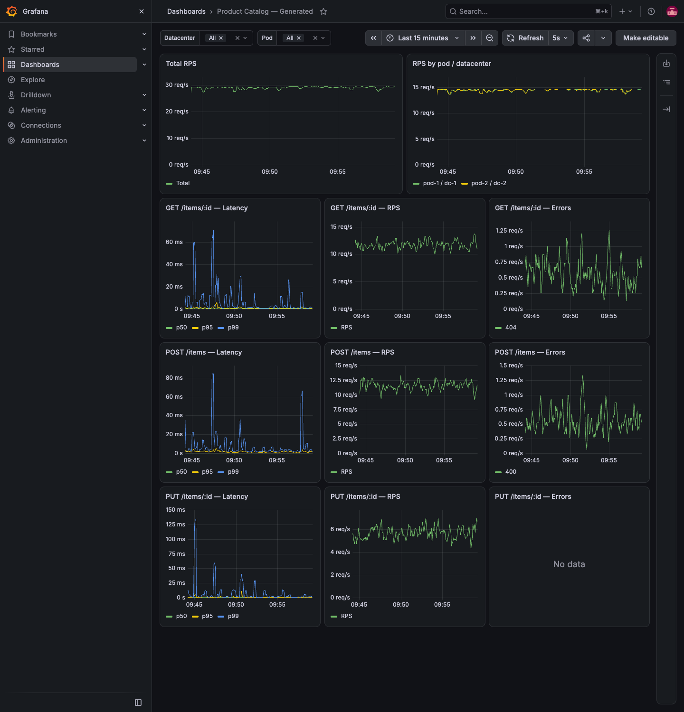

# ДЗ №1 — инструменты автоматизации в Grafana

**Автор:** Горюшкин Артем. **Трек:** fullstack.

**Скринкаст:** [демонстрация работы стенда](https://drive.google.com/file/d/16oWkpRyxu-drK1HB7XRe2f5W46uSivg8/view?usp=sharing).

Каталог товаров на TypeScript и Fastify. Стенд включает два экземпляра API, Prometheus, Grafana, генератор дашборда и генератор нагрузки. Всё запускается локально через Docker Compose.

## Запуск

Нужны Docker Engine/Desktop и Docker Compose v2. Команды выполняются из `hw-1/`:

```bash
cp .env.example .env
docker compose up
```

Node.js на хосте не требуется. После готовности сервисов дашборд создаётся автоматически и начинается нагрузка. Через 2–3 минуты графики заполняются.

| Компонент | Адрес по умолчанию |
|---|---|
| Первый API — pod-1 / dc-1 | http://127.0.0.1:18080 |
| Второй API — pod-2 / dc-2 | http://127.0.0.1:18081 |
| Prometheus Targets | http://127.0.0.1:9090/targets |
| Дашборд Grafana | http://127.0.0.1:3000/d/items-generated-test |

Логин и пароль Grafana задаются в `.env` через `GRAFANA_ADMIN_USER` и `GRAFANA_ADMIN_PASSWORD`. В `.env.example` приведены учебные значения. `.env` исключён из Git. Если порт занят, измените соответствующий порт в `.env`; все порты привязаны к `127.0.0.1`.

Compose использует healthcheck и `depends_on`: нагрузка начинается после готовности обоих API и успешной генерации дашборда. Генератор дашборда одноразовый: `Exited (0)` означает успешное завершение.

Команды управления из `hw-1/`:

```bash
make up       # запуск в фоне
make ps       # состояние контейнеров
make logs     # логи
make stop     # остановка
make down     # удаление контейнеров с сохранением томов
make rebuild  # пересборка и пересоздание контейнеров
```

## API

| Метод и путь | Ответ |
|---|---|
| `POST /items` | `201`, созданный товар |
| `GET /items/{id}` | `200` или `404` |
| `PUT /items/{id}` | `200` или `404`, без создания отсутствующего товара |
| `GET /health` | Проверка готовности |
| `GET /metrics` | Метрики Prometheus |
| `GET /handlers` | Каталог бизнес-маршрутов |

POST и PUT принимают `name` и `price`. Цена — целое число копеек. ID генерируется сервером.

```bash
curl -i -X POST http://127.0.0.1:18080/items \
  -H 'Content-Type: application/json' \
  -d '{"name":"Клавиатура","price":450000}'

# Подставьте ID из ответа того же экземпляра:
curl -i http://127.0.0.1:18080/items/ID
curl -i -X PUT http://127.0.0.1:18080/items/ID \
  -H 'Content-Type: application/json' \
  -d '{"name":"Мышь","price":150000}'
```

Невалидные данные дают `400`, неизвестный товар — `404`. Хранилища экземпляров независимы и находятся в памяти: ID первого API не существует на втором, после перезапуска товары теряются.

## Метрики

Инструментирование реализовано через Fastify hooks и `@prometheus-io/client`.

| Метрика | Тип | Лейблы |
|---|---|---|
| `http_requests_total` | Counter | method, route, pod_id, datacenter, status_code |
| `http_request_duration_seconds` | Histogram | method, route, pod_id, datacenter |

`pod_id` и `datacenter` берутся из переменных окружения `POD_ID` и `DATACENTER`. `route` содержит шаблон `/items/:id`, поэтому каждый новый ID не создаёт отдельную серию. Служебные маршруты исключены из бизнес-метрик.

Длительность фиксируется в `onResponse` через `reply.elapsedTime` и переводится в секунды. Histogram выбран для объединения данных нескольких экземпляров: сначала суммируются бакеты, затем вычисляется перцентиль. Усреднять готовые перцентили Summary между экземплярами нельзя.

Примеры запросов дашборда для GET:

```promql
# RPS выбранных экземпляров
sum(rate(http_requests_total{method="GET",route="/items/:id",pod_id=~"${pod_id:regex}",datacenter=~"${datacenter:regex}"}[$__rate_interval]))

# Ошибки в секунду, отдельно по HTTP-кодам
sum by (status_code) (rate(http_requests_total{method="GET",route="/items/:id",pod_id=~"${pod_id:regex}",datacenter=~"${datacenter:regex}",status_code=~"4..|5.."}[$__rate_interval]))

# p95 объединённого распределения
histogram_quantile(0.95, sum by (le) (rate(http_request_duration_seconds_bucket{method="GET",route="/items/:id",pod_id=~"${pod_id:regex}",datacenter=~"${datacenter:regex}"}[$__rate_interval])))
```

Prometheus собирает метрики обоих API каждые 5 секунд. На странице Targets оба адреса должны иметь статус `UP`.

## Дашборд

Datasource Prometheus создаётся через provisioning. Генератор получает список маршрутов из `/handlers`, строит JSON и сохраняет дашборд через Grafana HTTP API. Повторный запуск обновляет дашборд с тем же UID.

Всего 11 панелей:

- общий RPS и RPS по экземплярам/датацентрам;
- для каждого маршрута — задержка с линиями p50/p95/p99, RPS и ошибки по кодам.

Фильтры Datacenter и Pod поддерживают несколько значений и All; список Pod зависит от выбранных датацентров. На графиках включён общий tooltip, окно `$__rate_interval` адаптируется к масштабу времени. Дашборд имеет `editable: false` и обновляется каждые 5 секунд.

Новый маршрут, зарегистрированный внутри бизнес-плагина, автоматически попадает в метрики и `/handlers`. После `make rebuild` генератор добавит его панели без изменения своего кода.



## Нагрузка

Генератор использует встроенный `fetch` и отправляет запросы асинхронно. Общий RPS двух экземпляров: 5 первые 30 секунд, 10 до 60-й секунды, 20 до 90-й, затем 30.

Доли POST/GET/PUT — примерно 40/40/20. Генератор сохраняет до 1000 последних ID отдельно для каждого API. GET и PUT обращаются к экземпляру, создавшему товар; если ID ещё нет, выполняется POST.

Около 2% общего потока дают `400` из-за отрицательной цены и ещё 2% — `404` из-за отсутствующего ID. Эти запросы входят в общий RPS. HTTP- и сетевые ошибки логируются и не останавливают нагрузку.

Таймаут запроса — 5 секунд, одновременно допускается до 64 незавершённых запросов. При насыщении слоты пропускаются, очередь не накапливается. Каталог самого API растёт с успешными POST; стенд рассчитан на учебную демонстрацию.

## Локальная разработка

Для локальной разработки нужны Node.js 24 и pnpm 10.19.0. Из `hw-1/`:

```bash
pnpm install --frozen-lockfile
pnpm build
```
