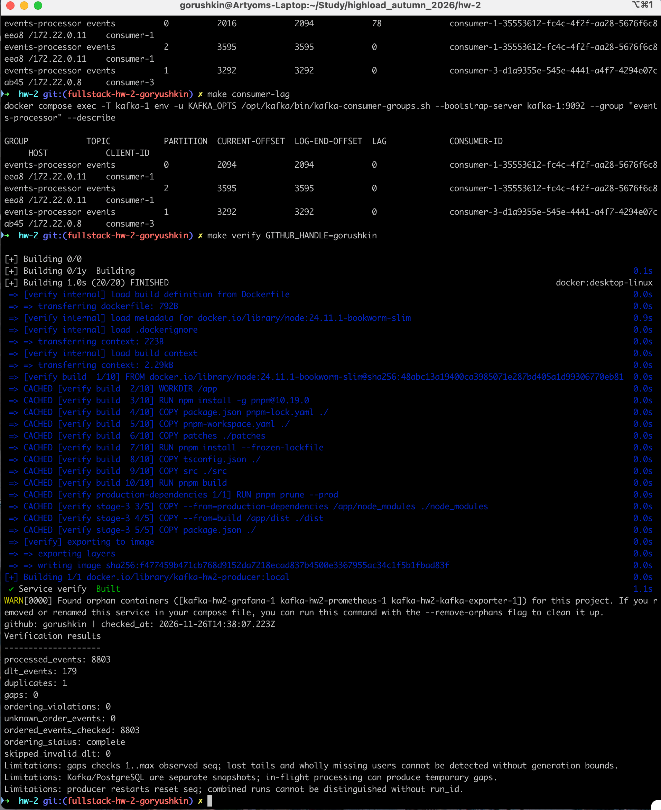
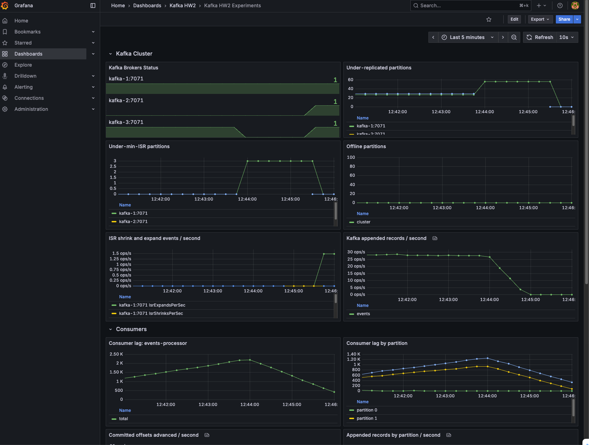
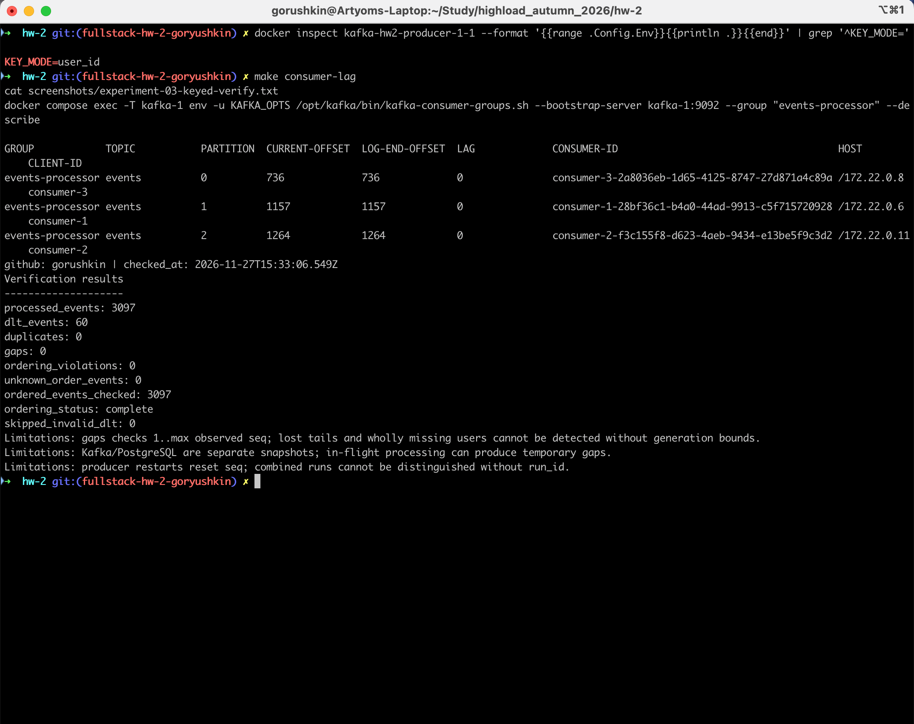
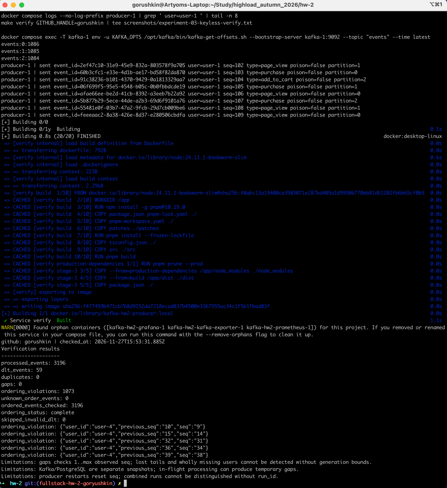

# Kafka HW2: эксперименты с отказами и порядком событий

Проект имитирует поток пользовательских событий. Три продюсера отправляют их в Kafka, три консьюмера сохраняют обработанные события в PostgreSQL. События, которые не удалось обработать после повторных попыток, попадают в отдельный топик `events.dlt`. Команда `make verify` проверяет результат обработки.

## Как запустить

Нужны Docker с поддержкой Compose и `make`. Node.js на компьютере для запуска через Docker не требуется. Из корня репозитория выполните:

```bash
cd hw-2
make up
make ps
make monitoring-up
```

`make up` собирает и запускает брокеры, базу данных, продюсеров и консьюмеров. В выводе `make ps` дождитесь работающих сервисов и успешного завершения `kafka-init`. Графики доступны в [Grafana](http://localhost:3000), на дашборде **Kafka HW2 Experiments**.

Когда событий накопилось достаточно, остановите их генерацию и дождитесь завершения обработки:

```bash
make producers-stop
make consumer-lag
```

Повторяйте `make consumer-lag`, пока `LAG` не станет равен нулю во всех партициях. **После этого** запустите проверку в терминале, подставив свой GitHub-логин:

```bash
make verify GITHUB_HANDLE=YOUR_GITHUB_LOGIN
```

Для завершения работы:

```bash
make monitoring-down
make down
```

Эти команды сохраняют данные. Перед новым независимым экспериментом мы использовали `make reset CONFIRM=delete-all-data`: она удаляет данные Kafka и PostgreSQL, поэтому запускайте её только когда прежний результат уже сохранён.

## Эксперимент 1: аварийное завершение консьюмера

**Гипотеза.** Если принудительно остановить один консьюмер, два оставшихся продолжат обработку. Возможна повторная доставка сообщения, но в базе не должна появиться его вторая копия.

**Что сделали.** Под нагрузкой остановили `consumer-2` через `SIGKILL`. Kafka передала его партицию другим участникам группы. После остановки продюсеров дождались окончания обработки.

**Результат.** Оставшиеся консьюмеры обработали очередь до `LAG=0`. Проверка показала одну повторную доставку, ноль пропусков и ноль нарушений порядка. В PostgreSQL сохранилось 8803 события, ещё 179 попали в DLT. Гипотеза подтвердилась в пределах проверки `verify`.




## Эксперимент 2: остановка двух брокеров

**Гипотеза.** После остановки одного брокера Kafka продолжит работать на оставшихся. После остановки второго подтверждённая запись остановится, поскольку для неё требуется минимум две доступные реплики. После возврата брокеров кластер восстановится.

**Что сделали.** По очереди остановили `kafka-2` и `kafka-3`, затем вернули оба брокера.

**Результат.** При первом отказе Kafka выбрала нового лидера и продолжила работу. После второго отказа продюсеры получили ошибку нехватки реплик и завершились. Брокеры восстановились, а консьюмеры обработали уже записанные события до `LAG=0`. Продюсеры сами не перезапустились — это расхождение с ожиданием автоматического продолжения отправки. Проверка показала ноль пропусков и ноль нарушений порядка; 9609 событий сохранились в PostgreSQL, 169 попали в DLT.




## Эксперимент 3: ключ сообщения и порядок

Здесь были два отдельных запуска на чистых данных. В первом ключом сообщения служил `user_id`, во втором ключ отсутствовал (`KEY_MODE=none`).

**Гипотеза.** С ключом события одного пользователя попадут в одну партицию и сохранят порядок. Без ключа они могут оказаться в разных партициях и обрабатываться в другом порядке.

**Результат.** С ключом события проверенного пользователя оставались в одной партиции; `verify` не нашёл нарушений порядка. Без ключа события этого пользователя разошлись по трём партициям, а проверка обнаружила 1073 нарушения порядка. В обоих запусках итоговый `LAG=0`, пропусков не обнаружено.

| Результат `verify` | С ключом `user_id` | Без ключа |
| --- | ---: | ---: |
| Сохранено в PostgreSQL | 3097 | 3196 |
| Отправлено в DLT | 60 | 59 |
| Повторных доставок | 0 | 0 |
| Пропусков | 0 | 0 |
| Нарушений порядка | **0** | **1073** |





## Вывод

Система продолжила обработку после отказа консьюмера и восстановилась после возврата брокеров. Ключ `user_id` сохранил порядок событий пользователя в проведённом прогоне; без ключа нарушения порядка проявились. Во всех завершённых прогонах `verify` показал ноль пропусков. В обоих режимах третьего эксперимента проверка порядка охватила все сохранённые события (`ordering_status=complete`).

Проверка подтвердила обработку записанных в Kafka событий, но не может подтвердить доставку всех событий, которые продюсеры пытались отправить.
