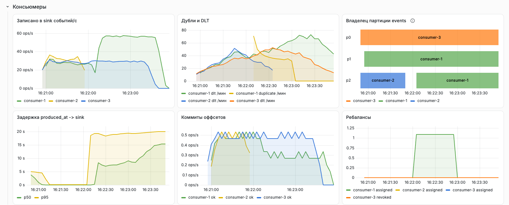
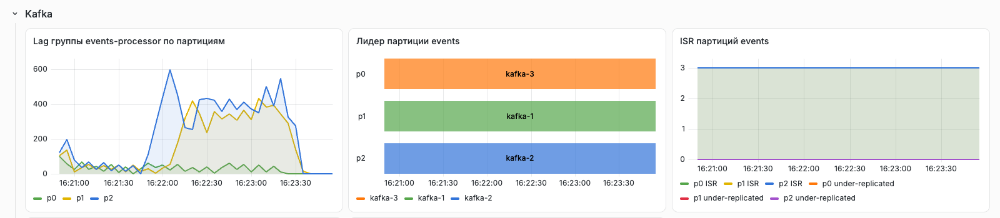
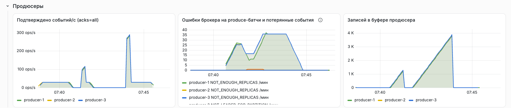
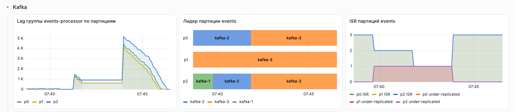
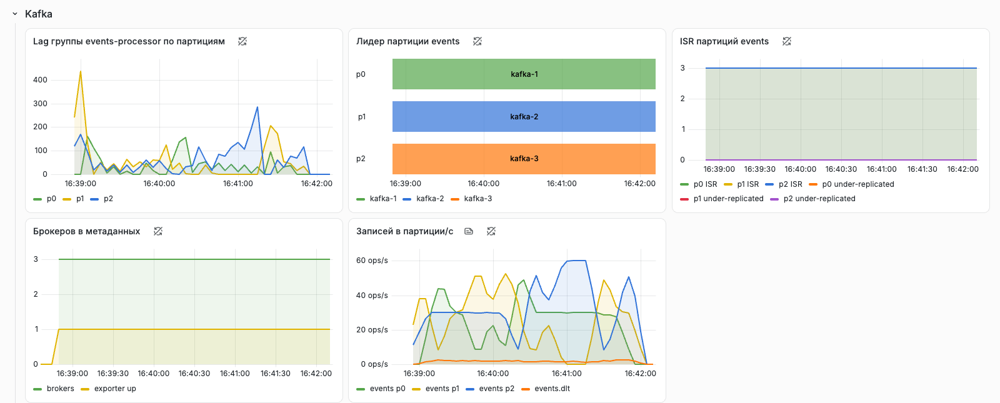

# HW-2. Очередь Kafka

Кластер Kafka из трёх брокеров в KRaft, три продюсера событий пользователей, три консьюмера в
одной группе с записью в Postgres, `verify` для проверки потерь, дублей и порядка, Grafana с
графиками очереди и три эксперимента с отказами.

## Запуск

```bash
cd hw-2
cp .env.example .env
docker compose up -d
docker compose run --rm verify                # проверка на ходу
docker compose stop producer-1 producer-2 producer-3
docker compose run --rm verify verify -wait=3m  # дождаться lag 0 и проверить
docker compose down -v
```

Дашборд - <http://localhost:3000> (домашний, анонимный просмотр, админ из `.env`). Если порты
заняты, их можно переопределить в `.env` (`KAFKA_1_PORT`, `GRAFANA_PORT` и т.д.).

| Сервис | Порт на хосте | Что это |
| --- | --- | --- |
| `kafka-1..3` | 9092, 9093, 9094 | брокер + контроллер KRaft, `apache/kafka:4.4.0` |
| `kafka-init` | - | создаёт топики и завершается |
| `postgres` | 5432 | sink |
| `producer-1..3` | - | продюсеры, метрики на `:2112` в сети compose |
| `consumer-1..3` | - | консьюмеры группы `events-processor`, метрики на `:2112` |
| `kafka-exporter` | - | lag группы, лидеры и ISR партиций |
| `prometheus` | 9090 | скрейп раз в 5 с |
| `grafana` | 3000 | datasource и дашборд через provisioning |
| `verify` | - | profile `tools`, запускается через `docker compose run` |

Порядок старта: брокеры (`service_healthy`) -> `kafka-init` -> продюсеры, консьюмеры и
`kafka-exporter` (`service_completed_successfully`); консьюмеры ещё ждут `postgres`.

Один образ `hw2/app:local` (distroless, nonroot) с тремя бинарниками: `producer`, `consumer`,
`verify`.

## Kafka

| Параметр | Значение |
| --- | --- |
| режим | KRaft combined: каждый узел и брокер, и контроллер, кворум из 3, без ZooKeeper |
| listeners | `INTERNAL` `:19092` для сети compose (`kafka-N:19092`), `EXTERNAL` `:9092` для хоста (`localhost:9092..9094`), `CONTROLLER` `:9093` |
| heap | `-Xmx256m -Xms256m`, `mem_limit: 640m` |
| `auto.create.topics.enable` | `false` |
| `default.replication.factor`, `min.insync.replicas` | 3 и 2 по умолчанию на брокерах |
| `__consumer_offsets` | RF 3 |

Топики создаёт `kafka-init` (`kafka/create-topics.sh`, `kafka-topics.sh --create --if-not-exists`):

| Топик | Партиции | RF | `min.insync.replicas` |
| --- | --- | --- | --- |
| `events` | 3 | 3 | 2 (явно в конфиге топика) |
| `events.dlt` | 3 | 3 | 2 (дефолт брокера) |

## Модель события

Value записи - JSON:

| Поле | Тип | Что это |
| --- | --- | --- |
| `event_id` | UUID v4 | ключ идемпотентности в sink |
| `user_id` | string | `u-<PRODUCER_ID>-<NNNN>` |
| `type` | string | `page_view`, `add_to_cart`, `purchase` |
| `seq` | int | номер события пользователя, с 1 без пропусков |
| `produced_at` | RFC 3339 | время генерации |
| `payload.producer` | string | `PRODUCER_ID` |
| `payload.poison` | bool | `true` - консьюмер на событии всегда падает |
| `payload.value` | int | случайное число |

## Продюсер

`cmd/producer`, `internal/producer`, `internal/event`.

* Пул пользователей продюсера - `u-<PRODUCER_ID>-0001 ... u-<PRODUCER_ID>-<USERS_PER_PRODUCER>`:
  пулы не пересекаются, каждый `user_id` генерирует ровно один продюсер.
* Тикер на `RATE` событий в секунду; на каждый тик - случайный пользователь, его `seq` в памяти
  растёт на 1, событие сразу отдаётся клиенту (`Produce`). Около `POISON_RATE` событий получают
  `payload.poison: true`.
* Ключ записи: `KEY_MODE=user_id` - `user_id`, все события пользователя попадают в одну
  партицию; `KEY_MODE=none` - ключа нет, партицию выбирает партиционер franz-go (sticky).
* `acks=all` (`kgo.RequiredAcks(kgo.AllISRAcks())`), идемпотентность включена (в franz-go по
  умолчанию, `kgo.DisableIdempotentWrite` не вызывается): брокер отбрасывает повторы батча после
  ретрая, порядок в партиции сохраняется.
* Ретраибельные ошибки брокера на батч (`NOT_ENOUGH_REPLICAS`, `REQUEST_TIMED_OUT` и т.п.)
  клиент повторяет сам, без ограничения числа попыток, и сообщает о них только в debug-сводке
  produce-запроса. Адаптер логгера (`internal/kafkalog`) разбирает эту сводку: каждый
  отклонённый батч - строка `produce batch rejected, retrying` (партиция, число записей, код) и
  `producer_batch_errors_total{code}`; остальной debug в лог не идёт.
  Смену лидера (`NOT_LEADER_FOR_PARTITION` с подсказкой нового лидера) и недоступный брокер клиент
  обрабатывает отдельно: в логе `moving producing partition ...`, `unable to open connection`,
  `metadata update triggered`.
* Событие считается потерянным, если клиент на нём сдался: прошло `DELIVERY_TIMEOUT` (`5m`,
  `kgo.RecordDeliveryTimeout`) или клиент закрыт с недосланным буфером. Тогда колбэк `Produce`
  получает ошибку, событие пишется в лог (`produce failed`, ключ и value) и в
  `producer_events_failed_total`. franz-go при этом фейлит и все следующие записи этой партиции
  в буфере, так что в `verify` это видно как пропуск подряд идущих `seq`.
* Пока брокер не отвечает, записи копятся в буфере клиента (`producer_buffered_records`, до 10 000);
  при полном буфере `Produce` блокируется и скорость генерации падает.
* SIGTERM: генерация останавливается, `Flush` досылает буфер не дольше `FLUSH_TIMEOUT` (`20s`),
  `stop_grace_period: 30s`. В лог пишется итог `generated / acked / failed`.

| Переменная | По умолчанию | Что делает |
| --- | --- | --- |
| `PRODUCER_ID` | `1` | номер продюсера, префикс пользователей, лейбл `pod=producer-N` |
| `USERS_PER_PRODUCER` | `50` | размер пула пользователей |
| `RATE` | `30` | событий в секунду |
| `POISON_RATE` | `0.02` | доля poison |
| `KEY_MODE` | `user_id` | `user_id` или `none` |
| `DELIVERY_TIMEOUT` | `5m` | сколько клиент пытается доставить запись |
| `PRODUCE_REQUEST_TIMEOUT` | `10s` | сколько брокер ждёт подтверждений ISR на produce-запрос |
| `FLUSH_TIMEOUT` | `20s` | сколько досылать буфер на остановке |

## Консьюмер

`cmd/consumer`, `internal/consumer`, `internal/sink`. Группа `events-processor`, топик `events`.

**Обработка записи** (`Processor.Handle`):

1. до `MAX_ATTEMPTS=3` попыток: пауза `PROCESSING_DELAY_MS`, разбор JSON; poison возвращает
   ошибку на каждой попытке;
2. успешная попытка - запись в Postgres; если Postgres недоступен - повтор раз в секунду, пока не
   получится (запись не теряется и не коммитится необработанной);
3. после трёх неудачных попыток - публикация в `events.dlt` с тем же ключом и value и
   заголовками `error`, `original-topic`, `original-partition`, `original-offset`, `attempts`,
   `consumer`; `ProduceSync` ждёт подтверждения брокера (acks=all), при ошибке - повтор.

Запись считается обработанной только после шага 2 или 3. Poison не блокирует партицию: после DLT
консьюмер идёт к следующему оффсету.

**Коммиты оффсетов** (`Group`, `Offsets`):

* `kgo.DisableAutoCommit()` - автокоммита нет;
* после обработки записи её `offset+1` отмечается в `Offsets`; коммитится только то, что там
  есть (`CommitOffsetsSync`), то есть только записанное в sink или DLT;
* цикл: `PollRecords` (до `MAX_POLL_RECORDS=100`, не дольше `COMMIT_INTERVAL`) -> обработка по
  одной -> если с прошлого коммита прошло `COMMIT_INTERVAL` (`2s`), синхронный коммит
  отмеченного -> `AllowRebalance`. Ошибка коммита не фатальна: оффсеты остаются в `Offsets` и
  уходят следующим коммитом. Всё, что обработано после последнего коммита, при падении
  консьюмера придёт повторно;
* `kgo.BlockRebalanceOnPoll()`: пока пачка обрабатывается, ребаланс ждёт `AllowRebalance`,
  поэтому партицию не отдадут посреди пачки;
* `OnPartitionsRevoked` - синхронный коммит отмеченных оффсетов отзываемых партиций до того, как
  клиент продолжит ребаланс; в лог - `partitions revoked` с закоммиченными оффсетами;
* `OnPartitionsLost` (сессия истекла, партиции уже у других) - без коммита, отметки
  выбрасываются: коммит перезаписал бы оффсеты нового владельца;
* после назначения партиции в лог пишется первый прочитанный оффсет (`partition resumed`).

Гарантия - at-least-once: всё, что обработано, но не закоммичено к моменту падения, придёт
повторно. Повторы отсекает дедупликация.

**Дедупликация.** Одна команда SQL: `INSERT INTO events ... ON CONFLICT (event_id) DO NOTHING`, а
если строка не вставилась - `INSERT INTO duplicates` (event_id, консьюмер, партиция, оффсет).
Число строк `duplicates` - счётчик отброшенных повторных доставок, его читает `verify`; в метриках
это `consumer_events_total{result="duplicate"}`.

**`auto.offset.reset` = earliest** (`kgo.ConsumeResetOffset(kgo.NewOffset().AtStart())`). Срабатывает,
когда у группы нет закоммиченного оффсета партиции: при первом старте группы консьюмер читает
топик с начала. Продюсеры и консьюмеры стартуют одновременно, и всё, что записано до вступления
консьюмеров в группу, с `latest` было бы пропущено и в `verify` выглядело бы как потеря первых
`seq`.

Ребалансировщик - franz-go по умолчанию, cooperative-sticky: при ребалансе отзываются только
переезжающие партиции. `SESSION_TIMEOUT=15s`.

| Переменная | По умолчанию | Что делает |
| --- | --- | --- |
| `CONSUMER_ID` | `1` | номер, `consumer_id=consumer-N` в sink и лейбл `pod` |
| `PROCESSING_DELAY_MS` | `15` | пауза на каждую попытку обработки |
| `MAX_ATTEMPTS` | `3` | попыток до DLT |
| `MAX_POLL_RECORDS` | `100` | записей за один poll |
| `COMMIT_INTERVAL` | `2s` | как часто коммитить обработанное |
| `SESSION_TIMEOUT` | `15s` | через сколько брокер выкинет молчащего участника |

## Sink

Postgres, схема `internal/sink/schema.sql` применяется консьюмером при старте
(`CREATE TABLE IF NOT EXISTS` под `pg_advisory_xact_lock`, чтобы три консьюмера не мешали друг
другу).

| Таблица `events` | |
| --- | --- |
| `id bigserial` | порядок записи в sink |
| `event_id uuid UNIQUE` | ключ дедупликации |
| `user_id`, `seq`, `type`, `poison`, `producer_id`, `produced_at` | из события |
| `consumer_id`, `topic`, `partition`, `offset` | кто и откуда прочитал |
| `processed_at` | `clock_timestamp()` в момент вставки |

`duplicates`: `event_id`, `consumer_id`, `topic`, `partition`, `offset`, `processed_at`.

## verify

`cmd/verify`, логика - `internal/verify` (чистые функции с тестами).

1. С `-wait=3m` сначала ждёт, пока группа догонит топик (`kadm.Lag` раз в 2 с): два замера подряд
   группа в состоянии `Stable` и lag 0 по каждой партиции. Партиция с ошибкой (нет оффсетов,
   lag -1) делает lag неизвестным, в выводе - `н/д` (`internal/verify/lag.go`).
2. Читает из Postgres все строки `events` по возрастанию `id` и счётчик `duplicates`.
3. Читает `events.dlt` целиком отдельным клиентом без группы: от начала каждой партиции до high
   watermark на момент старта.
4. Для каждого `user_id` строит множество `seq` из sink и DLT; `max` - наибольший `seq` из
   обоих. Потеря - `seq` из `1..max`, которого нет ни в sink, ни в DLT. Печатается число потерь,
   число пользователей с потерями и до 10 примеров.
5. Нарушения порядка: строки sink пользователя в порядке `id`; строка - нарушение, если её `seq`
   меньше максимального `seq` этого пользователя, уже записанного раньше:
   `violations = |{ i : seq_i < max(seq_j, j < i) }|`. Например, порядок записи `1 3 2 5 4` - два
   нарушения.
6. Ещё: сумма `max seq` против числа уникальных `seq` (без потерь равны), повторы `seq` с другим
   `event_id`, `seq` одновременно в sink и в DLT, poison в sink, разбивка по консьюмерам,
   продюсерам, партициям.

Первая строка - `GITHUB_LOGIN` (в compose `DenisBorzenkov`) и текущее время в формате `date`
(`TZ=Europe/Moscow`). Код возврата 1 при потерях или poison в sink, 2 при ошибке.

Ограничение: потеря последних событий пользователя (хвост после максимального записанного `seq`)
по sink не видна. Её показывают лог продюсера (`produce failed`, итог `stopped`) и
`producer_events_failed_total`.

## Мониторинг

Prometheus скрейпит продюсеров, консьюмеров и `kafka-exporter`
(`danielqsj/kafka-exporter:v1.11.0`, метаданные раз в 5 с). Дашборд `HW-2 Kafka` -
`grafana/dashboards/hw2-kafka.json`, provisioning из файла, правка из UI выключена.

| Панель | Метрика |
| --- | --- |
| Подтверждено событий/с | `producer_events_acked_total` по `pod` |
| Ошибки брокера на produce-батчи и потерянные события | `producer_batch_errors_total{code}`, `producer_events_failed_total` |
| Записей в буфере продюсера | `producer_buffered_records` |
| Записано в sink событий/с | `consumer_events_total{result="ok"}` по `pod` |
| Дубли и DLT | `consumer_events_total{result=~"duplicate\|dlt"}` |
| Владелец партиции | `consumer_partition_owner` - номер консьюмера на партицию |
| Задержка produced_at -> sink | `consumer_event_latency_seconds`, p50 и p95 |
| Коммиты оффсетов, ребалансы | `consumer_commits_total{result}`, `consumer_rebalance_events_total{kind}` |
| Lag по партициям | `kafka_consumergroup_lag` |
| Лидер партиции | `kafka_topic_partition_leader` (-1 - нет лидера) |
| ISR | `kafka_topic_partition_in_sync_replica`, `kafka_topic_partition_under_replicated_partition` |
| Брокеров в метаданных | `kafka_brokers` |
| Записей в партиции/с | `rate(kafka_topic_partition_current_offset)` по партициям `events` и для `events.dlt` |

Серии `consumer_events_total` для всех партиций `events` (число - из метаданных топика) и всех
`result` консьюмер заводит нулями при старте: повторы после ребаланса приходят пачкой быстрее
интервала скрейпа, и серия, появившаяся сразу со значением N, для `increase()` на панели дублей
не росла бы.

## Ресурсы

Лимиты памяти: брокеры по 640 МБ (heap 256 МБ), Grafana 1 ГБ, остальные сервисы 128-256 МБ, в
сумме около 4,3 ГБ. Фактически под нагрузкой весь стек занимает около 1,6 ГБ по `docker stats`,
из них Grafana - около 250 МБ.

Grafana на старте ставит и обновляет плагины из каталога и запускает их backend-процессы: с
лимитом 512 МБ её убивал OOM, с 1 ГБ пик памяти контейнера вместе со страничным кэшем - около
820 МБ.

## CI

`.github/workflows/hw-2.yml` на каждый PR:

* `go` - gofmt, go vet, `go test -race`, golangci-lint;
* `docker` - hadolint, `compose config`, `promtool check config`, весь стек через
  `docker compose up`, затем: `kafka-init` завершился с кодом 0, у топиков нужные партиции, RF и
  `min.insync.replicas`, автосоздание выключено; в sink есть события от всех трёх продюсеров и
  всех трёх консьюмеров, в DLT есть записи; все таргеты Prometheus живы, метрики продюсеров,
  консьюмеров, lag и лидеры есть; дашборд доступен анонимно без права правки; после остановки
  продюсеров `verify -wait` выходит с кодом 0 и первой строкой логина;
* `actionlint`.

`.github/workflows/hw-2-stand.yml` - прогон на стенде: ВМ со своим self-hosted раннером, запуск
push в `ci/hw-2-stand` или руками из Actions (эксперименты all / none / 1 / 2 / 3). Поднимает стек,
даёт нагрузку, проверяет `verify`, гоняет скрипты экспериментов и сверяет итоги: в эксперименте 1
есть отброшенные дубли, во 2 - `NOT_ENOUGH_REPLICAS` в фазе `min.insync.replicas=3`, в 3 нарушения
порядка только при `KEY_MODE=none`. Результаты и логи - в артефакте прогона. На `pull_request` не
срабатывает: репо публичный, раннер свой.

Прогон на стенде 16.11.2026 даёт ту же картину, что и цифры ниже: эксперимент 1 - 0 потерь,
19 дублей; эксперимент 2 - 0 потерь, 86 `NOT_ENOUGH_REPLICAS` в фазе `min.insync.replicas=3`;
эксперимент 3 - `user_id` 0 нарушений, `none` 403 у 128 пользователей.

## Эксперименты

Все эксперименты - скрипты в `experiments/`, каждый начинает с чистого стека (`down -v`, `up`),
даёт нагрузке поработать 60 с, в эксперименте 3 - 180 с (`RATE=30` на продюсер, 150
пользователей, `PROCESSING_DELAY_MS=15`),
в конце останавливает продюсеров и запускает `verify -wait`. Результаты и выдержки логов -
`experiments/results/`, отметки времени для графиков - `experiments/results/<n>-times.env`.
Время в логах - UTC, в выводе `verify` - MSK.

### 1. kill -9 консьюмера

#### Гипотеза

После kill -9 консьюмер не успевает ни закоммитить оффсеты, ни выйти из группы. Брокер заметит
его пропажу по session timeout (15 с) и отдаст партицию другому поду. Тот начнёт с последнего
закоммиченного оффсета, поэтому хвост обработанных, но не закоммиченных событий придёт повторно
и отсеется по `event_id`. Потерь и нарушений порядка быть не должно.

#### Что делаем

```bash
./experiments/1-kill-consumer.sh
```

Через 60 с нагрузки - `kafka-consumer-groups.sh --describe`, затем
`docker kill -s KILL hw2-consumer-2-1`, ожидание 90 с, снова `--describe`, остановка продюсеров,
`verify -wait=3m`.

#### Результат

```text
DenisBorzenkov Fri Nov 13 19:23:35 MSK 2026

ПРОВЕРКА                           ЗНАЧЕНИЕ
пользователей                      150
событий в sink                     13787
записей в events.dlt (уникальных)  307 (306)
lag группы                         0
сумма max seq по пользователям     14093
уникальных seq в sink + dlt        14093
потеряно seq (пользователей)       0 (0)
отброшено дублей по event_id       57
повторов seq с другим event_id     0
seq и в sink, и в dlt              0
нарушений порядка (пользователей)  0 (0)
poison в sink                      0

КОНСЬЮМЕР   СОБЫТИЙ В SINK
consumer-1  7192
consumer-2  2005
consumer-3  4590

ПРОДЮСЕР    СОБЫТИЙ В SINK
producer-1  4600
producer-2  4588
producer-3  4599

ПАРТИЦИЯ  СОБЫТИЙ В SINK
0         4524
1         4267
2         4996

OK: потерь нет
```




* До kill (`1-groups-before.txt`): `p0` - consumer-3, `p1` - consumer-1, `p2` - consumer-2;
  закоммиченный оффсет `p2` - 2038, log-end - 2056.
* consumer-2 завершился с кодом 137, Docker его не перезапускал (`1-container.txt`).
* kill в 16:21:44 (`1-times.env`); через 15,7 с (`SESSION_TIMEOUT=15s`, назначение в
  16:21:59.7) - ребаланс: consumer-1 получил `p2` (`partitions assigned [2]`), чтение `p2`
  продолжилось с оффсета 2038 (`partition resumed`). consumer-1 и consumer-3 свои партиции не
  отдавали, `partitions revoked` у них нет.
* `duplicates`: 57 строк, все у consumer-1 по `p2`, оффсеты 2038-2095 (`1-duplicates.txt`).
* В `events.dlt` 307 записей на 306 уникальных событий: одно poison-событие из этого диапазона
  опубликовано в DLT дважды.
* Пока партиция была без владельца, lag `p2` вырос примерно до 600. После ребаланса consumer-1
  пишет около 57 событий/с (две партиции), consumer-3 - около 30; lag `p1` и `p2` держится на
  350-420 (`1-groups-after.txt`), p95 задержки до sink - около 20 с. После остановки продюсеров
  lag ушёл в 0.
* `verify`: потерь 0, отброшено 57 дублей, нарушений порядка 0.

#### Вывод

Гипотеза подтвердилась. Ребаланс прошёл через 15,7 с, партицию забрал consumer-1 и продолжил с
закоммиченного оффсета 2038. Повторно пришли 57 событий, все отброшены дедупликацией. Потерь 0,
нарушений порядка 0.

Чего не ждал: одно poison-событие попало в DLT дважды, потому что в DLT дедупликации нет. И lag
после ребаланса не ушёл сам: два пода на три партиции работают на пределе, он обнулился только
после остановки продюсеров.

### 2. Отказ брокеров: min.insync.replicas и кворум KRaft

#### Гипотеза

Без одного брокера запись продолжается: лидеры переезжают, в ISR остаётся 2 реплики, этого
хватает для `min.insync.replicas=2`. Если живых реплик меньше `min.insync.replicas`, продюсеры
с `acks=all` получают `NOT_ENOUGH_REPLICAS`, копят события в буфере и повторяют отправку.
Консьюмеры при этом дочитывают уже записанное. С одним брокером из трёх нет и кворума KRaft.
После возврата брокеров буфер досылается, потерь и дублей нет.

#### Что делаем

```bash
./experiments/2-brokers-down.sh
```

| Шаг | Команда | Пауза |
| --- | --- | --- |
| нагрузка | - | 60 с |
| A1. стоп kafka-1 | `docker compose stop kafka-1` | 45 с |
| A2. живых реплик меньше `min.insync.replicas` | `kafka-configs.sh --alter --entity-type topics --entity-name events --add-config min.insync.replicas=3` | 40 с |
| A3. вернуть | то же с `min.insync.replicas=2` | 30 с |
| B. стоп kafka-2 (один узел, кворум KRaft потерян) | `docker compose stop kafka-2` | 60 с |
| возврат | `docker compose start kafka-1 kafka-2` | 90 с |
| проверка | остановка продюсеров, `verify -wait=5m` | - |

Между шагами - `kafka-topics.sh --describe` (`2-describe-*.txt`), при одном узле и после
возврата - `kafka-metadata-quorum.sh describe --status` (`2-quorum-*.txt`). Отметки времени -
`2-times.env`, выдержки логов - `2-producers.log`, `2-consumers.log`.

#### Результат

```text
DenisBorzenkov Mon Nov 16 10:46:23 MSK 2026

ПРОВЕРКА                           ЗНАЧЕНИЕ
пользователей                      150
событий в sink                     35548
записей в events.dlt (уникальных)  674 (674)
lag группы                         0
сумма max seq по пользователям     36222
уникальных seq в sink + dlt        36222
потеряно seq (пользователей)       0 (0)
отброшено дублей по event_id       0
повторов seq с другим event_id     0
seq и в sink, и в dlt              0
нарушений порядка (пользователей)  0 (0)
poison в sink                      0

КОНСЬЮМЕР   СОБЫТИЙ В SINK
consumer-1  12879
consumer-2  11685
consumer-3  10984

ПРОДЮСЕР    СОБЫТИЙ В SINK
producer-1  11846
producer-2  11845
producer-3  11857

ПАРТИЦИЯ  СОБЫТИЙ В SINK
0         11685
1         10965
2         12898

OK: потерь нет
```




| Момент (UTC) | Лидеры `events` p0 / p1 / p2, ISR | Продюсеры | Консьюмеры |
| --- | --- | --- | --- |
| до | 2 / 3 / 1, ISR 1,2,3 (`2-describe-0`) | 30 событий/с каждый | consumer-2 - `p0`, consumer-3 - `p1`, consumer-1 - `p2` |
| 07:39:40 A1 стоп kafka-1 | 2 / 3 / 2, ISR 2,3 (`2-describe-1`) | один `NOT_LEADER_FOR_PARTITION` на `p2`, клиент перевёл `p2` на kafka-2 (`moving producing partition due to kip-951`), подтверждения не прерывались | без изменений |
| 07:40:30 A2 `min.insync.replicas=3` | без изменений, ISR 2,3 < 3 (`2-describe-2`) | с 07:40:31 по 07:41:11 брокеры отклоняют все батчи: `produce batch rejected, retrying ... NOT_ENOUGH_REPLICAS`; `acked` стоит, `buffered` растёт до ~1120 на продюсер; `failed` 0 | дочитывают записанное, lag растёт до ~1,4 тыс. |
| 07:41:13 A3 `min.insync.replicas=2` | без изменений | буфер досылается к 07:41:18 (до ~110 подтверждений/с), дальше 30 событий/с | догоняют |
| 07:41:44 B стоп kafka-2 | 3 / 3 / 3, по exporter ISR 1 и under-replicated | по одному `NOT_LEADER_FOR_PARTITION` на `p0` и `p2`, затем с 07:41:45 по 07:43:45 kafka-3 отклоняет все батчи `NOT_ENOUGH_REPLICAS`, один `REQUEST_TIMED_OUT` на `p1`; `acked` стоит ~2 мин, `buffered` до ~3700 на продюсер; `failed` 0 | назначение не меняется, lag до ~5,1 тыс. |
| 07:43:48 возврат | 3 / 3 / 3, ISR 1,2,3 (`2-describe-4`) | ещё по одному `NOT_ENOUGH_REPLICAS` на партицию в 07:43:50, буфер досылается к 07:43:58 (до ~290 подтверждений/с), дальше 30 событий/с | lag в 0 примерно к 07:46 |

* Ошибки по кодам за прогон (`2-producers.log`, строки `produce batch rejected`):
  `NOT_ENOUGH_REPLICAS` 313 - в фазе A2 29 / 28 / 27 по партициям 0 / 1 / 2, в фазе B 73 / 73 / 74,
  после возврата 3 / 3 / 3; `NOT_LEADER_FOR_PARTITION` 3; `REQUEST_TIMED_OUT` 1. На дашборде -
  `producer_batch_errors_total{code}`.
* Кворум: `kafka-metadata-quorum.sh` на kafka-3 при одном узле не ответил за 30 с, код 124
  (`2-quorum-one-broker.txt`); после возврата лидер кворума - узел 3, все три голосующих на месте
  (`2-quorum-after.txt`).
* `kafka-topics.sh --describe` при одном узле (07:43:18) не ответил за 30 с
  (`2-describe-3-one-broker.txt`); лидеры и ISR в этот момент - по панелям exporter.
* Консьюмеры за весь прогон не теряли партиций и не меняли назначение; в `2-consumers.log` кроме
  стартового ребаланса одна строка - `unable to open connection to broker` к kafka-2 в 07:41:51.
* Строки `stats` продюсеров идут каждые 10 с без пропусков на всём прогоне.
* `duplicates` - 0, в `events.dlt` 674 записи на 674 уникальных события.
* Итог продюсеров (`stopped`): `generated` 12066 + 12068 + 12088 = 36222, подтверждено столько же,
  `failed` 0; в `verify` уникальных `seq` тоже 36222.
* `verify`: потерь 0, дублей 0, нарушений порядка 0.

#### Вывод

Гипотеза подтвердилась. Стоп kafka-1 прошёл незаметно: лидер переехал, одна ошибка
`NOT_LEADER_FOR_PARTITION`, запись не прерывалась. При `min.insync.replicas=3` и при одном
живом брокере все батчи отклонялись с `NOT_ENOUGH_REPLICAS`, подтверждения стояли, буфер рос,
но `failed` остался 0. С одним брокером не отвечали и админ-команды: кворума нет.

После возврата ISR снова 1,2,3, буфер дослался, lag ушёл в 0. Отправлено 36222, найдено 36222,
потерь 0, дублей 0. Система выбрала согласованность вместо доступности: запись встаёт, но
ничего не теряется.

### 3. KEY_MODE=none против user_id

#### Гипотеза

Kafka держит порядок только внутри одной партиции. С ключом `user_id` все события пользователя
идут в одну партицию и читаются одним консьюмером, порядок сохраняется. Без ключа события
пользователя расходятся по всем партициям, их читают разные поды с разным lag, и меньший `seq`
может записаться позже большего. Потерь не должно быть в обоих режимах.

#### Что делаем

```bash
./experiments/3-key-mode.sh
```

Два прогона подряд, каждый с чистого стека: `KEY_MODE=user_id`, затем `KEY_MODE=none`; по 180 с
нагрузки, остановка продюсеров, `verify -wait=3m`, распределение событий и пользователей по
партициям из sink (`3-<mode>-partitions.txt`). Остальное одинаково: 3 продюсера по 30 событий/с,
150 пользователей, 3 консьюмера, `PROCESSING_DELAY_MS=15`.

#### Результат

`KEY_MODE=user_id` (`3-user_id.txt`, начало вывода):

```text
DenisBorzenkov Fri Nov 13 19:38:15 MSK 2026

ПРОВЕРКА                           ЗНАЧЕНИЕ
пользователей                      150
событий в sink                     15986
записей в events.dlt (уникальных)  264 (264)
lag группы                         0
сумма max seq по пользователям     16250
уникальных seq в sink + dlt        16250
потеряно seq (пользователей)       0 (0)
отброшено дублей по event_id       0
повторов seq с другим event_id     0
seq и в sink, и в dlt              0
нарушений порядка (пользователей)  0 (0)
poison в sink                      0
```

`KEY_MODE=none` (`3-none.txt`):

```text
DenisBorzenkov Fri Nov 13 19:41:52 MSK 2026

ПРОВЕРКА                           ЗНАЧЕНИЕ
пользователей                      150
событий в sink                     15855
записей в events.dlt (уникальных)  331 (331)
lag группы                         0
сумма max seq по пользователям     16186
уникальных seq в sink + dlt        16186
потеряно seq (пользователей)       0 (0)
отброшено дублей по event_id       0
повторов seq с другим event_id     0
seq и в sink, и в dlt              0
нарушений порядка (пользователей)  392 (111)
poison в sink                      0

КОНСЬЮМЕР   СОБЫТИЙ В SINK
consumer-1  4832
consumer-2  6214
consumer-3  4809

ПРОДЮСЕР    СОБЫТИЙ В SINK
producer-1  5267
producer-2  5296
producer-3  5292

ПАРТИЦИЯ  СОБЫТИЙ В SINK
0         4643
1         4944
2         6268

примеры нарушений порядка:
  u-2-0018: seq 5 после 10
  u-3-0042: seq 5 после 12
  u-2-0036: seq 8 после 11
  u-3-0042: seq 6 после 12
  u-3-0011: seq 5 после 8
  u-2-0010: seq 3 после 9
  u-3-0017: seq 4 после 9
  u-3-0004: seq 2 после 7
  u-3-0042: seq 7 после 12
  u-2-0011: seq 4 после 12

OK: потерь нет
```



| | `user_id` | `none` |
| --- | --- | --- |
| событий в sink | 15986 | 15855 |
| потеряно | 0 | 0 |
| нарушений порядка (пользователей) | 0 (0) | 392 (111) |
| партиций на пользователя | 1 у всех 150 | 3 у всех 150 |
| пользователей в партиции p0 / p1 / p2 | 49 / 46 / 55 | 150 / 150 / 150 |

* В `none` у каждого пользователя события лежат во всех трёх партициях, а партиции читают разные
  консьюмеры (в sink у `p1` и `p2` по два консьюмера - начальный ребаланс при старте группы).
* На графике `none` скорость записи в партицию меняется ступенями по ~30 событий/с: продюсер
  какое-то время пишет в одну партицию, затем переключается на другую. Lag партиций разный и
  меняется независимо (до ~440 на старте, дальше до ~290).
* Примеры нарушений - в выводе `verify` выше: например, у `u-3-0042` `seq` 5, 6, 7 записаны
  после 12.
* Потерь и дублей нет в обоих прогонах.

#### Вывод

Гипотеза подтвердилась. С ключом `user_id` нарушений 0, у каждого пользователя одна партиция.
Без ключа - 392 нарушения у 111 пользователей, события каждого лежат во всех трёх партициях.
Потерь и дублей нет в обоих прогонах.

Нарушения берутся не из потерь и не из повторов, а из того, что партиции читаются независимо и
с разным lag. Порядок по пользователю гарантирует только ключ.
