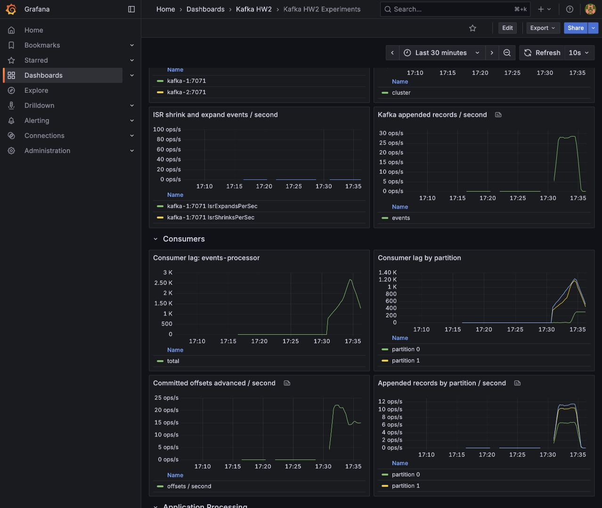
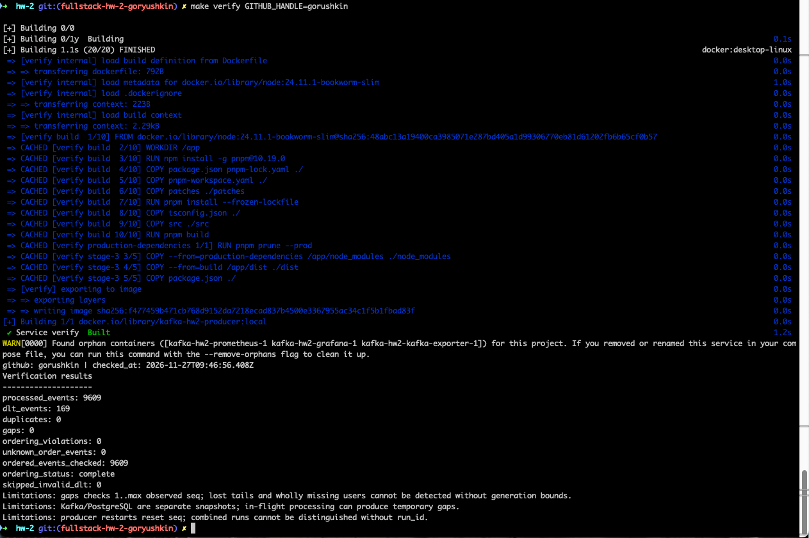

# Kafka HW2

Стенд: три брокера Kafka 4.1.1 в KRaft, три продюсера, три консьюмера группы `events-processor`, PostgreSQL и топики `events` / `events.dlt`.

## Запуск

Команды выполняются из `hw-2`:

```bash
make up
make brokers
make quorum
make topics
make consumer-lag
```

Из контейнеров Kafka доступна по `kafka-1:9092`, `kafka-2:9092`, `kafka-3:9092`. С хоста доступны `localhost:19092`, `localhost:29092`, `localhost:39092`.

Для остановки стенда без удаления данных: `make down`. Команда `make reset CONFIRM=delete-all-data` удаляет **все** Kafka и PostgreSQL volumes; используйте её только для намеренного сброса между отдельными прогонами.

## Monitoring / Grafana

После `make up` запустите мониторинг:

```bash
make monitoring-up
make monitoring-ps
```

Откройте [Grafana](http://localhost:3000) и дашборд **Kafka HW2 → Kafka HW2 Experiments**. По умолчанию локальный вход `admin` / `admin`; для своего пароля задайте `GRAFANA_ADMIN_PASSWORD` до первого запуска. Prometheus доступен на [localhost:9090](http://localhost:9090). Дашборд и оба источника данных (Prometheus, PostgreSQL) создаются автоматически. Интервал обновления 10 секунд, начальный диапазон 30 минут; диапазон можно менять в правом верхнем углу.

Панели **Kafka Cluster** показывают отдельный статус каждого брокера по JMX `up`, under-replicated и under-min-ISR partitions, offline partitions, события ISR shrink/expand и скорость роста конечных offsets `events`. **Consumers** показывает суммарный lag группы, lag каждой партиции, скорость продвижения committed offsets и скорость роста offsets по партициям. **Application Processing** показывает сохранённые события и дубликаты из PostgreSQL, нарушения порядка только среди строк с известным `processing_order`, число старых строк с неизвестным порядком и количество записей, находящихся в DLT-топике.

Для скриншотов (не более двух на эксперимент):

| Эксперимент | Первый скриншот | Второй скриншот |
| --- | --- | --- |
| Завершение консьюмера | `SIGKILL` и состав группы после ребаланса | Конечные offsets, `LAG=0` и вывод `verify` |
| Отключение брокеров | `Kafka Brokers Status` и `Under-replicated partitions` | `Under-min-ISR partitions`, `Offline partitions` и ISR events |
| `KEY_MODE` | `Appended records by partition / second` | `Processed events`, `Ordering violations` и результат `make verify` |

При отказе одного консьюмера остальные могут быстро принять его партиции, поэтому суммарный lag не обязан заметно вырасти. При отказе двух совмещённых broker/controller узлов возможна потеря кворума KRaft; часть Kafka-метрик на это время исчезнет, а `up` JMX endpoints сохранит информацию об их доступности. Эксперименты с отказами мониторинг сам не запускает.

**Ограничения метрик:** скорость committed offsets не равна точной скорости успешной обработки; продвижение включает сообщения, отправленные в DLT, и дубликаты. Панель DLT показывает число записей между oldest и latest offsets, включая невалидные записи; окончательное число валидных DLT-событий даёт `make verify GITHUB_HANDLE=<имя>`. Накопительные счётчики processed и duplicates не подчиняются выбранному диапазону времени; отдельная панель processed в диапазоне использует `processed_at`. Строки с `processing_order=NULL` исключаются из проверки порядка и показаны отдельно. В текущих данных нет `run_id`, поэтому два режима `KEY_MODE` нельзя честно сравнивать в общей накопительной статистике.

Для отдельных прогонов `KEY_MODE=user_id` и `KEY_MODE=none`: остановите продюсеров, сохраните скриншоты и вывод `make verify GITHUB_HANDLE=<имя>`, остановите мониторинг и затем при необходимости сознательно сбросьте Kafka и PostgreSQL командой `make reset CONFIRM=delete-all-data`. Вновь запустите `make up`, `make monitoring-up` и продюсеров с нужным `KEY_MODE`. Сброс удаляет данные Kafka и PostgreSQL, но сохраняет историю Prometheus в отдельном volume; учитывайте границу нового прогона на временных графиках. Не смешивайте накопительные значения двух прогонов.

Остановка только мониторинга:

```bash
make monitoring-down
```

Команда не останавливает Kafka, PostgreSQL, продюсеров или консьюмеров и не удаляет их volumes. Данные Prometheus и Grafana сохраняются в своих volumes при перезапуске контейнеров.

## Эксперимент 1: аварийное завершение консьюмера

Чистый прогон проведён 26 ноября 2026 года после сброса данных стенда. Время `checked_at` в выводе `verify` указано в UTC.

### Гипотеза

После `SIGKILL` одного из трёх консьюмеров Kafka перераспределит партиции между двумя оставшимися. Обработка продолжится с последних зафиксированных offsets; возможную повторную доставку приложение обработает идемпотентно. После остановки продюсеров ожидаются `LAG=0`, `gaps=0` и отсутствие нарушений порядка. Счётчик `duplicates` может вырасти.

### Результат эксперимента

1. После остановки `consumer-2` в группе `events-processor` остались `consumer-1` и `consumer-3`. Первый получил партиции 0 и 2, второй — партицию 1. После остановки продюсеров общий лаг снижался; на промежуточной проверке он составлял 803 сообщения (`287 + 320 + 196`).
2. После завершения обработки все offsets сравнялись с концом журнала: партиция 0 — `2094/2094`, партиция 1 — `3292/3292`, партиция 2 — `3595/3595`; везде `LAG=0`.
3. `make verify GITHUB_HANDLE=gorushkin` выполнен после достижения нулевого лага (`checked_at: 2026-11-26T14:38:07.223Z`):

   ```text
   processed_events: 8803
   dlt_events: 179
   duplicates: 1
   gaps: 0
   ordering_violations: 0
   unknown_order_events: 0
   ordered_events_checked: 8803
   ordering_status: complete
   skipped_invalid_dlt: 0
   ```




### Вывод

Наблюдения согласуются с гипотезой: группа продолжила обработку двумя консьюмерами, лаг снизился до нуля, проверка не обнаружила пропусков или нарушений порядка. Зафиксирована одна повторная доставка. `dlt_events: 179` показывает количество записей в DLT, а не число потерянных сообщений.

Проверка `gaps` охватывает последовательности от 1 до максимального наблюдаемого `seq`; она не выявляет потерянные хвосты и пользователей, целиком отсутствующих в PostgreSQL и DLT. Отдельная сверка всех подтверждённых отправок этого чистого прогона не выполнялась, поэтому вывод об отсутствии потерь ограничен возможностями `verify` и проверкой `LAG=0`.

## Эксперимент 2: последовательная остановка двух брокеров

Чистый прогон проведён 27 ноября 2026 года. Гипотеза ниже была записана до остановки брокеров.

### Гипотеза

После остановки одного брокера лидер его партиции перейдёт к доступной реплике. При двух репликах в ISR продюсеры с `acks=all` продолжат отправку, а консьюмеры — обработку. После остановки второго брокера запись в `events` прекратится, поскольку останется меньше двух реплик (`min.insync.replicas=2`) и KRaft quorum потеряет большинство. После возврата брокеров quorum и ISR восстановятся; ожидалось, что отправка и обработка продолжатся автоматически. После завершения обработки ожидаются `LAG=0` и `gaps=0`.

### Действия и наблюдения

1. До отказа все три брокера входили в ISR топика `events`. Лидеры партиций 0, 1, 2 были соответственно `2`, `3`, `1`; три продюсера и три консьюмера работали под нагрузкой.
2. После `docker compose stop kafka-2` лидер партиции 0 сменился с `2` на `3`; у всех партиций `events` ISR стал `3,1`. KRaft quorum отвечал. В логах всех трёх продюсеров продолжались подтверждённые отправки, у консьюмеров продвигались offsets.
3. После `docker compose stop kafka-3` остался только `kafka-1`. Grafana показала состояние брокеров `1,0,0` и три партиции ниже минимального ISR. Все три продюсера получили `NOT_ENOUGH_REPLICAS` («fewer in-sync replicas than required»), исчерпали три повтора и завершились с кодом 1. Ошибки не были скрыты и не выдавались за успешные отправки.
4. После `docker compose start kafka-2 kafka-3` KRaft quorum восстановился (`LeaderId: 3`), все три брокера стали healthy, а ISR каждой партиции `events` снова содержал три реплики. Консьюмеры разобрали накопившиеся записи. Продюсеры **не возобновились автоматически**, поскольку уже завершились; их не перезапускали, чтобы не смешать новый `seq` с данным прогоном.
5. В конечном `make consumer-lag` committed и log-end offsets совпали: партиция 0 — `2282/2282`, партиция 1 — `3585/3585`, партиция 2 — `3911/3911`; везде `LAG=0`.


### Результат `verify`

`make verify GITHUB_HANDLE=gorushkin` выполнен после достижения нулевого лага (`checked_at: 2026-11-27T09:46:56.408Z`):

```text
processed_events: 9609
dlt_events: 169
duplicates: 0
gaps: 0
ordering_violations: 0
unknown_order_events: 0
ordered_events_checked: 9609
ordering_status: complete
skipped_invalid_dlt: 0
```



### Вывод

Смена лидера, работа при одном отказавшем брокере, отказ записи при двух отказавших брокерах и восстановление Kafka соответствуют гипотезе. Расхождение: продюсеры после второго отказа исчерпали повторы и завершились с ошибкой, поэтому возврат брокеров **не возобновил отправку автоматически**. Консьюмеры после восстановления завершили обработку, `LAG=0`, `gaps=0`, нарушений порядка нет.

Сумма конечных offsets топика `events` равна **9778** (`2282 + 3585 + 3911`); она совпала с суммой сохранённых и отправленных в DLT записей (`9609 + 169`). Это согласуется с обработкой всего записанного в Kafka журнала данного чистого прогона. Подсчёт не доказывает, что каждое созданное продюсерами событие было подтверждено при отказе: три продюсера завершились с ошибкой, а отдельная сверка `event_id` не выполнялась.

## Эксперимент 3: ключ сообщения и порядок событий

Два отдельных чистых прогона проведены 27 ноября 2026 года. Перед каждым прогоном данные Kafka и PostgreSQL сбрасывались. В обоих работали три продюсера и три консьюмера; команды запуска задавали `EVENT_INTERVAL_MS=100`, `USER_COUNT=30`, `POISON_RATE=0.02`, `PROCESSING_DELAY_MS=100`, `RETRY_DELAY_MS=300`. По первой и последней подтверждённым отправкам `producer-1` нагрузка длилась примерно 118 секунд в каждом режиме. После остановки продюсеров обработка продолжалась до `LAG=0`.

### Гипотеза

С ключом `user_id` все события пользователя попадут в одну партицию и сохранят порядок записи внутри неё; ожидаются `ordering_violations=0`. Без ключа события пользователя могут оказаться в разных партициях, которые обрабатываются независимо. Kafka не гарантирует порядок между ними, поэтому нарушения **возможны**, но их ненулевое число не было обязательным условием успеха эксперимента. В обоих режимах ожидаются `gaps=0` после обработки всего журнала.

### Результаты двух прогонов

| Наблюдение | `KEY_MODE=user_id` | `KEY_MODE=none` |
| --- | ---: | ---: |
| Конечные offsets `events`, партиции 0 / 1 / 2 | 736 / 1157 / 1264 | 1086 / 1085 / 1084 |
| Всего записей в `events` | 3157 | 3255 |
| `processed_events` | 3097 | 3196 |
| `dlt_events` | 60 | 59 |
| `duplicates` | 0 | 0 |
| `gaps` | 0 | 0 |
| `ordering_violations` | **0** | **1073** |
| `unknown_order_events` | 0 | 0 |
| `ordering_status` | complete | complete |
| Итоговый `LAG` во всех партициях | 0 | 0 |

В режиме с ключом последние восемь подтверждённых событий `user-1` (`seq=99…106`) попали в партицию 2. Без ключа последние восемь событий того же пользователя (`seq=102…109`) распределились между партициями 0, 1 и 2. Пример нарушения из `verify`: для `user-4` после `seq=10` в PostgreSQL был записан `seq=9`. Таким образом, отсутствие ключа действительно позволило обработке разных партиций менять порядок записи событий одного пользователя.

`make verify GITHUB_HANDLE=gorushkin` выполнен после достижения нулевого лага в каждом прогоне. Полные выводы проверки:

**`KEY_MODE=user_id`**

```text
github: gorushkin | checked_at: 2026-11-27T15:33:06.549Z
Verification results
--------------------
processed_events: 3097
dlt_events: 60
duplicates: 0
gaps: 0
ordering_violations: 0
unknown_order_events: 0
ordered_events_checked: 3097
ordering_status: complete
skipped_invalid_dlt: 0
Limitations: gaps checks 1..max observed seq; lost tails and wholly missing users cannot be detected without generation bounds.
Limitations: Kafka/PostgreSQL are separate snapshots; in-flight processing can produce temporary gaps.
Limitations: producer restarts reset seq; combined runs cannot be distinguished without run_id.
```

**`KEY_MODE=none`**

```text
github: gorushkin | checked_at: 2026-11-27T15:53:31.885Z
Verification results
--------------------
processed_events: 3196
dlt_events: 59
duplicates: 0
gaps: 0
ordering_violations: 1073
unknown_order_events: 0
ordered_events_checked: 3196
ordering_status: complete
skipped_invalid_dlt: 0
ordering_violation: {"user_id":"user-4","previous_seq":"10","seq":"9"}
ordering_violation: {"user_id":"user-4","previous_seq":"15","seq":"14"}
ordering_violation: {"user_id":"user-4","previous_seq":"32","seq":"31"}
ordering_violation: {"user_id":"user-4","previous_seq":"36","seq":"34"}
ordering_violation: {"user_id":"user-4","previous_seq":"39","seq":"38"}
Limitations: gaps checks 1..max observed seq; lost tails and wholly missing users cannot be detected without generation bounds.
Limitations: Kafka/PostgreSQL are separate snapshots; in-flight processing can produce temporary gaps.
Limitations: producer restarts reset seq; combined runs cannot be distinguished without run_id.
```


### Вывод и границы проверки

Наблюдения подтвердили гипотезу: ключ закрепил каждого пользователя за одной партицией, а без ключа события пользователей распределились по разным партициям и проверка обнаружила 1073 уменьшения `seq` между соседними успешными записями в порядке обработки внутри соответствующего пользователя. Это **нарушения порядка**, а не потерянные события: `gaps=0`, `LAG=0`, а в каждом чистом прогоне число записей Kafka равно `processed_events + dlt_events` (`3157 = 3097 + 60`, `3255 = 3196 + 59`).

Количество событий двух прогонов различается из-за фактической скорости отдельных запусков; сравнение не приписывает эту разницу режиму ключа. Проверка `gaps` не выявляет потерянные хвосты и целиком отсутствующих пользователей без границ генерации. Отдельная сверка всех `event_id` не выполнялась.
