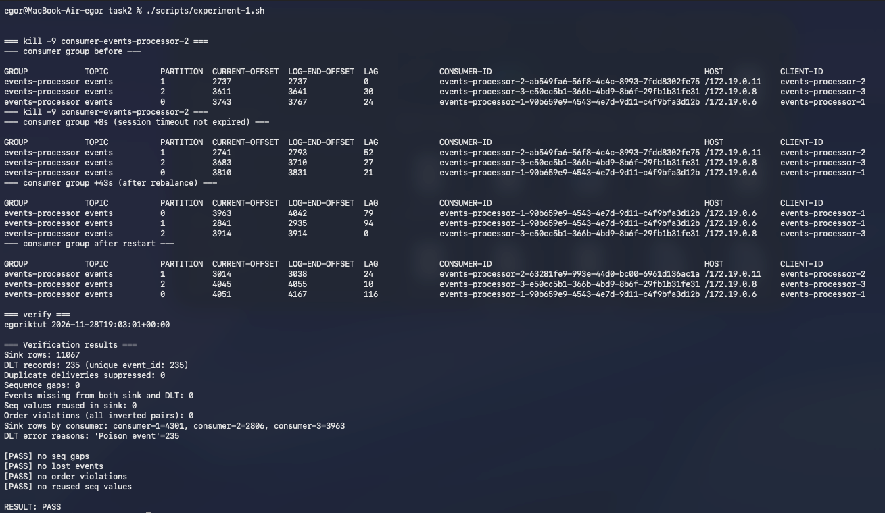
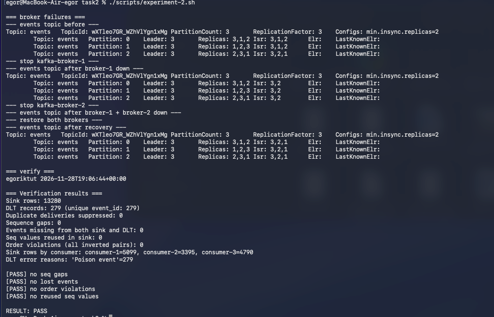
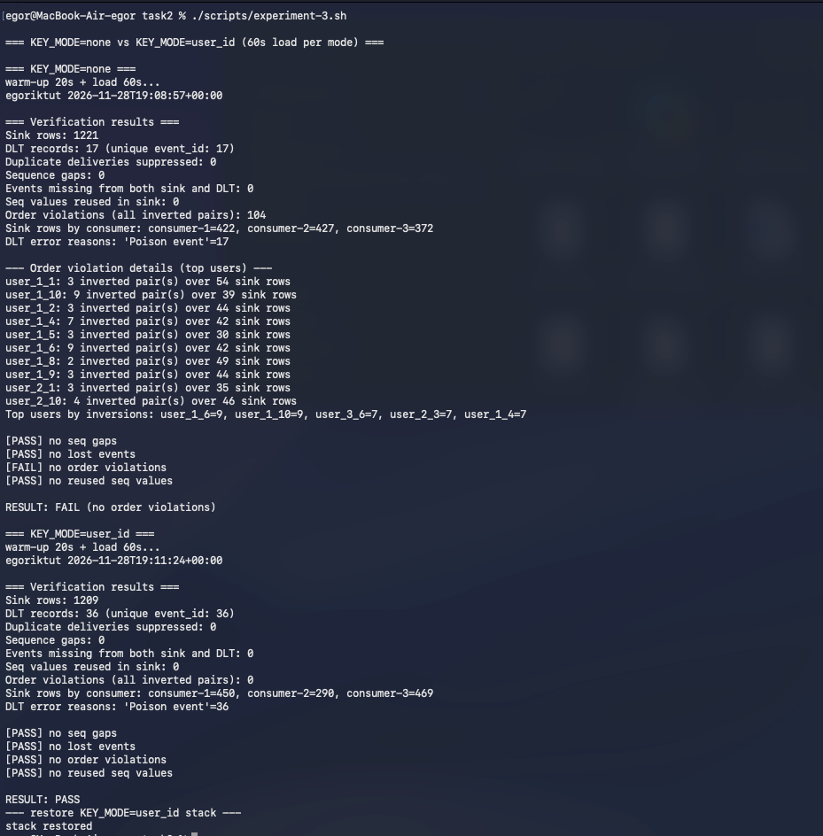

# HW2/3. Очередь Kafka

### [Демо видео](https://drive.google.com/file/d/1Ah_EDB4QYpuVafnQvFLhFID6jDLZkOJg/view?usp=sharing)


### Запуск

```bash
cd hw/task2
# cp .env.example .env
docker compose up --build -d
docker compose ps
```


### Проверка:

```bash
cd hw/task2
docker compose --profile tools run --rm --build verify
```


### Остановить и удалить все данные (Kafka-логи, sink, Grafana):
```bash
cd hw/task2
docker compose down -v
```

---

## Проверка и эксперименты

### 1. kill -9 консьюмера

#### Запуск
```bash
cd hw/task2
./scripts/experiment-1.sh
```

#### Гипотеза
После `SIGKILL` под не успевает закоммитить оффсет и не может
отправить `LeaveGroup`. Поэтому:
* мёртвый участник останется в группе до истечения `session.timeout.ms`, затем координатор запустит ребаланс
* партиции убитого пода достанутся живым
* обработка продолжится с последнего **закоммиченного** оффсета
* возможны дубликаты только для записи, которая была обработана и записана в
  sink, но оффсет ещё не закоммичен
* потерь быть не должно; порядок внутри партиции сохраняется

#### Результат

Ребаланс произошёл после
`session.timeout.ms`, партиция убитого пода перешла к `consumer-1`, обработка
продолжилась с закоммиченного оффсета, потерь и нарушений порядка нет



---

### 2. Отказ двух брокеров

```bash
cd hw/task2
./scripts/experiment-2.sh
```

#### Гипотеза

* Один упавший брокер - quorum ещё жив (2 из 3); для партиций,
  лидер которых был на упавшем брокере, выбирается новый лидер, но `min.insync.replicas=2` еще выполняется — продюсеры с
  `acks=all` продолжают работать.
* Два упавших брокера: остаётся 1 из 3, quorum теряется; все
  лидеры — на единственном живом брокере. `acks=all` и
  `min.insync.replicas=2` не могут подтвердить запись, продюсеры буферизуют и
  ретраят. Консьюмеры могут читать то, что уже есть, но новые записи не
  коммитятся. После возврата брокеров система должна восстановиться без
  потерь.

#### Результат

Система восстановилась, после возврата брокеров, лидеры вернулись к норме, consumer group
снова собралась из трёх участников, в `verify` нет
пропусков и потерь. Потому что `acks=all` + `min.insync.replicas=2`
защищают от потери при отказе одного брокера, а при потере quorum система
переходит в режим ожидания/ретраев вместо тихой потери данных.


---

### 3. `KEY_MODE=none` против `user_id`

```bash
cd hw/task2
./scripts/experiment-3.sh
```

#### Гипотеза

* `KEY_MODE=user_id`: все события пользователя в одной партиции, один
  консьюмер обрабатывает их последовательно
* `KEY_MODE=none`: ключа нет, продюсер раскладывает события по партициям. События одного пользователя попадают в разные
  партиции и обрабатываются разными консьюмерами параллельно. Порядок
  вставки в sink может не совпасть с `seq`. В `verify` будут нарушения
  порядка

#### Результат

Порядок гарантирует только внутри партиции. При `KEY_MODE=none` события одного `user_id` оказываются в разных
партициях. Три консьюмера обрабатывают партиции параллельно, и хотя каждый
внутри своей партиции идёт по возрастанию `seq`, глобальный порядок вставки
в sink перемешивается: событие `seq=10` из партиции A может быть вставлено
раньше `seq=9` из партиции B. `verify` считает все инверсии. При `key=user_id` такой ситуации нет: партиция для
пользователя одна, и внутри неё порядок сохраняется.

