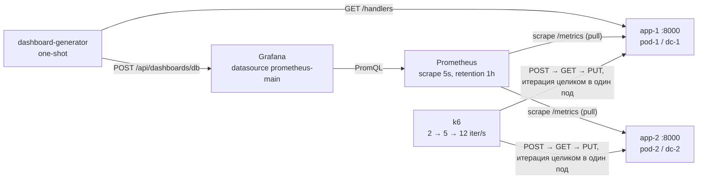

# HW-1 — автоматизация дашбордов Grafana (DDIA, DevOps)

Pet-project по заданию HW-1: микросервис с REST-ручками, метрики Prometheus, генерируемый дашборд Grafana и фоновая нагрузка.

## Стек

- Python 3.12 + FastAPI
- Prometheus `v2.55.1` + Grafana `11.3.0`
- k6 `0.54.0` (нагрузка)
- Docker Compose

## Архитектура



Стрелка означает «кто инициирует запрос». Prometheus **сам** опрашивает поды (`pull`) — приложение метрики никуда не отправляет; Grafana не хранит данные, а запрашивает их у Prometheus по PromQL.

Портов нет у `k6` и `dashboard-generator`: первый пишет нагрузку в сеть compose, второй отрабатывает один раз и завершается. Остальные сервисы публикуются только на `127.0.0.1` (таблица — §«Порты»).

Порядок запуска: `healthy` у приложений → Prometheus → Grafana → `dashboard-generator` (ждёт `healthy` у обоих приложений и Grafana, читает список ручек, заливает дашборд) → `k6` (ждёт успешного завершения генератора). Это `depends_on` с условиями, а не «повезло с таймингом».

## Структура

```
app/                  # микросервис (FastAPI)
dashboard-generator/  # генератор дашборда Grafana (one-shot в compose)
load/                 # сценарий нагрузки k6 + чистая логика и тесты (node --test)
observability/        # конфиг Prometheus и provisioning Grafana
docker-compose.yaml   # запуск стека
.env.example          # контракт переменных окружения
```

## Быстрый старт

```bash
cp .env.example .env
docker compose up
```

Проверка:

```bash
curl -f http://localhost:8000/health
curl -X POST http://localhost:8000/items -H 'Content-Type: application/json' -d '{"name":"first","value":1}'
```

Остановка:

```bash
docker compose down
```

Образы Prometheus и Grafana объявляют `VOLUME`, поэтому история метрик и SQLite Grafana живут в анонимных volume: `restart` их сохраняет, `down` — нет (новый `up` создаёт пустые). Чистый прогон с нуля — `docker compose down -v`.

## Как посмотреть результат

1. Открыть `http://localhost:3000/d/hw1-items-overview` — дашборд **HW-1 Items Service**, uid `hw1-items-overview`. Логин и пароль — `GF_SECURITY_ADMIN_USER` / `GF_SECURITY_ADMIN_PASSWORD` из вашего `.env` (в `.env.example` это `admin` / `change_me`).
2. Смотреть панели; переменные сверху — `datacenter` и `pod` (обе каскадные, с `All`): переключение на `pod-2` показывает трафик второго пода.

| Момент | Что видно |
|---|---|
| 0–30 с | дашборд уже существует (его залил генератор), панели пустые — «No data» |
| 30–45 с | первые точки RPS: Prometheus успел сделать ≥ 2 скрейпа по 5 с |
| 2–3 мин | все 9 панелей с данными: RPS, p50/p95/p99 и доли 4xx/5xx по трём ручкам |
| ≥ 4 мин | рампы вышли на плато: ≈ 37 req/s суммарно, 404 ≈ 5 %, 500 ≈ 3 % |

## Эндпоинты

| Метод | Путь | Код | Описание |
|---|---|---|---|
| POST | `/items` | 200 / 422 / 500 | Создать запись |
| GET | `/items/{id}` | 200 / 404 / 500 | Получить запись |
| PUT | `/items/{id}` | 200 / 404 / 422 / 500 | Обновить запись |
| GET | `/health` | 200 | Готовность сервиса (без метрик и без инъекции сбоев) |
| GET | `/metrics` | 200 | Метрики в формате Prometheus |
| GET | `/handlers` | 200 | Список бизнес-ручек для генератора дашборда |

Тело запроса `{"name": str, "value": int}` (`name` — 1..100 символов), ответ `{"id", "name", "value"}`. `PUT` для несуществующего id — 404 (upsert не выполняется). Невалидное тело — 422. `500` — срабатывание `FAILURE_RATE` или необработанное исключение.

Прочие коды — на уровне маршрутизации и в бизнес-логике не участвуют: неизвестный путь → 404, неподдерживаемый метод → 405 (в том числе `HEAD`, FastAPI не добавляет его к GET), обращение к пути со слэшем (`GET /items/`) → 307-редирект.

## Метрики

| Метрика | Тип | Лейблы |
|---|---|---|
| `http_requests_total` | Counter | `handler`, `status_code`, `pod_id`, `datacenter` |
| `http_request_duration_seconds` | Histogram | `handler`, `pod_id`, `datacenter` |

`handler` — метод и шаблон пути (`GET /items/{id}`), а не фактический URL: иначе каждый id создавал бы новый временной ряд. Неизвестный путь, 405 и 307 получают `handler="unmatched"`. Служебные ручки (`/health`, `/metrics`, `/handlers`, `/docs`, `/docs/oauth2-redirect`, `/openapi.json`, `/redoc`) не инструментируются.

Латентность замеряется в ASGI-middleware от входа в приложение до отправки заголовков ответа (`http.response.start`): работа хендлера и формирование ответа входят, передача тела по сети — нет. Отмена запроса и обрыв соединения клиентом метрику не пишут; исключение после отправки заголовков статус не меняет. Серии `*_created` отключены, `/metrics` отдаётся без сжатия.

Сервис работает **в один процесс uvicorn**: реестр метрик живёт в памяти процесса, поэтому при `--workers > 1` каждый воркер считал бы своё и скрейп попадал бы в случайный. Мультипроцессный режим потребовал бы `PROMETHEUS_MULTIPROC_DIR`.

**Почему `Histogram`, а не `Summary`.** Перцентили `Summary` считаются внутри процесса и не складываются: сумма p95 двух подов не имеет смысла. `Histogram` хранит счётчики по бакетам, поэтому `sum by (le)` по инстансам даёт корректный `histogram_quantile`. Бакеты заданы явно (13 значений от 1 мс до 2.5 с), верхний бакет выше ожидаемого p99 при 20–50 RPS.

`FAILURE_RATE` (`.env.example` → `0.03`) — доля бизнес-запросов, которые искусственно завершаются `500` до обращения к хранилищу; служебные ручки не затрагиваются. Полное описание контракта — `docs/metrics-contract.md`.

## Дашборд

Дашборд **не** лежит в provisioning: состав панелей зависит от списка ручек, который знает только работающее приложение (`GET /handlers`). Поэтому дашборд собирается кодом в рантайме: сервис `dashboard-generator` (one-shot, `restart: "no"`) ждёт `healthy` у app-1, app-2 и Grafana, читает `/handlers`, строит JSON и заливает его через `POST /api/dashboards/db` с `overwrite: true`.

| Что | Где |
|---|---|
| Контракт дашборда (uid, панели, PromQL, переменные) | `docs/dashboard-contract.md` |
| Сборка JSON (чистые функции) | `dashboard-generator/dashboard.py` |
| CLI: `/handlers` → Grafana API | `dashboard-generator/generator.py` |
| Эталонный артефакт (3 ручки → 9 панелей) | `docs/examples/dashboard.json` |

Для каждой ручки — три панели (латентность p50/p95/p99, RPS, ошибки 4xx/5xx), всего `3 × N`. Переменные `datacenter` и `pod` каскадные: `pod` фильтруется выбранным `datacenter`, обе допускают `All`. Отдельной переменной `handler` нет: в именах ручек есть `{id}`, а regex-фильтр по такой строке ломается, и пришлось бы отказываться от мультивыбора.

Перезапуск генератора вручную (после очистки Grafana или `docker compose down -v`):

```bash
docker compose run --rm dashboard-generator
```

## Использование AI

Задание AI-friendly в части «несодержательной» работы и требует самостоятельно выполнить прикладные решения: названия метрик, PromQL-шаблоны, архитектуру генератора, выбор и использование нагрузочного инструмента. Ниже — фактическое разделение, без округления в удобную сторону.

**Делегировано агенту** (с проверкой результата на каждом шаге): каркас FastAPI-сервиса, `Dockerfile`, `docker-compose.yaml`, конфиги Prometheus и provisioning datasource Grafana, код генератора дашборда, сценарий k6.
