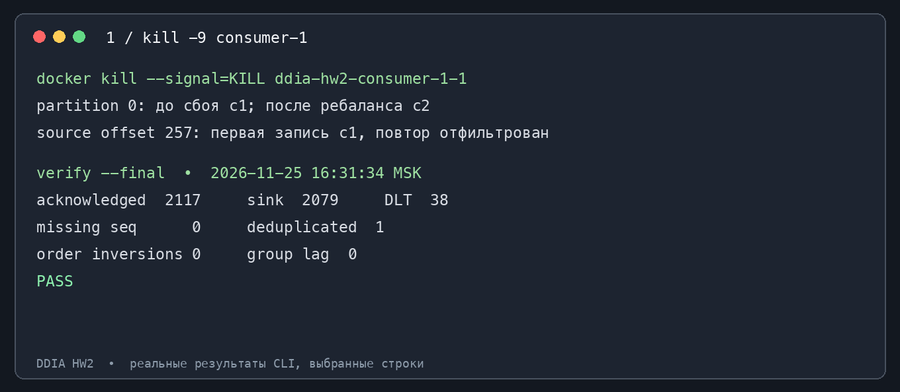
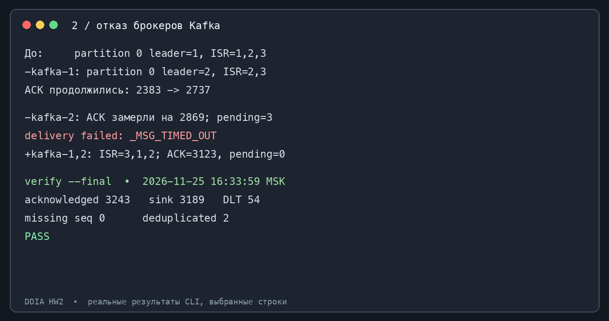
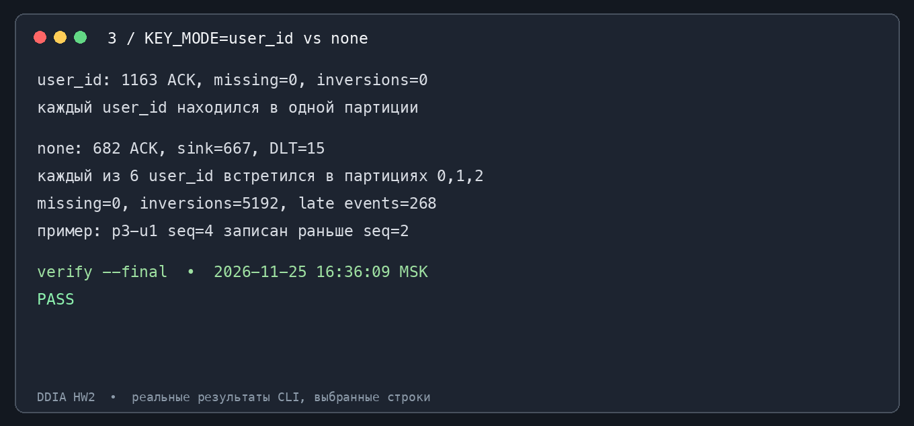

# HW2: Kafka и обработка событий

Невара Вадим, M4128, трек Fullstack. Локальный стенд для проверки партиций, повторной доставки и поведения Kafka при отказах.

## Запуск

Из этого каталога:

```bash
cp .env.example .env
docker compose up -d --build
docker compose ps -a
sleep 30
docker compose stop producer-1 producer-2 producer-3
docker compose run --rm verify --final
```

На машине без Docker Buildx можно собрать общий образ отдельно: `docker build -t ddia-hw2-app:local .`, затем выполнить `docker compose up -d --no-build`. `verify --final` имеет смысл после `docker compose stop producer-1 producer-2 producer-3`: консьюмеры должны обработать оставшийся хвост. Пока поток продолжается или группа отстаёт, скрипт выдаёт `INCOMPLETE`.

Kafka доступна с хоста через `localhost:29092`, `localhost:39092`, `localhost:49092`; контейнеры используют внутренние имена брокеров. Одноразовые `topic_init` и `schema_init` создают топики и таблицы. Проверить топики можно командой:

```bash
docker compose exec kafka-1 /opt/kafka/bin/kafka-topics.sh --bootstrap-server kafka-1:19092 --describe --topic events
```

Для нового прогона используйте `docker compose down -v`: команда удаляет данные Kafka и PostgreSQL. Без `-v` данные сохраняются. Одновременно запускать два проекта нельзя из-за одинаковых портов; для отдельного прогона без ключа сначала остановите первый стенд через `docker compose down`, затем выполните `KEY_MODE=none docker compose -p ddia-hw2-keyless up -d --build`.

## Как устроена обработка

- Три продюсера владеют разными наборами `user_id`. Состояние пользователя и подготовленное событие хранятся в PostgreSQL. `seq` увеличивается лишь после подтверждения Kafka; при неясном результате отправки повторяется тот же `event_id`.
- `user_id` служит ключом Kafka, поэтому события пользователя попадают в одну партицию. `KEY_MODE=none` отправляет сообщения без ключа и нужен только для третьего опыта. Продюсеры используют `acks=all` и идемпотентную отправку.
- Три консьюмера входят в группу `events-processor`. Запись в `processed_events` уникальна по `event_id`; повтор увеличивает счётчик `duplicates`. Kafka offset подтверждается только после записи в PostgreSQL, пакетами по 10 событий или раз в секунду. При ребалансе готовые offsets отзываемых партиций подтверждаются отдельно. `auto.offset.reset=earliest` позволяет новой группе читать события с начала; существующий подтверждённый offset имеет приоритет.
- Событие с `payload.poison=true` трижды вызывает ошибку обработки. Затем исходные bytes отправляются в `events.dlt` с причиной и координатами исходного сообщения в заголовках. Только подтверждённая публикация в DLT позволяет подтвердить исходный offset.
- `verify` объединяет sink и DLT, сравнивает их с сохранённым максимальным `seq` каждого пользователя, считает отброшенные дубли и пары событий, записанных не по порядку. Гарантия схемы — at-least-once: запись PostgreSQL и commit Kafka не являются одной транзакцией.

## Проверка и эксперименты

Гипотезы записаны 25 ноября 2026 года до запуска опытов. Изображения пока показывают сводки фактических результатов; для сдачи их нужно заменить буквальными снимками терминала. Исходные ответы `verify` и журналы лежат в [`evidence`](evidence). Время в строках `verify` указано в UTC, остальные значения времени ниже — MSK.

### 1. Убить один консьюмер

**Гипотеза.** Kafka перераспределит партиции между оставшимися консьюмерами. Новый владелец начнёт с последнего подтверждённого оффсета. Событие, уже записанное в PostgreSQL, но ещё не подтверждённое Kafka, может прийти повторно. Уникальный `event_id` не даст второй раз записать его как новое событие; счётчик дублей вырастет, если попадём в это окно. После остановки продюсеров и обработки очереди пропусков `seq` быть не должно.

**Результат.** Выполнил `docker kill --signal=KILL ddia-hw2-consumer-1-1` при работающих продюсерах. Перед остановкой группа показывала партицию 0 за `c1` и подтверждённый offset 229; после ребаланса её получил `c2`. В sink осталась первая запись события `p1-u2`, `seq=258`, `events/0/257` от `c1`; повторная попытка увеличила `duplicates` до 1, не создав второй строки. После остановки продюсеров `verify --final` показал 2117 подтверждённых событий, 2079 записей в sink, 38 в DLT, 0 пропусков, 1 отброшенный дубль и 0 нарушений порядка. Статус `PASS`. Гипотеза подтвердилась; конкретный дубль зависит от момента аварии относительно commit offset.

Для точной фиксации точки возобновления повторил `kill -9` с новым логом первого прочитанного сообщения после назначения партиции. В этом прогоне `c2` получил `events/0`, первым прочитал **offset 582** и затем отбросил повторные доставки offsets 582 и 583. Это видно в [журнале ребаланса](evidence/exp1b-rebalance.txt). После остановки потока повторная [проверка](evidence/exp1b-verify.txt) дала `PASS`, 0 пропусков и 4 отброшенных дубля суммарно за все опыты на основном стенде.



Полный [вывод verify](evidence/exp1-verify.txt).

### 2. Остановить сначала один, затем второй брокер

**Гипотеза.** После остановки одного брокера Kafka выберет новых лидеров для затронутых партиций. При двух оставшихся синхронных репликах продюсеры с `acks=all` смогут продолжить запись после короткой паузы. После остановки второго брокера новых успешных подтверждений быть не должно: для `events` требуется минимум две синхронные реплики. В нашем стенде эти же три узла являются KRaft-контроллерами, поэтому одновременно исчезнет и большинство контроллеров. Продюсеры должны сообщать об ошибках и повторять те же pending-события, не перескакивая через `seq`. После возврата брокеров запись и чтение должны восстановиться.

**Результат.** До отказа лидер партиции 0 был брокер 1, ISR — `1,2,3`. После `docker stop ddia-hw2-kafka-1-1` лидером стал брокер 2, ISR — `2,3`; число подтверждённых событий выросло с 2383 до 2737. После остановки `kafka-2` счётчик ACK остановился на 2869, в PostgreSQL осталось 3 подготовленных события, а продюсеры логировали `_MSG_TIMED_OUT`. Повторная проверка подтвердила те же 2869 ACK. После `docker start` обоих брокеров ISR снова включил все три реплики, число ACK выросло до 3123, pending-событий не осталось. После штатной остановки продюсеров и обработки хвоста `verify --final`: 3243 подтверждённых события, 3189 записей в sink, 54 в DLT, 0 пропусков, 2 отброшенных дубля, `PASS`.

Гипотеза подтвердилась. После второго отказа одновременно недоступны `min.insync.replicas=2` и большинство KRaft-контроллеров, так как три брокера совмещают роли broker/controller. Поэтому этот прогон не изолирует влияние каждого из двух механизмов.

В дополнительном прогоне проверил и потребителей. После остановки одного брокера число записей sink выросло с 4562 до 4923, а offsets группы продолжали продвигаться. После остановки второго число записей остановилось на 5078: две проверки с паузой дали одинаковое значение, в [журнале консьюмеров](evidence/exp2b-consumers.txt) видны отключения от брокеров. После возврата брокеров sink снова вырос до 5159; итоговый [verify](evidence/exp2b-verify.txt) после обработки хвоста — `PASS`, 0 пропусков.



Полный [вывод verify](evidence/exp2-verify.txt).

### 3. Запустить продюсеры без ключа сообщения

**Гипотеза.** С ключом `user_id` события одного пользователя попадают в одну партицию и обрабатываются по порядку. Без ключа события одного пользователя могут попасть в разные партиции. Разные консьюмеры обрабатывают их параллельно; более поздний `seq` иногда будет записан в PostgreSQL раньше более раннего. При этом число пропусков после завершения обработки должно остаться нулевым.

**Результат.** Базовый прогон с `KEY_MODE=user_id` завершился с 1163 подтверждёнными событиями, 0 пропусков и 0 нарушений порядка; каждый из шести `user_id` находился в одной партиции. Для сравнения остановил этот Compose-проект без удаления volumes и запустил отдельный `ddia-hw2-keyless` с новыми volumes и `KEY_MODE=none`. В нём каждый из шести `user_id` оказался во всех трёх партициях. После остановки продюсеров `verify --final` показал 682 подтверждённых события, 667 записей в sink, 15 в DLT, 0 пропусков и 5192 инверсионные пары (`late_events=268`), `PASS`. Например, для `p3-u1` событие `seq=4` записалось раньше `seq=2`.

Гипотеза подтвердилась: Kafka сохраняет порядок только внутри партиции. Разные консьюмеры параллельно записывали события одного пользователя из разных партиций; `PROCESSING_DELAY_MS=200` у `c1` и 60 у `c2`/`c3` сделали расхождение заметным. Нулевые пропуски при этом означают, что порядок и полнота — разные свойства.



Полные выводы: [с ключом](evidence/baseline-verify.txt), [без ключа](evidence/exp3-verify.txt).

Распределение шести пользователей по партициям в отдельном прогоне: [вывод SQL](evidence/exp3-partitions.txt).

## Что снять перед отправкой PR

Замените три файла в `screenshots/` настоящими снимками окна терминала (на macOS: `Shift` + `Cmd` + `4`, затем выделить окно). Достаточно по одному снимку на опыт; лимит задания — не более двух. Для кадра с ребалансом покажите `cat evidence/exp1b-rebalance.txt` и `cat evidence/exp1b-verify.txt`; для брокеров — `cat evidence/exp2b-consumers.txt` и `cat evidence/exp2b-verify.txt`; для порядка — `cat evidence/baseline-verify.txt`, `cat evidence/exp3-verify.txt` и `cat evidence/exp3-partitions.txt`. На снимках должны быть видны команды и вывод, а не только пересказ чисел.
