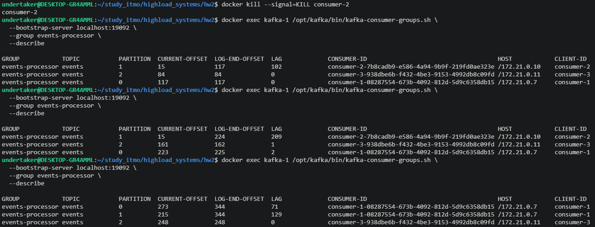
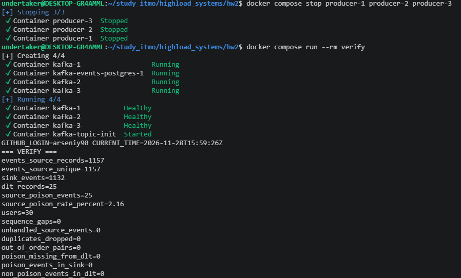
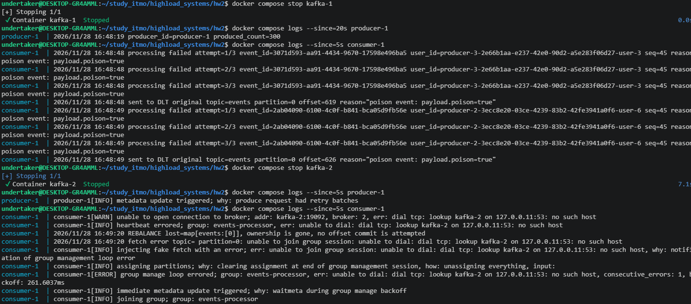
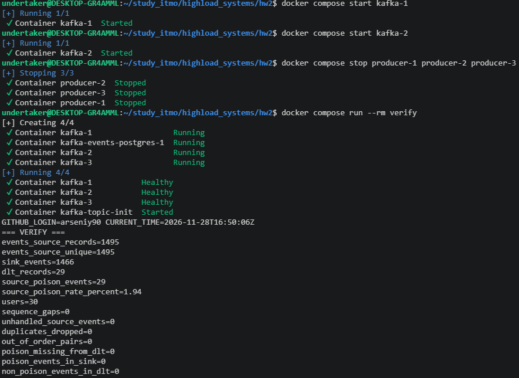

# Kafka Events: Go с использованием `franz-go`, PostgreSQL.

## Summary

- 3 Kafka broker/controller в режиме KRaft, без ZooKeeper
- одноразовый сервис `topic-init` для создания топиков
- 3 независимых producer сервиса
- consumer group `events-processor` с 3 consumer сервисами
- PostgreSQL используется для хранения событий и счетчика дедупликации;
- `verify` читает Kafka и sink, сверяет результаты.

## Модель события

Пример сообщения из `events`:

```json
{
  "event_id": "6b1c04d5-83f1-4b13-80fd-f2b46afaa8f7",
  "user_id": "producer-1-<run-uuid>-user-1",
  "type": "page_view",
  "seq": 1,
  "produced_at": "2026-11-24T10:00:00Z",
  "payload": {
    "poison": false,
    "producer_id": "producer-1",
    "note": "load event"
  }
}
```

## Запуск

В корне репозитория выполните:

```bash
cp .env.example .env
```

В `.env` замените `POSTGRES_USER` и `POSTGRES_PASSWORD` на свой логин и пароль.
`GITHUB_LOGIN` можно оставить по default.
Запустите docker compose:

```bash
docker compose up --build -d
```

После первой сборки для повторного запуска можно использовать ровно `docker compose up`; при изменении исходников или Dockerfile пересоберите образы командой `docker compose up --build`.

Проверить состояние сервисов и логи:

```bash
docker compose ps
docker compose logs -f producer-1 producer-2 producer-3 consumer-1 consumer-2 consumer-3
```

Чтобы остановить сервисы и удалить данные:

```bash
docker compose down -v
```


Проверить оффсеты:
```bash
docker exec kafka-1 /opt/kafka/bin/kafka-get-offsets.sh \
  --bootstrap-server localhost:19092 \
  --topic events
```

Проверить топики:
```bash
docker compose exec kafka-1 /opt/kafka/bin/kafka-topics.sh \
  --bootstrap-server kafka-1:19092 \
  --describe
```

Проверить консьюмеры:
```bash
docker exec kafka-1 /opt/kafka/bin/kafka-consumer-groups.sh \
  --bootstrap-server localhost:19092 \
  --group events-processor \
  --describe
```
С хоста можно использовать Kafka CLI, указав bootstrap servers:

```text
localhost:9092,localhost:9094,localhost:9096
```

### Корректное завершение и verify

Сначала остановить генерацию, подождать некоторое время, чтобы все сообщения зачитались, вызвать `verify`:

```bash
docker compose stop producer-1 producer-2 producer-3
docker compose run --rm verify
```

При изменении исходников или Dockerfile запустите `docker compose run --rm --build verify`.
Первая строка `verify` содержит GitHub-логин и время.

## CLI verify

`verify` читает end offsets топиков `events` и `events.dlt`, сканирует их от начала до зафиксированных end offsets и сверяет результаты с PostgreSQL sink.

Проверяет и выводит:
  - events_source_records - общее количество записей в исходном топике событий
  - events_source_unique - количество уникальных event_id в исходном топике
  - sink_events - количество событий, записанных в events_sink
  - dlt_records - общее количество записей в топике events.dlt
  - source_poison_events - количество poison-событий в исходном топике
  - source_poison_rate_percent - доля poison-событий в исходном топике в процентах
  - users - количество уникальных user_id
  - sequence_gaps - количество пропущенных номеров seq в последовательностях пользователей
  - unhandled_source_events - количество исходных событий, не попавших ни в events_sink, ни в dlt
  - duplicates_dropped - количество отброшенных дублей по event_id при записи в events_sink
  - out_of_order_pairs - количество пар событий одного user_id в events_sink, записанных с нарушением порядка seq
  - poison_missing_from_dlt - количество poison-событий из исходного топика, отсутствующих в dlt
  - poison_events_in_sink - количество poison-событий из исходного топика, попавших в events_sink
  - non_poison_events_in_dlt - количество обычных (не poison) событий из исходного топика, попавших в dlt

## Эксперименты
### 1. Аварийное завершение consumer (`kill -9`)

**Гипотеза** После `SIGKILL` один member перестанет работать. Группа обнаружит его отсутствие и выполнит rebalance. Партиции перейдут двум оставшимся consumer. Неподтверждённые offset будут прочитаны повторно. Возможны дубли sink при падении между успешной записью и commit offset, но уникальный `event_id` не позволит создать вторую sink-строку. Потерь не ожидается.

**Команды**

```bash
docker compose up -d

docker kill --signal=KILL consumer-2
# несколько раз, чтобы отслеживать лаг
docker exec kafka-1 /opt/kafka/bin/kafka-consumer-groups.sh \
  --bootstrap-server localhost:19092 \
  --group events-processor \
  --describe

docker compose stop producer-1 producer-2 producer-3
docker compose run --rm verify
```





**Результат** После SIGKILL на consumer-2 в партиции 1 вырос лаг, затем после ребаланса партиции 0 и 1 перешли consumer-1, а партиция 2 осталась за consumer-3, и лаг был разобран. `duplicates_dropped` может остаться 0, если kill не попал в окно между sink commit и Kafka offset commit; это не является ошибкой эксперимента.

### 2. Остановка одного, затем двух брокеров

**Гипотеза** При отказе одного брокера KRaft сохраняет большинство контроллеров (2 из 3). Для каждой партиции остаются две реплики в ISR, поэтому после переизбрания лидера `acks=all` может продолжить запись. При остановке второго брокера остаётся один контроллер из трёх: большинство теряется, Kafka перестаёт нормально обслуживать операции. Продюсеры не должны подтверждать новые записи, текущая запись будет повторяться с тем же `event_id` и `seq`. После возвращения брокеров quorum, лидеры и ISR должны восстановиться, а producers продолжат отправку.

**Команды**

```bash
docker compose down -v
docker compose up -d 

docker compose stop kafka-1
docker compose logs --since=20s producer-1
docker compose logs --since=5s consumer-1

docker compose stop kafka-2
# Зафиксировать ошибки producer / недоступность Kafka.
docker compose logs --since=5s producer-1
docker compose logs --since=5s consumer-1

docker compose start kafka-1
docker compose start kafka-2

docker compose stop producer-1 producer-2 producer-3
docker compose run --rm verify
```





**Результат** При остановке kafka-1 кластер продолжил работу в штатном режиме (в логах consumer-1 видна обработка poison-событий и отправка в DLT), а после остановки kafka-2 появились ошибки, ретраи продюсера и ребаланс консьюмера. После запуска kafka-1 и kafka-2 работа восстановилась: все события обработаны.

### 3. Сравнение `KEY_MODE=user_id` и `KEY_MODE=none`

**Гипотеза** С ключом `user_id` все события одного пользователя попадают в одну партицию, Kafka сохраняет порядок записей внутри неё, и consumer обрабатывает её последовательно. Поэтому `out_of_order_pairs` ожидается равным 0. Без ключа round-robin распределяет последовательные события пользователя по разным партициям; разные consumer могут завершать обработку в разном порядке, поэтому количество `out_of_order_pairs` может стать больше нуля. Нарушения порядка не означают пропусков: события всё равно должны оказаться в sink или DLT.

При запуске с `KEY_MODE=user_id` во всех предыдущих экспериментах `out_of_order_pairs` был 0.

**Команды**

```bash
docker compose down -v
KEY_MODE=none EVENTS_PER_SEC=2 USERS_COUNT=1 PROCESSING_DELAY_MS=0 PROCESSING_JITTER_MS=750 docker compose up -d

docker compose stop producer-1 producer-2 producer-3
docker compose run --rm verify
```


**Результат** При запуске с KEY_MODE=none получено out_of_order_pairs > 0 при sequence_gaps=0 и unhandled_source_events=0, что подтверждает гипотезу о нарушении порядка без ключа при сохранении всех событий.
