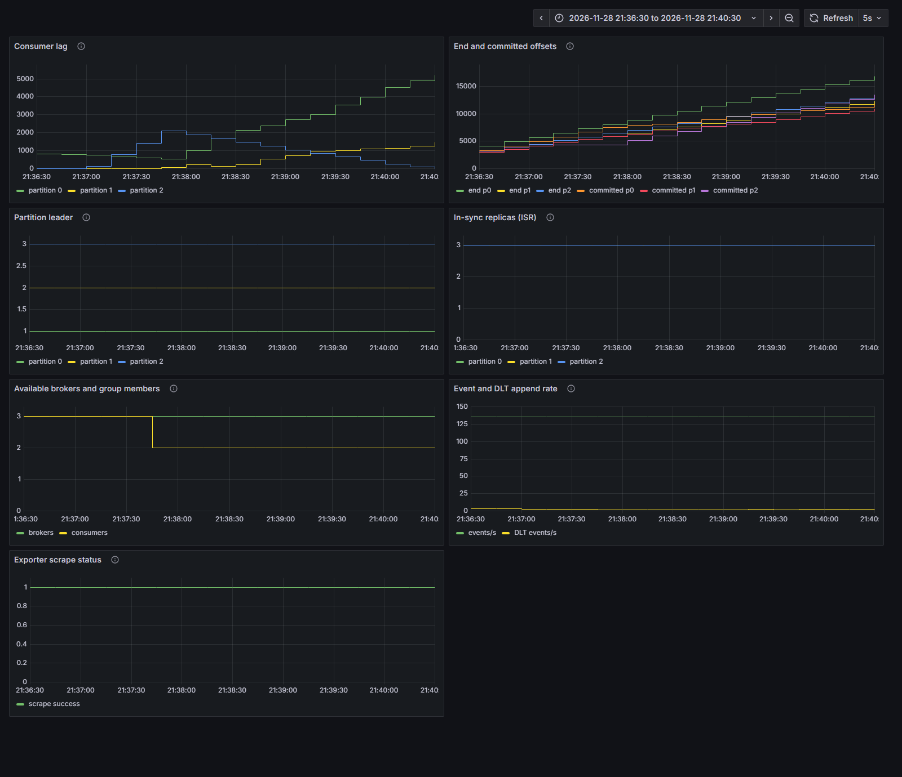
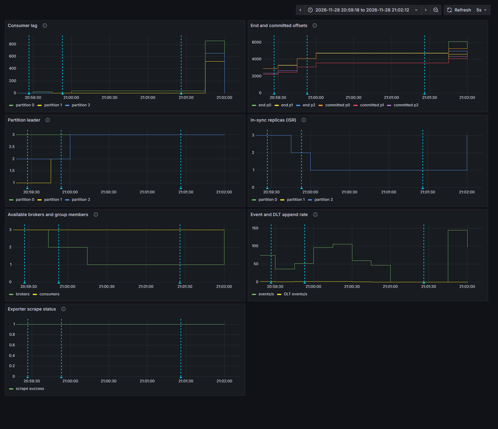

## Эксперимент 1
Гипотеза: После SIGKILL координатор заметит пропажу консьюмера и перераспределит его партицию. 
Новый владелец начнёт с сохранённого оффсета. Если процесс погибнет между коммитом PostgreSQL и коммитом Kafka, событие доставится повторно и дедупликация отбросит его.
Потерь и нарушений порядка с ключом не ожидаю.

## Как в действительности

**Консоль.** После `docker kill --signal 9` контейнер `consumer-2` получил статус `Exited (137)`. До SIGKILL партицию `events-2` читал хост `172.26.0.12`. После ребаланса её получил `consumer-1` на `172.26.0.9`. В логе нового владельца в 21:37:43 по местному времени:

```text
Setting offset for partition events-2 to the committed offset FetchPosition{offset=4317, ...}
events-processor: partitions assigned: [events-2]
```

В снимке, сделанном до SIGKILL, коммитнутый оффсет этой партиции был `2848`. К моменту остановки консьюмер успел продвинуть его до `4317`.

**Grafana.** В 21:37:45 число участников группы упало с трёх до двух. Лаг `events-2` достиг 2106 сообщений.
После назначения нового консьюмера лаг этой партиции начал снижаться, пока продюсеры продолжали отправлять события.



**Итоговый `verify`.** После возврата консьюмера и остановки продюсеров дождался нулевого лага на всех трёх партициях. Конечные оффсеты партиций 0, 1 и 2 — `36004`, `26577` и `29118` соответственно.

```text
kerzhakovna 2026-11-28T21:49:29+05:00
Result: NO SEQUENCE GAPS OR ORDER VIOLATIONS
Missing seq in sink + DLT (1..max observed): 0 across 0 of 300 users
Duplicate deliveries discarded: 0
Order violations (inverted pairs): 0
Sink events: 89923
DLT events (unique event_id): 1776
Late sink events: 0
Sink rows without write order: 0
Events present in both sink and DLT: 0
Kafka lag: 0 (offsets stable during verification)
```

**Вывод.** Гипотеза подтвердилась.

## Эксперимент 2

Гипотеза: После остановки одного брокера оставшиеся два сохранят кворум и минимальный ISR. Для партиций с потерянным лидером выберут новых лидеров, и обработка продолжится. 
После остановки второго брокера потеряется кворум контроллеров, а одной реплики недостаточно для успешного `acks=all`. После возврата брокеров запись и чтение должны возобновиться.

## Как в действительности

**Консоль.** При остановке `kafka-1` лидер партиции `events-1` сменился с брокера 1 на брокер 2. 
С двумя работающими брокерами конечные оффсеты продолжали расти. После остановки `kafka-2` продюсер получил `TimeoutException` примерно через 16 секунд,
а консьюмеры сообщали о разрыве соединения. После возврата обоих брокеров запись и чтение возобновились.

```text
Producer: org.apache.kafka.common.errors.TimeoutException: Expiring 1 record(s) for events-0:16001 ms has passed since batch creation. The request has not been sent, or no server response has been received yet.
Consumer: Node -2 disconnected.
```

**Grafana.** После первой остановки ISR сократился с трёх реплик до двух, после второй рост оффсетов остановился. После запуска обоих брокеров ISR вернулся к трём, а конечные и коммитнутые оффсеты снова начали расти.



**Итоговый `verify`.** После восстановления дождался нулевого лага. Конечные оффсеты партиций 0, 1 и 2 — `6092`, `4596` и `4973`.

```text
kerzhakovna 2026-11-28T21:01:57+05:00
Users observed: 300
Sink events: 15335
DLT events (unique event_id): 325
Missing seq (1..max observed per user): 0
Duplicate deliveries discarded: 3
Order violations (inverted pairs): 0
Late sink events: 0
Sink rows without write order: 0
Events present in both sink and DLT: 0
```

**Вывод.** Гипотеза подтвердилась.

## Эксперимент 3

Гипотеза: С ключом `user_id` все события пользователя попадут в одну партицию и будут обработаны по порядку. С `KEY_MODE=none` партиции могут обрабатываться разными консьюмерами с разной скоростью, 
поэтому ожидаю нарушения порядка при сохранении непрерывности `seq` с учётом DLT.

## Как в действительности

**Консоль.** Запустил два отдельных стенда с одинаковыми настройками нагрузки, меняя только режим ключа. 
После остановки продюсеров лаг в обеих группах дошёл до нуля по всем партициям. Конечные оффсеты в прогоне с ключом — `1466`, `1074`, `1162`, без ключа — `1668`, `1028`, `956`.

**Grafana.** На панели **Consumer lag** итоговое состояние проверялось по всем трём партициям. Пары с нарушенным порядком рассчитывались по очередности записи строк в PostgreSQL.

**Итоговый `verify` с `KEY_MODE=user_id`.**

```text
kerzhakovna 2026-11-28T20:57:58+05:00
Users observed: 300
Sink events: 3624
DLT events (unique event_id): 78
Missing seq (1..max observed per user): 0
Duplicate deliveries discarded: 0
Order violations (inverted pairs): 0
Late sink events: 0
Sink rows without write order: 0
Events present in both sink and DLT: 0
```

**Итоговый `verify` с `KEY_MODE=none`.**

```text
kerzhakovna 2026-11-28T21:03:21+05:00
Users observed: 300
Sink events: 3574
DLT events (unique event_id): 78
Missing seq (1..max observed per user): 0
Duplicate deliveries discarded: 0
Order violations (inverted pairs): 2184
Late sink events: 1249
Sink rows without write order: 0
Events present in both sink and DLT: 0
```

**Вывод.** Гипотеза подтвердилась. С ключом события каждого пользователя попадали в одну партицию и обрабатывались по порядку.
Без ключа разные консьюмеры могли обрабатывать события одного пользователя параллельно, поэтому меньший `seq` иногда записывался позже большего. 
1249 поздних событий образовали 2184 пары с нарушенным порядком. Пропусков с учётом DLT в обоих прогонах не обнаружено.
