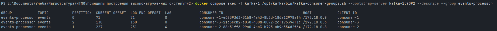
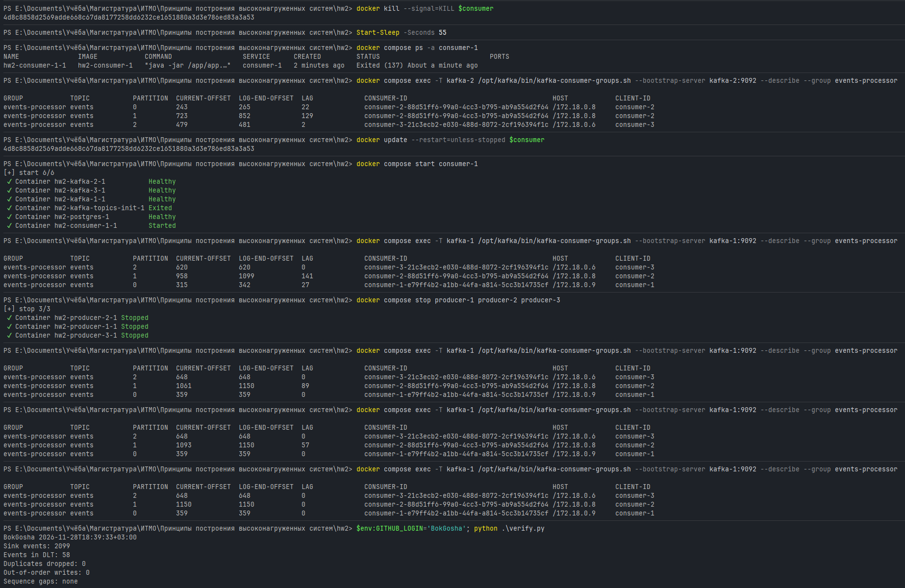
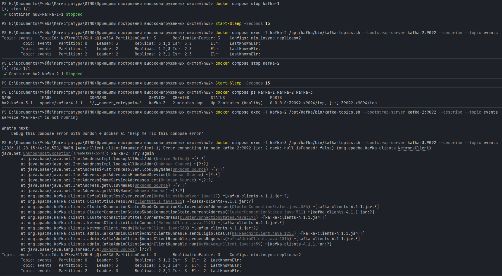
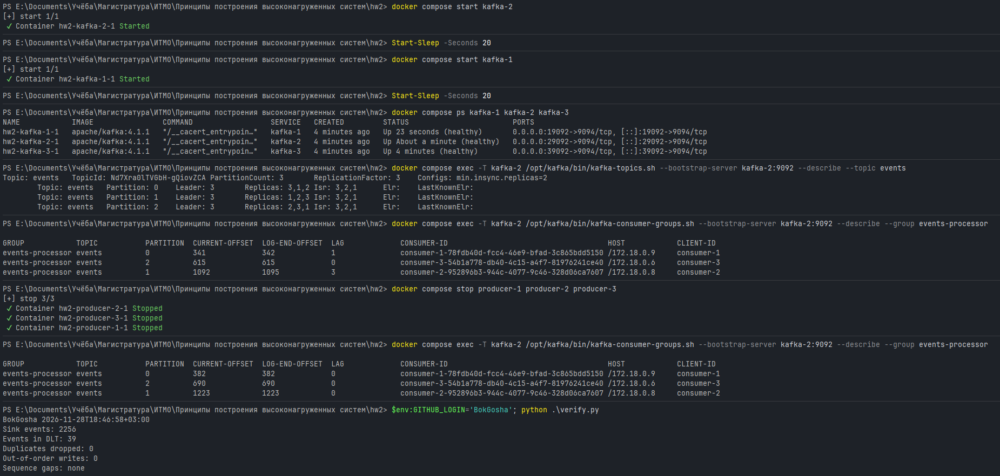
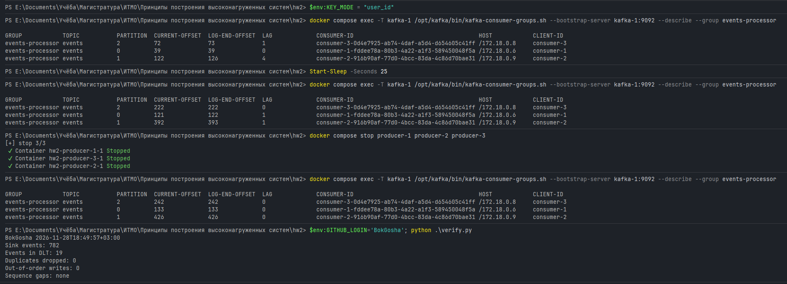
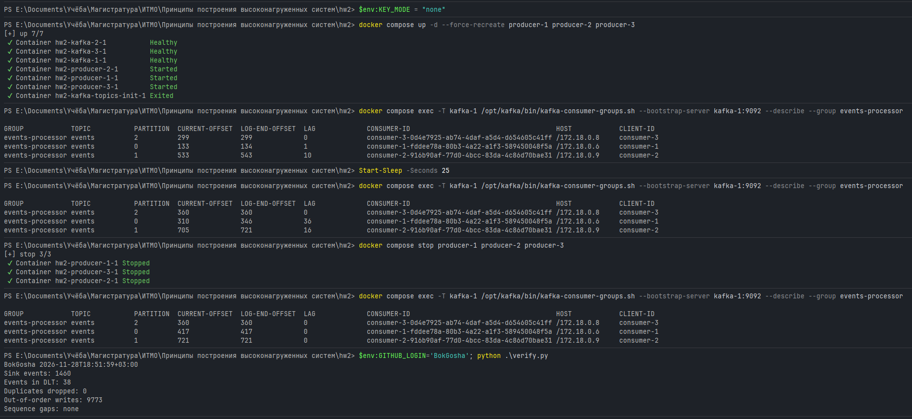

# Обработка событий в Kafka

## Архитектура

Docker Compose запускает кластер Kafka из трёх брокеров в режиме KRaft, PostgreSQL, три продюсера и три экземпляра консьюмера в одной consumer group. Топик `events` имеет три партиции, replication factor 3 и `min.insync.replicas=2`. Для надёжной публикации продюсеры используют `acks=all` и idempotence.

Продюсеры создают события с полями `event_id`, `user_id`, `type`, `seq`, `produced_at` и `payload`. Около 2% событий помечены как poison. В режиме `KEY_MODE=user_id` Kafka использует `user_id` в качестве ключа сообщения; режим `none` отправляет сообщения без ключа.

Консьюмеры отключают автоматический commit и обрабатывают сообщения по одному на партицию. После трёх неудачных попыток событие отправляется в `events.dlt` с исходными topic, partition, offset и причиной ошибки в заголовках. После успешной записи в PostgreSQL или подтверждённой отправки в DLT консьюмер синхронно фиксирует offset.

Таблица PostgreSQL `processed_events` имеет уникальный `event_id`, поэтому повторная доставка не создаёт вторую запись. Счётчик таких повторов хранится в `duplicate_delivery_stats`. Запись sink выполняется перед commit Kafka offset, обеспечивая at-least-once delivery с идемпотентным хранением.

Java-код сгруппирован по ответственности:

```text
itmo.ddia.hw2
├── model        модели Kafka-события и JPA-сущность
├── producer     генерация событий и публикация в Kafka
├── consumer     чтение, обработка и публикация в DLT
└── persistence  Spring Data JPA repository для sink
```

## Запуск приложения

Нужны Docker с Compose и Python 3. Из корня проекта соберите образы и запустите весь стек:

```powershell
docker compose up --build -d
docker compose ps
```

Compose запускает три Kafka-брокера, создаёт топики `events` и `events.dlt`, поднимает PostgreSQL, затем запускает продюсеры и консьюмеры. По умолчанию каждый продюсер создаёт 5 событий/с. Настройки можно переопределить переменными окружения или файлом `.env`: `USERS_PER_PRODUCER`, `EVENTS_PER_SECOND`, `POISON_RATE`, `KEY_MODE`, `PROCESSING_DELAY_MS`. Значение `KEY_MODE` по умолчанию — `user_id`.

Kafka доступна с хоста на `localhost:19092`, `localhost:29092`, `localhost:39092`; сервисы Compose используют `kafka-1:9092`, `kafka-2:9092`, `kafka-3:9092`. Для локальной работы пароль PostgreSQL по умолчанию — `hw2-local-only`.

Остановить контейнеры, сохранив данные Kafka и PostgreSQL:

```powershell
docker compose down
```

`docker compose down -v` удалит volumes с накопленными данными.

## Эксперимент 1. Отказ одного консьюмера

Один из трёх экземпляров консьюмера был аварийно завершён сигналом SIGKILL. После таймаута Kafka выполнила rebalance и назначила его партиции оставшимся экземплярам. После восстановления консьюмер снова присоединился к группе и получил назначение; offsets продолжили продвигаться. В итоговой проверке после обработки отставания пропусков последовательностей и подавленных дубликатов не было.



До отказа: распределение партиций и offsets группы, результат `verify.py`.



Во время и после отказа: `consumer-1` остановлен, партиции перераспределены; после запуска offsets продвинулись, `Duplicates dropped: 0`, `Sequence gaps: none`.

## Эксперимент 2. Отказ брокеров

При остановке одного брокера у партиций были выбраны доступные лидеры, а ISR сократился до двух реплик. После остановки второго брокера оставшаяся реплика не удовлетворяла `min.insync.replicas=2`, поэтому продюсеры с `acks=all` получали `NOT_ENOUGH_REPLICAS` и повторяли отправку. В ходе отказа могли также временно меняться координатор consumer group и доступность commit offsets. После возвращения брокеров ISR восстановился до трёх реплик на каждой партиции, а consumer group продолжила обработку. В проверенном восстановленном состоянии лидером всех трёх партиций стал брокер 3; это допустимо, если брокеры доступны и ISR восстановлен.



Скриншот показывает оба этапа: после остановки `kafka-1` у партиций остаются два брокера в ISR; после остановки `kafka-2` работает только `kafka-3`. Запрос через остановленный `kafka-2` завершается ошибкой, а запрос через `kafka-3` показывает состояние партиций при отказе двух брокеров.



После восстановления: все три брокера находятся в ISR, показаны лидеры, lag группы и результат `verify.py`.

## Эксперимент 3. Ключ сообщения

При `KEY_MODE=user_id` события одного пользователя направляются в одну партицию, сохраняя порядок их чтения внутри этой партиции. При `KEY_MODE=none` привязка пользователя к партиции теряется; распределение может быть неравномерным, а события одного пользователя могут обрабатываться разными консьюмерами параллельно.

В итоговых проверках на скриншотах `Out-of-order writes` равен `0` для `user_id` и `9773` для `none`. Это согласуется с ожидаемым эффектом ключа: без ключа события одного пользователя могут попадать в разные партиции и записываться в sink не по порядку. В `verify.py` метрика считает инверсии пар записей sink. Счётчик накопительный, а генератор хранит sequence в памяти и начинает его заново после пересоздания продюсеров, поэтому сравнение корректно описывает показанные запуски, но не является отдельным замером только 25-секундного интервала. В режиме `none` промежуточная проверка также показывала пробелы `[20]` для двух пользователей; после остановки продюсеров и обработки оставшегося lag итоговая проверка показала `Sequence gaps: none`.



`user_id`: offsets до и после интервала, остановка продюсеров, нулевой lag и итоговый `verify.py`.



`none`: offsets до и после интервала, проверка распределения по партициям и результат `verify.py`; `Out-of-order writes: 9773`.
