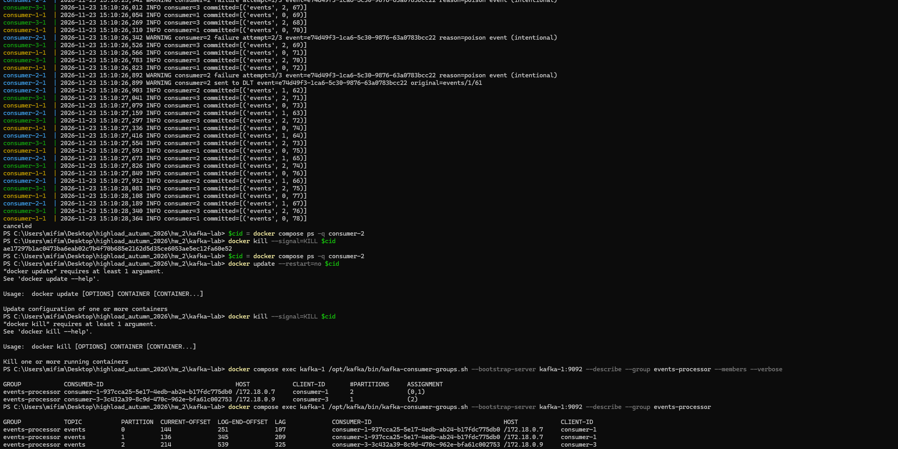
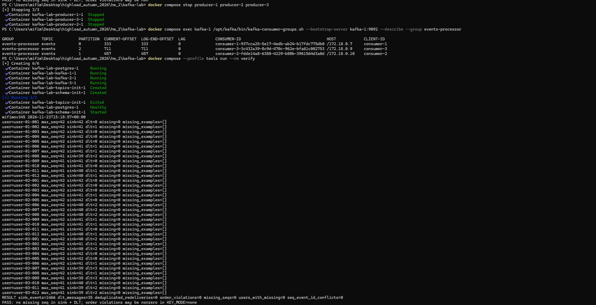
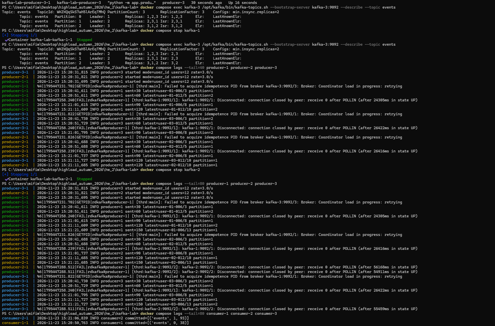
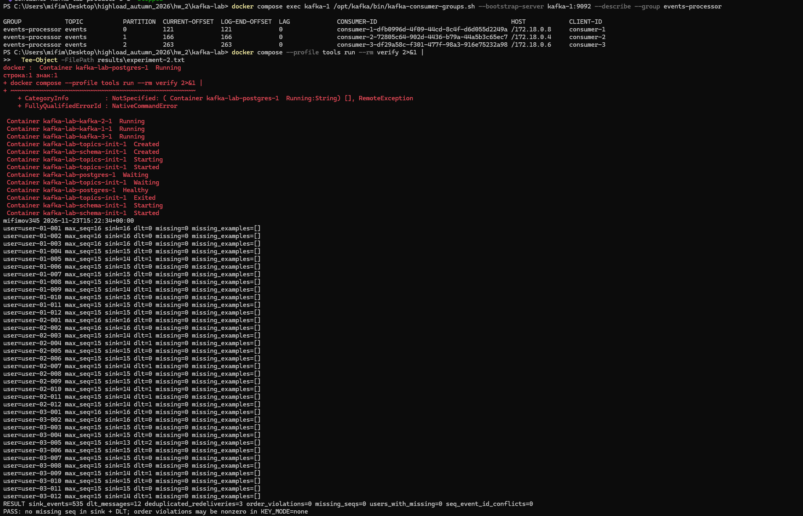
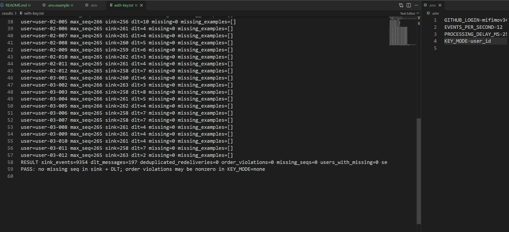
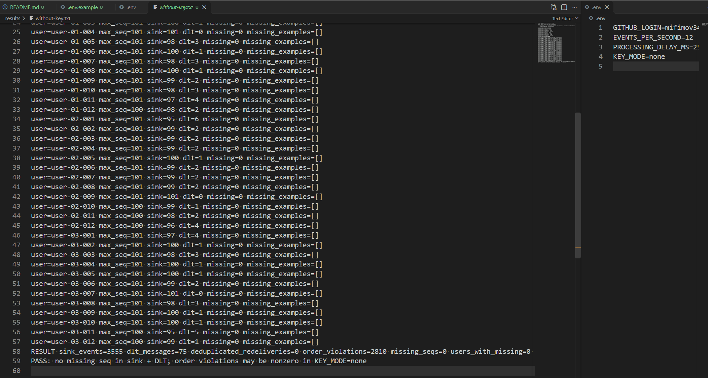

# Лабораторная работа №2 — Kafka: очереди, партиции, сбои

## Архитектура

- Три Kafka 3.9.1 брокера в **KRaft combined mode**: каждый одновременно broker + controller. При потере двух контроллеров quorum исчезает; это отдельный эффект от `min.insync.replicas`.
- `events`: 3 партиции, RF=3, `min.insync.replicas=2`. `events.dlt`: 3 партиции, RF=3, ISR=2.
- Три Python-продюсера; фиксированные непересекающиеся наборы пользователей `user-01-*`, `user-02-*`, `user-03-*` по 12 пользователей на экземпляр. Скорость `EVENTS_PER_SECOND` **на экземпляр**. События с `payload.poison=true` генерируются с вероятностью 2%.
- Три Python-консьюмера входят в одну группу `events-processor` и по очереди забирают сообщения назначенных им партиций.
- PostgreSQL `sink`: уникальный `event_id`, порядковый `write_order`, `user_id`, `seq`, `consumer_id`, `topic`, `partition`, `message_offset`; `stats.duplicates` показывает конфликты уникальности.
- Продюсеры сохраняют последний подтверждённый `seq` в PostgreSQL. `event_id` детерминирован по `(user_id, seq)` — если процесс погибнет после Kafka ACK, но до сохранения прогресса, повторная отправка имеет прежний `event_id` и устраняется дедупликацией.

producer-1 ─┐
producer-2 ─┼──► Kafka cluster (KRaft, 3 brokers)
producer-3 ─┘         │
                       ├── events (3 partitions, RF=3, min ISR=2)
                       │       │
                       │       ▼
                       │  events-processor (3 consumers)
                       │       ├──► PostgreSQL sink (UNIQUE event_id)
                       │       └──► events.dlt (poison after 3 failures)
                       │
                       └── events.dlt (3 partitions, RF=3)

verify ─────► PostgreSQL sink + Kafka events.dlt

### Модель события

```json
{
  "event_id": "UUID",
  "user_id": "user-01-001",
  "type": "purchase",
  "seq": 1,
  "produced_at": "2026-11-23T12:00:00+00:00",
  "payload": {"poison": false, "producer": 1, "sample": 0}
}
```

Ключ Kafka: `user_id` или `null` при `KEY_MODE=none`. За порядок для одного пользователя отвечает Kafka partition order (при наличии ключа), а не глобальная сортировка Kafka.

Продюсер: `acks=all`, `enable.idempotence=true`, обработка delivery callback, SIGTERM + `flush`. Консьюмер: `enable.auto.commit=false`, синхронный коммит после транзакции в sink; `on_revoke` коммитит уже обработанные записи. `auto.offset.reset=earliest` нужен для новой группы без сохранённых оффсетов; при существующих коммитах значение не влияет. DLT записывается с `error`, `original_topic`, `original_partition`, `original_offset` в headers, и только после ACK DLT коммитится исходный offset.

**Семантика:** at-least-once, не end-to-end exactly-once. При сбое между записью в Postgres и коммитом произойдёт повторная доставка; она учитывается в `stats`.

## Запуск

Требуются Docker Engine + Compose v2; на машине желательно от 5–6 ГиБ свободной памяти.

```bash
cp .env.example .env

docker compose up -d --build

docker compose ps
docker compose logs --tail 50 topics-init
docker compose logs --tail 50 consumer-1 consumer-2 consumer-3
```

CLI с хоста: Kafka bootstrap `localhost:19092,localhost:29092,localhost:39092`; внутри compose: `kafka-1:9092,kafka-2:9092,kafka-3:9092`. Внешние порты опубликованы только на loopback.

**Корректный снимок `verify`:** для строгой проверки остановите продюсеров, дождитесь полного отставания группы (`LAG=0` для всех партиций) и запустите CLI:

```bash
docker compose stop producer-1 producer-2 producer-3

docker compose exec kafka-1 /opt/kafka/bin/kafka-consumer-groups.sh \
  --bootstrap-server kafka-1:9092 --describe --group events-processor

docker compose --profile tools run --rm verify
```

Иначе `verify` может показывать **временно** отсутствующие события, которые ещё находятся в Kafka и не дошли до sink/DLT. После проверки запустить продюсеры снова: `docker compose start producer-1 producer-2 producer-3`.

Просмотреть распределение и лидеров:

```bash
docker compose exec kafka-1 /opt/kafka/bin/kafka-topics.sh \
  --bootstrap-server kafka-1:9092 --describe --topic events
```

Проверить параметры:

```bash
docker compose exec kafka-1 /opt/kafka/bin/kafka-configs.sh \
  --bootstrap-server kafka-1:9092 --entity-type topics --entity-name events --describe
```
## Эксперимент 1. Отказ консьюмера

### Гипотеза
**Гипотеза:** после принудительной остановки пода группа перераспределит его партицию оставшимся консьюмерам. Последний подтвержденный offset определяет, откуда продолжить. Возможны повторы при записи sink перед фиксацией offset; потерь быть не должно.

```bash
# Сервис consumer-2 должен быть запущен; в другой консоли смотрите логи

docker compose logs -f consumer-1 consumer-3

# В Linux bash, Docker Desktop или Git Bash:
docker kill --signal=KILL "$(docker compose ps -q consumer-2)"

docker compose exec kafka-1 /opt/kafka/bin/kafka-consumer-groups.sh \
  --bootstrap-server kafka-1:9092 --describe --group events-processor

# После восстановления и стабилизации:
docker compose up -d consumer-2
# Остановить продюсеров, дождаться LAG=0 и запустить verify
```





## Эксперимент 2. Отказ брокеров

### Гипотеза
**Гипотеза:** после остановки одного брокера партиции, лидером которых он был, выберут нового лидера из ISR. При двух работающих репликах `acks=all` и `min.insync.replicas=2` обычно продолжают работать. После остановки второго Kafka теряет controller quorum (2 из 3 в combined mode), поэтому операции могут останавливаться и продюсеры логируют ошибки/таймауты. После возврата брокеров кластер должен восстановиться.

```bash
# Зафиксировать исходных лидеров ДО остановки

docker compose exec kafka-3 /opt/kafka/bin/kafka-topics.sh \
  --bootstrap-server kafka-3:9092 --describe --topic events

docker compose stop kafka-1

docker compose exec kafka-3 /opt/kafka/bin/kafka-topics.sh \
  --bootstrap-server kafka-3:9092 --describe --topic events

docker compose stop kafka-2

docker compose logs --tail=80 producer-1 consumer-1

# Возврат брокеров, дождаться восстановления ISR

docker compose start kafka-1 kafka-2

docker compose exec kafka-3 /opt/kafka/bin/kafka-topics.sh \
  --bootstrap-server kafka-3:9092 --describe --topic events
# Остановить продюсеров, дождаться LAG=0 и запустить verify
```





## Эксперимент 3. Сравнение ключей

### Гипотеза
**Гипотеза:** с ключом `user_id` события пользователя направляются в одну партицию и сохраняют порядок чтения. Без ключа Kafka может распределять события по нескольким партициям, которые обрабатываются разными консьюмерами, вызывая инверсии порядка записи в sink. Результаты могут быть недетерминированными, поэтому нагрузку нужно сделать достаточно длительной.

**Запуск с ключом (новые чистые тома):**

```bash
docker compose down -v
# В .env выставить KEY_MODE=user_id, EVENTS_PER_SECOND=12, PROCESSING_DELAY_MS=250
docker compose up -d --build
# Накопить достаточно событий, затем stop producers, LAG=0, verify
```

**Запуск без ключа (снова новые чистые тома):**

```bash
docker compose down -v
# В .env выставить KEY_MODE=none, EVENTS_PER_SECOND=12, PROCESSING_DELAY_MS=250
docker compose up -d --build
# Накопить достаточно событий, затем stop producers, LAG=0, verify
```





## Ограничения

- Проект рассчитан на локальный учебный стенд: Kafka и Postgres без TLS/SASL, пароли демонстрационные; на боевом сервере так разворачивать нельзя.
- Зафиксированный пользователь закреплён за экземпляром по `INSTANCE_ID`; нельзя запускать копии одного `producer-N` без дополнительного lease механизма.
- Дедупликация хранит каждую конфликтную попытку, но не гарантирует, что именно отказ вызовет дубликат; для гарантированной демонстрации повторов потребуется отдельная инъекция сбоя сразу после SQL commit перед Kafka offset commit.
- Проверка `verify` является снимком и не включает события, ещё не обработанные в момент измерения. Следует остановить входящий поток и дождаться `LAG=0`.
