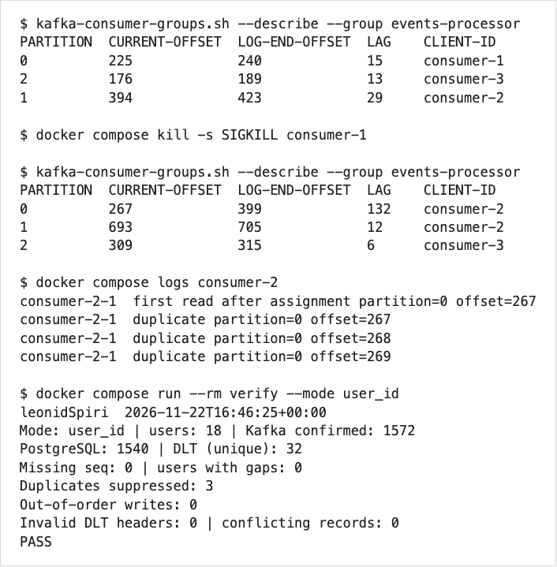
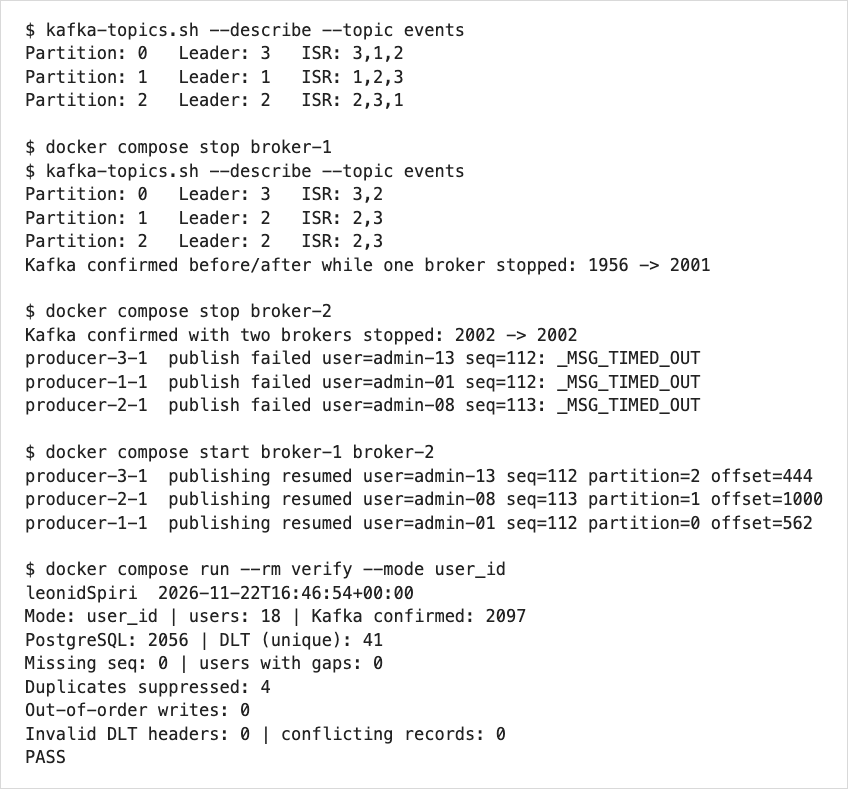
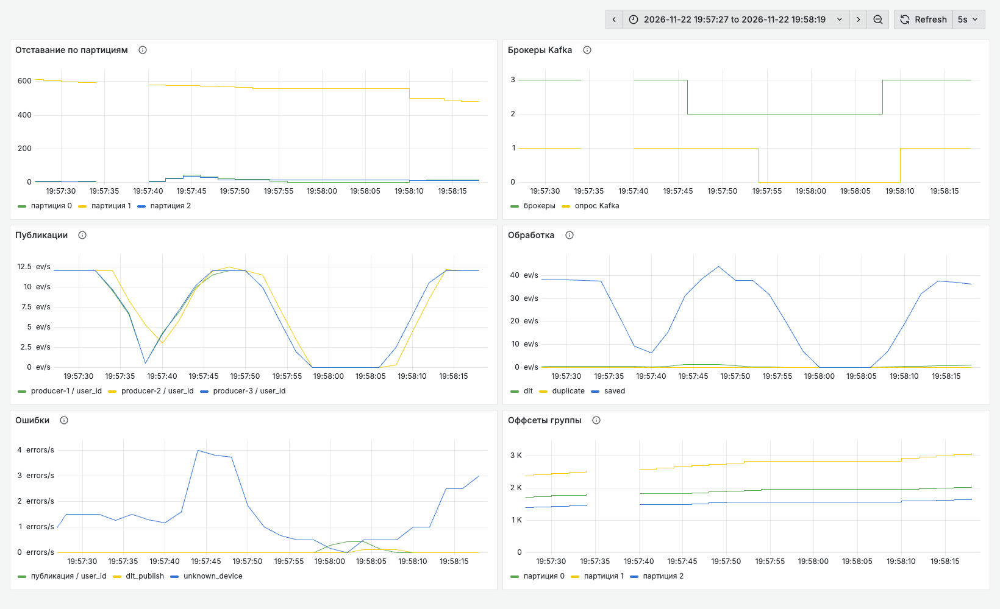
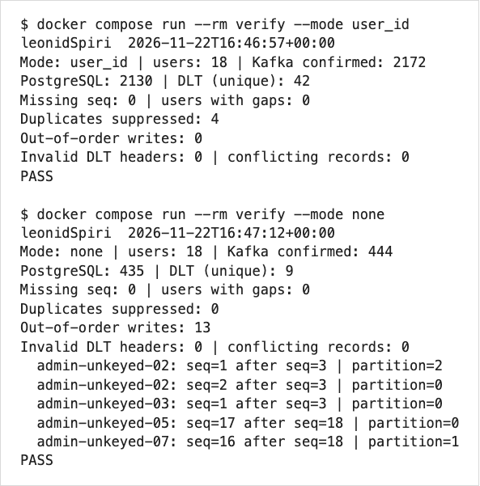

# NetInventory

Стенд обработки событий комплектации учебной сети. Администратор открывает карточку маршрутизатора, коммутатора или точки доступа, добавляет устройство в заявку и подтверждает её. Продюсеры имитируют эти действия, воркеры читают события из Kafka и сохраняют результат в PostgreSQL.

## Запуск

Требуется Docker с Compose v2. Команды выполняются из каталога с `compose.yaml`.

```sh
docker compose up -d --build --wait
docker compose ps
```

Сервис `topics` создаёт `events` и `events.dlt` после запуска брокеров. Код выхода 0 для него означает, что инициализация завершилась успешно. Первый запуск включает загрузку образов.

| Адрес на хосте | Назначение |
| --- | --- |
| [localhost:13000/d/netinventory-kafka](http://localhost:13000/d/netinventory-kafka) | Дашборд с отставанием по партициям, скоростью публикации, обработкой и ошибками |
| [localhost:19090](http://localhost:19090) | Prometheus |
| `127.0.0.1:19092,127.0.0.1:29092,127.0.0.1:39092` | Kafka для клиентов на хосте |

Внутри сети Compose клиенты используют `broker-1:9092,broker-2:9092,broker-3:9092`. Grafana доступна локально в режиме просмотра без входа. Остановка с сохранением данных выполняется командой `docker compose down`.

## События и обработка

У события есть UUID `event_id`, идентификатор администратора `user_id`, тип `type`, последовательный номер `seq`, время создания `produced_at` и JSON `payload` с кодом оборудования и номером заявки. Типы `page_view`, `add_to_cart` и `purchase` соответствуют просмотру карточки, добавлению в заявку и её подтверждению. За каждым администратором закреплён один продюсер. Нумерация начинается с 1 отдельно для каждого администратора. Продюсер сохраняет ожидающее подтверждения событие и последний подтверждённый `seq` в PostgreSQL. После сбоя публикацию можно повторить с тем же UUID.

Три процесса Kafka совмещают роли брокера и контроллера KRaft. В каждом топике по три партиции и три реплики. Для `events` задано `min.insync.replicas=2`. Продюсеры ждут подтверждения с `acks=all`, используют идемпотентную отправку и при штатной остановке завершают отправку буфера. Лог содержит ошибки доставки.

Три воркера входят в группу `events-processor`. Автокоммит выключен. Сначала воркер записывает результат в PostgreSQL, затем фиксирует следующий оффсет. При отзыве партиций воркер коммитит уже обработанные позиции. Новая группа без сохранённого оффсета начинает с начала доступного журнала (`earliest`). В PostgreSQL сохраняются идентификатор воркера и позиция события в Kafka, уникальность `event_id` защищает результат при повторной доставке. Повторы учитываются отдельно.

Около 2% событий содержат неизвестный код оборудования. После трёх ошибок обработки воркер публикует событие в `events.dlt` с причиной и исходными топиком, партицией и оффсетом в заголовках. Позиция в `events` сохраняется после подтверждения этой публикации.

| Параметр | Назначение |
| --- | --- |
| `KEY_MODE=user_id\|none` | По умолчанию `user_id`. В режиме `none` ключ отсутствует, партиции для последовательных сообщений чередуются |
| `EVENTS_PER_SECOND` | Целевая скорость одного продюсера, по умолчанию 12 событий/с |
| `PROCESSING_DELAY_MS` | Задержка обработки одной попытки, по умолчанию 45 мс |
| `COMMIT_INTERVAL_MS` | Интервал между коммитами обработанных оффсетов, по умолчанию 2000 мс |
| `GITHUB_LOGIN` | Логин в первой строке отчёта `verify` |

## Проверка

```sh
docker compose run --rm -e GITHUB_LOGIN=leonidSpiri verify
```

В первой строке отчёта печатаются GitHub-логин и текущее время. `verify` фиксирует подтверждённый `seq` каждого администратора и сверяет весь диапазон от единицы с PostgreSQL и `events.dlt`. Отчёт показывает пропуски, число подавленных повторов и число записей, у которых `seq` меньше уже сохранённого номера того же администратора. Событие в DLT считается учтённым.

Итоговый отчёт после прогона снимается после остановки генерации и обработки накопленных сообщений.

```sh
docker compose stop producer-1 producer-2 producer-3
docker compose run --rm -e GITHUB_LOGIN=leonidSpiri verify --wait 60
docker compose start producer-1 producer-2 producer-3
```

## Эксперименты

На снимках вывода оставлены строки, относящиеся к каждому опыту.

### 1. Аварийная остановка воркера

Если запись в PostgreSQL успела сохраниться, а оффсет ещё не закоммичен, новый владелец партиции прочитает запись повторно. Повтор проявится в счётчике только при попадании сбоя в этот интервал. Перед остановкой и после ребаланса сравниваются владельцы партиций и оффсеты группы.

```sh
docker compose exec broker-3 /opt/kafka/bin/kafka-consumer-groups.sh \
  --bootstrap-server broker-3:9092 --describe --group events-processor
docker compose kill -s SIGKILL consumer-1
```

После смены владельца партиции та же команда показывает нового участника. Команда `docker compose logs --since 1m consumer-2 consumer-3` выводит обработку на оставшихся воркерах. Для возврата к исходной конфигурации выполняется `docker compose start consumer-1`. Затем снимается итоговый отчёт `verify`.

В прогоне партиция 0 перешла от `consumer-1` к `consumer-2`. Новый обработчик начал с оффсета 267. Записи с оффсетами 267–269 уже были в PostgreSQL, поэтому повторная доставка увеличила счётчик дублей на 3. `verify` учёл 1572 события, из них 32 в DLT, и показал 0 пропусков.



### 2. Остановка одного, затем двух брокеров

При двух доступных репликах Kafka может продолжить подтверждать записи после смены лидера. При одном доступном узле требование двух синхронных реплик невыполнимо. В этой конфигурации с совмещёнными ролями также исчезает большинство контроллеров KRaft.

```sh
docker compose exec broker-3 /opt/kafka/bin/kafka-topics.sh \
  --bootstrap-server broker-3:9092 --describe --topic events
docker compose stop broker-1
```

После смены лидера повторяется запрос состояния топика. На дашборде сравниваются число доступных брокеров, поток публикации и ошибки. Затем останавливается `broker-2` и проверяются ошибки отправки.

```sh
docker compose stop broker-2
docker compose logs --since 1m producer-1 producer-2 producer-3
docker compose start broker-1 broker-2
```

После восстановления повторяется запрос состояния топика, проверяется возобновление публикаций и снимается итоговый отчёт `verify`.

После остановки `broker-1` лидер партиции 1 сменился с 1 на 2, в ISR остались брокеры 2 и 3, а счётчик подтверждений вырос с 1956 до 2001. С двумя остановленными брокерами счётчик остановился на 2002, все три продюсера получили `_MSG_TIMED_OUT`. После запуска брокеров ISR снова включал все три реплики. Продюсеры подтвердили публикации с теми же `seq`, на которых остановились, и `verify` учёл все 2097 подтверждённых событий, включая 41 в DLT.



На графике повторного прогона видны падение скорости публикации до нуля и её восстановление. При потере кворума линия «опрос Kafka» падает до 0. Линия «брокеры» в этот момент показывает последнее доступное значение из метаданных Kafka.



### 3. Обработка с ключом и без ключа

С ключом записи одного администратора направляются в одну партицию. Без ключа записи могут попасть в разные партиции, и воркер, обслуживающий одну из них, может успеть записать больший `seq` раньше меньшего.

```sh
docker compose stop producer-1 producer-2 producer-3
docker compose run --rm -e GITHUB_LOGIN=leonidSpiri verify --mode user_id --wait 60
KEY_MODE=none docker compose up -d --no-deps producer-1 producer-2 producer-3
```

После накопления событий второго прогона снимается отдельный отчёт. Идентификаторы администраторов в режимах различаются, поэтому сравнение использует один кластер и одну базу без сброса данных.

```sh
docker compose stop producer-1 producer-2 producer-3
docker compose run --rm -e GITHUB_LOGIN=leonidSpiri verify --mode none --wait 60
KEY_MODE=user_id docker compose up -d --no-deps producer-1 producer-2 producer-3
```

| Режим | Подтверждено | В PostgreSQL | В DLT | Пропуски | Нарушения порядка |
| --- | ---: | ---: | ---: | ---: | ---: |
| `user_id` | 2172 | 2130 | 42 | 0 | 0 |
| `none` | 444 | 435 | 9 | 0 | 13 |

Например, для `admin-unkeyed-02` записи с `seq=1` и `seq=2` попали в базу после `seq=3`. Исходные события лежали в разных партициях, воркеры обрабатывали их параллельно.


