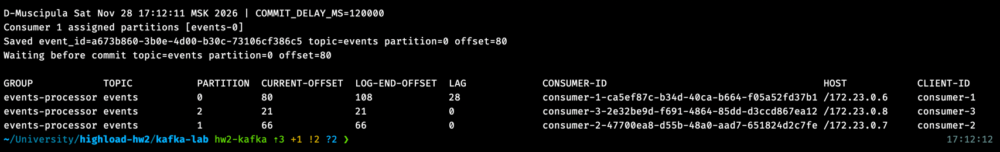
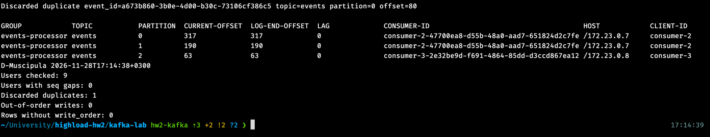
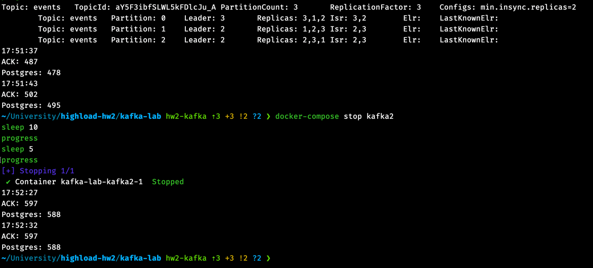
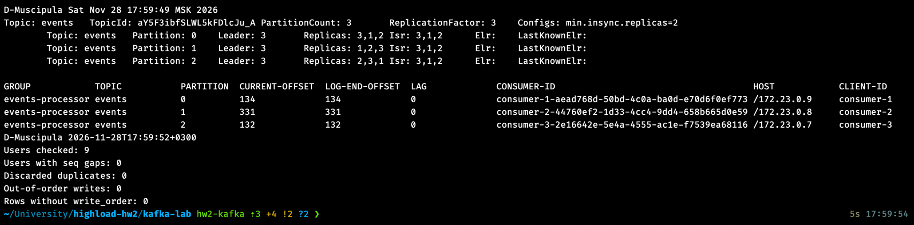
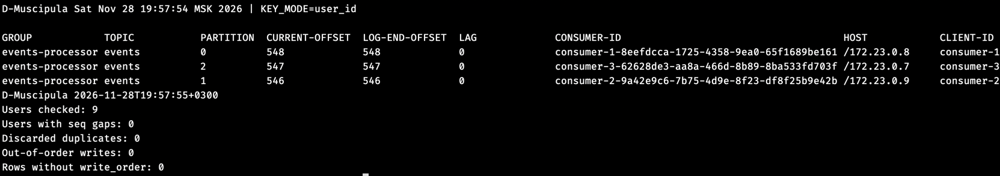
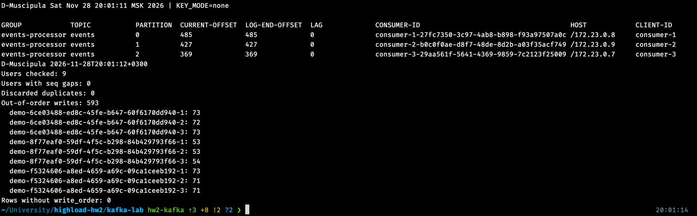

# ДЗ 2. Очередь Kafka

Три Kotlin-продюсера пишут события в `events`. Три консьюмера группы `events-processor` обрабатывают их и записывают результат в Postgres. После трёх неудачных попыток ядовитое событие отправляется в `events.dlt` с причиной ошибки и исходными координатами записи.

## Запуск

Из корня репозитория:

```sh
cd kafka-lab
docker-compose up -d --build
docker-compose ps -a
```

Compose собирает общий образ Kotlin-приложения и запускает три брокера Kafka в режиме KRaft, Postgres, продюсеров и консьюмеров. `kafka-init` создаёт топики и завершает работу с кодом `0`.

В обоих топиках по три партиции и три реплики. Для `events` задано `min.insync.replicas=2`. С ноутбука Kafka доступна по `127.0.0.1:19092`, `127.0.0.1:19093` и `127.0.0.1:19094`.

| Переменная | По умолчанию | Назначение |
| --- | --- | --- |
| `KEY_MODE` | `user_id` | Ключ события. При `none` запись отправляется без ключа. |
| `EVENT_INTERVAL_MS` | `1000` | Пауза продюсера после подтверждённой отправки, мс. |
| `PROCESSING_DELAY_MS` | `50` | Задержка перед каждой попыткой обработки, мс. |
| `COMMIT_DELAY_MS` | `0` | Дополнительная пауза после обработки перед коммитом оффсета, мс. Нужна для воспроизведения повторной доставки при `SIGKILL`. |
| `GITHUB_LOGIN` | `D-Muscipula` | Логин в первой строке `verify`. |

## Модель события

В Kafka передаётся JSON:

```json
{
  "event_id": "c1c4242e-6dcb-4c83-b45b-762bc630e777",
  "user_id": "demo-550e8400-e29b-41d4-a716-446655440000-1",
  "type": "page_view",
  "seq": 1,
  "produced_at": "2026-11-28T12:00:00Z",
  "payload": {
    "path": "/",
    "poison": false
  }
}
```

`event_id` — UUID события, `user_id` — идентификатор пользователя. У каждого продюсера свой набор из трёх пользователей. `seq` начинается с `1` и увеличивается для каждого пользователя отдельно. `produced_at` — время генерации в UTC. Значения `type` чередуются между `page_view`, `add_to_cart` и `purchase`.

`payload` — JSON с данными события. Каждое 50-е событие продюсера получает `poison=true`, то есть около 2% событий являются ядовитыми. При каждой попытке их обработки возникает ошибка.

## Проверка

```sh
./verify
```

Консьюмер коммитит следующий оффсет после записи в Postgres, учёта дубля или подтверждённой отправки в DLT. Дубли определяются по `event_id`. `verify` ищет пропуски `seq` по Postgres и DLT от `1` до максимального увиденного номера, выводит счётчик отброшенных дублей и проверяет порядок записи в Postgres по `write_order`.

Для консьюмера было выбрано `auto.offset.reset=earliest`, чтобы при отсутствии валидного сохранённого оффсета обработать всю доступную историю, включая события, отправленные до первого запуска группы. При наличии валидного сохранённого оффсета чтение продолжается с него.

## Эксперименты

Перед итоговым `./verify` продюсеры были остановлены, очередь дочитана до `LAG=0` во всех партициях. При повторном использовании томов отчёт включает прежние данные, поэтому значения счётчика дублей сравниваются до и после опыта.

### 1. Падение консьюмера

**Гипотеза.** После `SIGKILL` чтение партиции начнётся другим консьюмером с последнего закоммиченного оффсета. Т.е. если в Postgres уже успели сохранить данные, но не успели закоммитить оффсет в Kafka, то новый консьюмер получит эти данные ещё раз. Выглядит так, что эксперимент проверяет семантику at-least-once с обработкой дублей.

**Условия.** Свежие тома, три продюсера и три консьюмера, `KEY_MODE=user_id`, `EVENT_INTERVAL_MS=1000`, `PROCESSING_DELAY_MS=50`. Для воспроизведения дубля у `consumer-1` была добавлена пауза 120 секунд между записью в Postgres и коммитом Kafka.

**Запуск.** Команды выполнялись из `kafka-lab` в одном терминале.

Перед запуском были явно заданы параметры нагрузки и удалены тома Kafka и Postgres с данными предыдущих прогонов.

```sh
unset COMPOSE_PROJECT_NAME COMPOSE_FILE
export KEY_MODE=user_id EVENT_INTERVAL_MS=1000
export PROCESSING_DELAY_MS=50 COMMIT_DELAY_MS=0
docker-compose down --volumes
docker-compose up -d --build
```

Для просмотра группы была определена команда `group`. `PARTITION` — партиция, `CURRENT-OFFSET` — сохранённая позиция, `LOG-END-OFFSET` — конец журнала, `LAG` — разница между ними, `CLIENT-ID` — текущий консьюмер.

```sh
group() {
  docker-compose exec -T kafka1 /opt/kafka/bin/kafka-consumer-groups.sh \
    --bootstrap-server localhost:9092 --describe --group events-processor
}
group
```

Через `group` было проверено назначение одной партиции каждому из трёх консьюмеров и появление числовых позиций в `CURRENT-OFFSET`.

Было зафиксировано исходное значение счётчика `Discarded duplicates`.

```sh
./verify
```

**Пауза перед коммитом.** `consumer-1` был перезапущен с паузой 120 секунд.

```sh
COMMIT_DELAY_MS=120000 docker-compose up -d --no-deps consumer-1
docker-compose logs -f --tail=3 --no-log-prefix consumer-1
```

После появления `Saved` и `Waiting before commit` с одинаковым оффсетом просмотр логов был прерван через `Ctrl+C`. Состояние было выведено отдельно.

```sh
clear
printf 'D-Muscipula %s | COMMIT_DELAY_MS=120000\n' "$(date)"
docker-compose logs --tail=3 --no-log-prefix consumer-1
group
```

Скриншот после `docker-compose logs` и `group`, перед отправкой `SIGKILL`.



`consumer-1` сохранил в Postgres событие `a673b860-3b0e-4d00-b30c-73106cf386c5` из `events-0` с оффсетом `80`. В Kafka позиция группы всё ещё `80`, консьюмер ждёт перед коммитом.

**Падение и ребаланс.** До окончания паузы был отправлен `SIGKILL`.

```sh
docker-compose kill -s SIGKILL consumer-1
group
```

Через `group` была проверена смена владельца партиции. В логах была найдена строка `Discarded duplicate` для того же события, затем продюсеры были остановлены.

```sh
docker-compose logs --since 2m consumer-2 consumer-3
docker-compose stop producer
```

Перед проверкой очередь была дочитана до `LAG=0` во всех партициях.

```sh
clear
docker-compose logs --no-log-prefix consumer-2 consumer-3 | grep 'Discarded duplicate' | tail -n 2
group
./verify
```

Скриншот после просмотра дубля в логах, `group` и `./verify`.



После падения партицию `events-0` получил `consumer-2`. Он перечитал событие с оффсетом `80` и отбросил дубль. После остановки продюсеров очередь дочитана, `LAG=0`. Проверка девяти пользователей показала один дубль, ноль пропусков и нарушений порядка.

После проверки стенд был остановлен.

```sh
docker-compose stop
```

**Вывод.** Гипотеза подтвердилась. Была зафиксирована повторная доставка после сбоя между записью в Postgres и коммитом Kafka, дубль был отброшен при дедупликации.

### 2. Остановка одного и двух брокеров

**Гипотеза.** После остановки одного работа продолжится. acks будет у двух оставшихся, `min.insync.replicas` и так две задано.
После остановки двух по идее работа должна прекратиться, т.к. для KRaft мало нод. После возвращения брокеров работа должна восстановиться, а консьюмеры продолжат чтение с последних закоммиченных оффсетов.

**Условия.** Свежие тома, `KEY_MODE=user_id`, `EVENT_INTERVAL_MS=1000`, `PROCESSING_DELAY_MS=50`, `COMMIT_DELAY_MS=0`. Продюсеры используют `acks=all`, у топика `events` задано `min.insync.replicas=2`.

**Запуск.** Данные предыдущего опыта были удалены, стенд запущен заново. Команды выполнялись из `kafka-lab` в одном терминале.

```sh
unset COMPOSE_PROJECT_NAME COMPOSE_FILE
export KEY_MODE=user_id EVENT_INTERVAL_MS=1000
export PROCESSING_DELAY_MS=50 COMMIT_DELAY_MS=0
docker-compose down --volumes
docker-compose up -d --build
```

Для просмотра топика, группы и прогресса были определены команды `topics`, `group` и `progress`. Запросы выполнялись к `kafka3`, который оставался включённым. `ACK` — число подтверждённых отправок в логах продюсеров, `Postgres` — число сохранённых событий. Ядовитые события уходят в DLT, поэтому эти числа могут различаться.

```sh
topics() {
  docker-compose exec -T kafka3 /opt/kafka/bin/kafka-topics.sh \
    --bootstrap-server localhost:9092 --describe --topic events
}
group() {
  docker-compose exec -T kafka3 /opt/kafka/bin/kafka-consumer-groups.sh \
    --bootstrap-server localhost:9092 --describe --group events-processor
}
progress() {
  date '+%H:%M:%S'
  printf 'ACK: '
  docker-compose logs --no-log-prefix producer | grep -c '^Sent event_id='
  printf 'Postgres: '
  docker-compose exec -T postgres psql -U kafka_lab -d kafka_lab -qAt \
    -c 'SELECT count(*) FROM processed_events'
}
topics
group
progress
```

Перед остановкой брокеров были проверены назначение партиций трём консьюмерам и наличие всех трёх брокеров в ISR.

**Остановка брокеров.** `kafka1` был остановлен. Через `topics` было проверено, что в ISR остались брокеры `2` и `3`.

```sh
docker-compose stop kafka1
topics
```

Было выведено состояние с одним остановленным брокером. Затем был остановлен второй брокер и повторены замеры.

```sh
clear
printf 'D-Muscipula %s\n' "$(date)"
topics
progress
sleep 5
progress
docker-compose stop kafka2
sleep 10
progress
sleep 5
progress
```

Скриншот после `docker-compose stop kafka2` и повторных вызовов `progress`.



После остановки `kafka1` лидерами партиций остались брокеры `2` и `3`, в ISR по две реплики. Отправка и обработка продолжились. ACK вырос с `487` до `502`, число строк в Postgres с `478` до `495`. После остановки `kafka2` счётчики перестали расти и в двух замерах остались равны `597` и `588`.

Консьюмеры оставались запущенными без перезапуска. Продюсеры после 120 секунд ожидания доставки завершились с `TimeoutException`.

**Восстановление.** Брокеры были запущены повторно, проверено возвращение всех трёх в ISR. Пока работает только один брокер, `topics` и `group` могут зависать в ожидании ответа.

```sh
docker-compose start kafka1 kafka2
topics
```

К моменту возврата брокеров продюсеры уже завершились. Перед итоговой проверкой была вызвана команда `stop producer`, через `group` было проверено, что во всех партициях `LAG=0`.

```sh
docker-compose stop producer
group
```

```sh
clear
printf 'D-Muscipula %s\n' "$(date)"
topics
group
./verify
```

Скриншот после `topics`, `group` и `./verify` с восстановленными брокерами.



После восстановления брокер `3` стал лидером всех трёх партиций, а брокеры `1` и `2` — ведомыми репликами. ISR восстановился до трёх реплик, группа была доступна, у всех партиций `LAG=0`. Проверка девяти пользователей не обнаружила пропусков, дублей и нарушений порядка.

```sh
docker-compose stop
```

**Вывод.** Гипотеза подтвердилась частично. С одним остановленным брокером работа продолжалась. После остановки второго новые события перестали подтверждаться. После возвращения брокеров восстановились ISR и доступность группы. Автоматическое возобновление отправки не проверялось, поскольку продюсеры уже завершились по таймауту.

### 3. Порядок событий с ключом и без ключа

**Гипотеза.** При наличии ключа данные с одним ключом попадают в одну партицию, при `KEY_MODE=none` данные одного пользователя будут раскиданы по разным партициям. Порядок гарантируется только в рамках одной партиции, поэтому порядок может быть нарушен.

**Условия.** Два прогона на свежих томах с тремя продюсерами и тремя консьюмерами. В обоих `EVENT_INTERVAL_MS=100`, `PROCESSING_DELAY_MS=200`, `COMMIT_DELAY_MS=0`. После назначения партиций нагрузка поддерживалась ещё 30 секунд. Между прогонами был изменён только `KEY_MODE`.

**Подготовка.** Команды выполнялись из `kafka-lab` в одном терминале. Перед каждым прогоном данные Kafka и Postgres предыдущего опыта были удалены командой `down --volumes`.

```sh
unset COMPOSE_PROJECT_NAME COMPOSE_FILE
export EVENT_INTERVAL_MS=100 PROCESSING_DELAY_MS=200 COMMIT_DELAY_MS=0

group() {
  docker-compose exec -T kafka3 /opt/kafka/bin/kafka-consumer-groups.sh \
    --bootstrap-server localhost:9092 --describe --group events-processor
}
```

**С ключом.** Стенд был запущен с `KEY_MODE=user_id`.

```sh
docker-compose down --volumes
export KEY_MODE=user_id
docker-compose up -d
group
```

Через `group` было проверено назначение одной партиции каждому консьюмеру. Через 30 секунд продюсеры были остановлены.

```sh
sleep 30
docker-compose stop producer
group
```

Перед проверкой очередь была дочитана до `LAG=0` во всех партициях. Дочитывание заняло несколько минут.

```sh
clear
printf 'D-Muscipula %s | KEY_MODE=user_id\n' "$(date)"
group
./verify
```

Скриншот после `group` и `./verify` при `KEY_MODE=user_id`.



С ключом проверены девять пользователей. Пропусков, дублей и нарушений порядка нет, у всех партиций `LAG=0`.

**Без ключа.** Данные были очищены, стенд запущен с `KEY_MODE=none`.

```sh
docker-compose down --volumes
export KEY_MODE=none
docker-compose up -d
group
```

Было проверено назначение трёх партиций трём консьюмерам, затем повторена та же нагрузка.

```sh
sleep 30
docker-compose stop producer
group
```

Перед проверкой очередь была дочитана до `LAG=0` во всех партициях.

```sh
clear
printf 'D-Muscipula %s | KEY_MODE=none\n' "$(date)"
group
./verify
```

Скриншот после `group` и `./verify` при `KEY_MODE=none`.



Без ключа проверены девять пользователей. Пропусков и дублей нет, но обнаружены `593` нарушения порядка записи в Postgres. У всех партиций `LAG=0`.

```sh
docker-compose stop
unset KEY_MODE EVENT_INTERVAL_MS PROCESSING_DELAY_MS COMMIT_DELAY_MS
```

**Вывод.** Гипотеза подтвердилась. С ключом события одного пользователя обрабатывались по порядку. Без ключа они попадали в разные партиции, которые консьюмеры обрабатывали независимо. Часть событий с меньшим `seq` записалась в Postgres после событий с большим `seq`.
