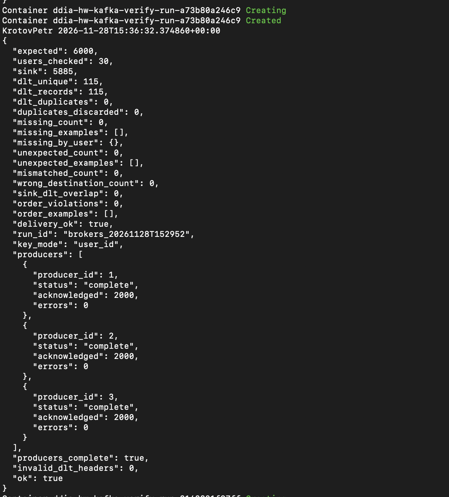
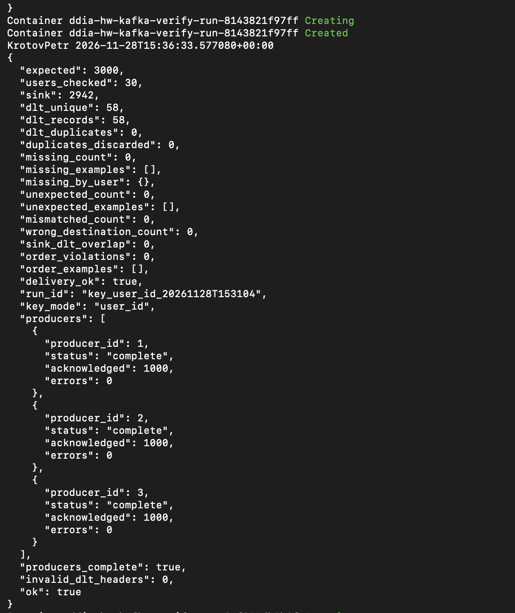

# HW2: Очередь Kafka

Кротов Пётр Андреевич, DevOps/ФиБ.

## Запуск

Требуются Docker с Compose.

```bash
git clone --branch task-02-krotov https://github.com/KrotovPetr/highload_autumn_2026.git
cd highload_autumn_2026/task-02/KrotovPetr
cp .env.example .env
export GITHUB_LOGIN=KrotovPetr
./local-compose up -d --build
./local-compose run --rm --no-deps verify --wait 180 --summary
./status
```

По умолчанию продюсеры отправляют 3000 событий и завершаются. Для новой генерации задайте новый `RUN_ID` в `.env`. Скорость задаётся через `RATE_PER_SECOND`, задержка обработки через `PROCESSING_DELAY_MS`.

```bash
./local-compose run --rm --no-deps tests  # тесты
./local-compose stop                    # остановка с сохранением данных
```

## Устройство

- Три узла Kafka в режиме KRaft совмещают роли broker/controller. Топики `events` и `events.dlt` создаёт init-сервис: три партиции, RF=3, `min.insync.replicas=2`. Автосоздание отключено.
- Три продюсера, три консьюмера в группе `events-processor` и PostgreSQL запускаются в Compose. Kafka доступна с хоста на `127.0.0.1:19092,29092,39092`; порт PostgreSQL наружу не опубликован.
- Событие содержит `event_id` UUIDv5, `user_id`, `type` из `page_view|add_to_cart|purchase`, последовательный `seq` от 1, `produced_at` в UTC и JSON `payload`. Пользователи распределены между продюсерами без пересечений. Около 2% событий имеют `payload.poison=true`; их обработчик всегда выбрасывает ошибку.
- Продюсер использует `acks=all`, идемпотентную отправку и ключ `user_id`; для сравнения доступен `KEY_MODE=none`. Ошибки логируются, при SIGTERM выполняется `flush`.
- В sink сохраняются идентификаторы события и пользователя, seq, обработчик, топик, партиция и оффсет. Уникальный `event_id` подавляет повторные записи; дубли считаются отдельно.
- Автокоммит отключён. После транзакции sink коммитится `offset + 1`; при revoke коммитятся завершённые позиции. `auto.offset.reset=earliest` позволяет новой группе прочитать накопленные события.
- После трёх ошибок обработки poison отправляется в DLT. Причина и исходные координаты находятся в заголовках. Исходный оффсет коммитится после подтверждения доставки в DLT. Ошибки инфраструктуры не считаются poison.

`verify` проверяет диапазоны seq каждого пользователя по манифесту генерации и объединению sink с DLT, включая пропуски в конце последовательности. Он считает дубли и события, записанные после большего seq. Порядок записи фиксируется транзакционно в PostgreSQL. Первая строка содержит GitHub-логин и время UTC.

## Эксперименты

Гипотезы [сохранены до запусков](evidence/2026-11-28-rerun/hypotheses-before-run.md). Результаты от 28 ноября 2026:

| Прогон | Событий | Sink | DLT | Дубли подавлены | Пропуски | Нарушения порядка |
| --- | ---: | ---: | ---: | ---: | ---: | ---: |
| SIGKILL консьюмера | 300 | 300 | 0 | 1 | 0 | 0 |
| Отказ двух брокеров | 6000 | 5885 | 115 | 0 | 0 | 0 |
| Ключ `user_id` | 3000 | 2942 | 58 | 0 | 0 | 0 |
| Без ключа | 3000 | 2933 | 67 | 0 | 0 | 1357 |

### 1. SIGKILL консьюмера

Гипотеза: остановка после записи в sink, но до коммита приведёт к ребалансу и повторной доставке. Дедупликация подавит дубль, потерь не будет.

```bash
GITHUB_LOGIN=KrotovPetr bash tests/recovery.sh
```

В прогоне `recovery_1795879776_64054` перед коммитом была пауза 5 с, poison отключён для изоляции повторной доставки. После SIGKILL `consumer-1` партицию 0 получил `consumer-2`: он повторно прочитал оффсет `10090`, подавил дубль и закоммитил `10091`.

Гипотеза подтвердилась: все 300 событий сохранены, один дубль подавлен. Это at-least-once доставка: sink и оффсет Kafka не входят в общую транзакцию.

[Вывод verify](evidence/2026-11-28-rerun/consumer-verify.txt) · [ребаланс и повторная обработка](evidence/2026-11-28-rerun/consumer-recovery-excerpt.log).


### 2. Отказ брокеров

Гипотеза: один отказ оставит две ISR-реплики и позволит продолжить запись. После второго подтверждения остановятся, сообщения накопятся у продюсеров. Возврат брокеров до delivery timeout восстановит доставку без потерь.

```bash
python3 tests/server_checks.py brokers
```

В прогоне `brokers_20261128T152952` последовательно остановлены `kafka-3` и `kafka-2`:

- После первого отказа лидер партиции 0 сменился с 3 на 1, ISR сократился с трёх реплик до `[1,2]`.
- После второго в логах появился `NotEnoughReplicasException`: одна ISR-реплика не удовлетворяла `min.insync.replicas=2`. Подтверждения отправок остановились, очередь продюсера росла.
- Консьюмеры теряли соединения с остановленными брокерами, коммиты завершались ошибкой `COORDINATOR_NOT_AVAILABLE`.
- После восстановления ISR снова включал три реплики, lag стал равен нулю. Учтены все 6000 событий: 5885 в sink и 115 в DLT.

Гипотеза подтвердилась. После второго отказа из трёх KRaft-контроллеров остаётся один, поэтому кворум метаданных теряет большинство. Роли broker/controller совмещены, и доступность ограничивается обоими механизмами.

[До отказов](evidence/2026-11-28-rerun/brokers-before.txt) · [первый отказ](evidence/2026-11-28-rerun/brokers-one-down.txt) · [ошибки](evidence/2026-11-28-rerun/broker-errors.log) · [восстановление](evidence/2026-11-28-rerun/brokers-restored.txt) · [verify](evidence/2026-11-28-rerun/brokers-verify.txt).



### 3. Сравнение ключей

Гипотеза: с ключом `user_id` события пользователя сохранят порядок в одной партиции. Без ключа они попадут в разные партиции, независимая обработка даст нарушения порядка. Потерь не будет в обоих режимах.

```bash
python3 tests/server_checks.py keys
```

Оба запуска: 30 пользователей, 3000 событий, скорость 100 событий/с на продюсер, задержка обработки 10 мс.

Гипотеза подтвердилась: с ключом нарушений нет, без ключа их 1357, события всех 30 пользователей распределились между несколькими партициями. Пример: `seq=6` записалось после `seq=7`. Kafka гарантирует порядок внутри партиции; дедупликация не переупорядочивает уникальные события. В режиме `none` значение `ok=true` подтверждает полноту доставки, а нарушения порядка выводятся отдельно.

[Verify с ключом](evidence/2026-11-28-rerun/keyed-verify.txt) · [без ключа](evidence/2026-11-28-rerun/unkeyed-verify.txt) · [сравнение](evidence/2026-11-28-rerun/key-comparison.json).




