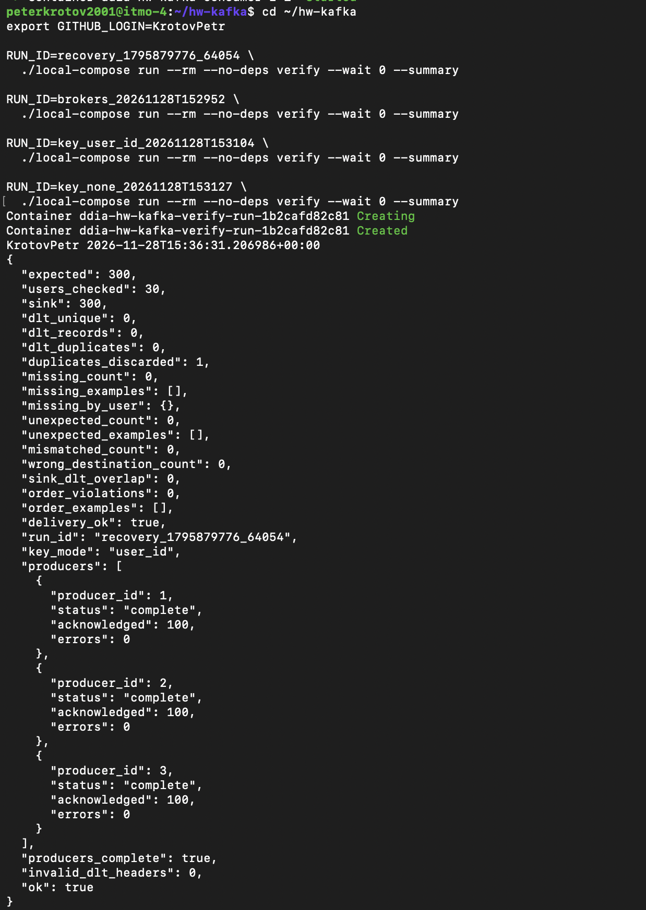
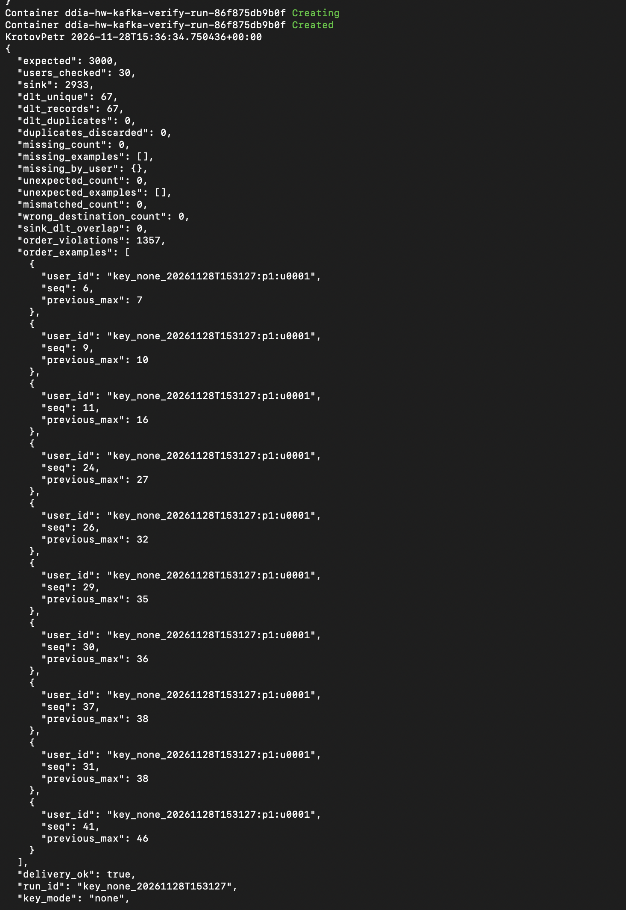

# HW2: Очередь Kafka

Студент: Кротов Пётр Андреевич. Трек: DevOps/ФиБ.

## Запуск

Требуются Docker с Compose.

Получение решения:

```bash
git clone --branch task-02-krotov https://github.com/KrotovPetr/highload_autumn_2026.git
cd highload_autumn_2026/task-02/KrotovPetr
```

Из каталога `task-02/KrotovPetr`:

```bash
cp .env.example .env
./local-compose up -d --build
./local-compose run --rm --no-deps verify --wait 180
./status
```

Compose запускает три Kafka-узла, три продюсера, три консьюмера, PostgreSQL и одноразовые init-сервисы. `init-app` собирает общий образ один раз, чтобы сборки нескольких сервисов не конфликтовали в Docker без Buildx. Каждый Kafka-узел совмещает роли broker/controller в KRaft. Heap ограничен 256 МБ, память контейнера Kafka ограничена 768 МБ.

Внутренние адреса Kafka: `kafka-1:9092,kafka-2:9092,kafka-3:9092`. С хоста доступны `127.0.0.1:19092,127.0.0.1:29092,127.0.0.1:39092`. PostgreSQL не публикует порт на хост. Приложение отвергает настройки подключения к Kafka или БД вне сервисов этого стенда.

Все volumes и сеть принадлежат этому Compose-проекту. Остановка сохраняет данные:

```bash
./local-compose stop
./local-compose start kafka-1 kafka-2 kafka-3 postgres consumer-1 consumer-2 consumer-3
```

Явное удаление контейнеров с сохранением данных: `./local-compose down`. Полный сброс только этого стенда, включая его данные: `make reset`.

## Топики и события

`init-topics` идемпотентно создаёт `events` и `events.dlt`: по три партиции, replication factor 3, `min.insync.replicas=2`, `cleanup.policy=delete`. Автосоздание топиков отключено. Внутренний топик оффсетов также имеет replication factor 3. Настройки несуществующих топиков не полагаются на значения клиента по умолчанию.

Событие содержит `event_id`, `user_id`, `type`, `seq`, `produced_at`, `payload`. `event_id` является UUIDv5 от пользователя и номера события. Повторная отправка того же логического события сохраняет его идентификатор. `produced_at` записывается в UTC в ISO 8601.

Пользователь имеет имя `<RUN_ID>:p<номер продюсера>:u<номер пользователя>`. Каждый пользователь принадлежит одному продюсеру. `seq` начинается с 1. Продюсер обходит своих пользователей по кругу, увеличивая их последовательности. Типы событий: `page_view`, `add_to_cart`, `purchase`.

Для poison используется `payload.poison`. Значение определяется хешем от seed, пользователя и seq. По умолчанию доля примерно 2%; на маленьком наборе она может отличаться. Обработчик такого события всегда выбрасывает `PoisonEvent`; исключение перехватывает цикл повторов. Три неудачные попытки происходят в живом процессе консьюмера. Принудительную смерть процесса исследует отдельный эксперимент.

## Конечные запуски и манифест

По умолчанию три продюсера создают по 10 пользователей и по 100 событий на пользователя, всего 3000 событий. Скорость `RATE_PER_SECOND=30` задаётся на один продюсер. `PROCESSING_DELAY_MS` задаёт задержку одной попытки обработки.

До отправки продюсеры сохраняют манифест в локальную таблицу `runs`. В нём находятся ожидаемые диапазоны seq, seed и параметры poison. Таблица `producer_runs` хранит подтверждённое количество отправок и итоговый статус каждого продюсера. По ним `verify` обнаруживает пропуск хвоста, отсутствие целого пользователя и незавершённую генерацию.

Один продюсер не может повторно запустить уже использованный `RUN_ID`: это предотвращает сброс seq и запуск двух владельцев одного пользователя. Для нового эксперимента задавайте новый `RUN_ID`. Консьюмеры могут читать события всех запусков, а `verify` выбирает один запуск по сохранённому манифесту.

```bash
RUN_ID=second-run ./local-compose up -d producer-1 producer-2 producer-3
RUN_ID=second-run ./local-compose run --rm --no-deps verify --wait 180
```

Для штатного SIGTERM продюсер прекращает генерацию, выполняет `flush` и проверяет подтверждения доставки. Срок доставки ограничен 120 секундами, `stop_grace_period` равен 150 секундам. Недоставленные сообщения и незавершённый запуск приводят к ошибке, а не к ложному успешному результату. После исчерпания срока доставки для восстановления эксперимента нужен новый RUN_ID.

## Обработка, повторы и оффсеты

Группа консьюмеров называется `events-processor`. Автокоммит и автоматическое сохранение позиции отключены. Каждый консьюмер обрабатывает события последовательно, без внутреннего пула задач.

Для обычного события консьюмер ждёт `PROCESSING_DELAY_MS`, подтверждает транзакцию PostgreSQL и только затем синхронно коммитит `offset + 1`. В памяти хранится явная граница завершённых событий по партициям. Callback revoke коммитит только завершённые позиции отзываемых партиций. После потери партиций callback lost удаляет эти позиции без коммита.

`auto.offset.reset=earliest` позволяет новой группе прочитать уже созданные события. При наличии закоммиченного оффсета чтение продолжается с него.

Три ошибки `PoisonEvent` приводят к отправке исходного сообщения в DLT. Заголовки: `error`, `source_topic`, `source_partition`, `source_offset`, `attempts`. Консьюмер ждёт подтверждения доставки в DLT, затем коммитит исходный оффсет. Ошибка PostgreSQL не считается poison: запись повторяется до ограниченного срока. При неисправности DLT или исчерпании повторов sink процесс завершится с ошибкой, не подтверждая текущее сообщение. После восстановления его можно запустить через `./local-compose start consumer-1 consumer-2 consumer-3`.

Запись в PostgreSQL и коммит Kafka не составляют общую транзакцию. Сбой между ними даёт повторную доставку. Первичный ключ `event_id` подавляет повторную запись; счётчик `user_state.duplicates` увеличивается в той же транзакции. Аналогичный сбой после доставки в DLT может дать дубликат DLT, который `verify` учитывает по event_id.

Строка пользователя блокируется на время записи в sink. Каждой новой записи назначается `write_order` этого пользователя. Блокировка удерживается до commit, поэтому порядок не зависит от часов контейнеров или порядка выделения глобального sequence. Записи сохраняются в фактическом порядке поступления, сортировки по seq нет.

## Проверка

```bash
./local-compose run --rm --no-deps verify --wait 180
./local-compose run --rm --no-deps tests
# Без Docker и клиентских зависимостей, интеграционные тесты будут пропущены:
python3 -m unittest discover -s tests -v
```

Первая строка `verify` содержит `GITHUB_LOGIN` и время UTC. Скрипт читает локальный sink и снимок всех трёх партиций DLT до зафиксированных конечных оффсетов. Его читатель не коммитит оффсеты и не вступает в `events-processor`.

Проверяются все ожидаемые event_id, user_id и seq. Poison должен находиться в DLT, остальные события в sink. Проверяются заголовки DLT и завершение всех продюсеров. Есть счётчики пропусков, лишних событий, повторов в sink и DLT, нарушений порядка.

Нарушение порядка считается один раз для каждого события, чей seq меньше максимального seq ранее записанных событий этого пользователя. Для последовательности `3,1,2,4` это два нарушения. Для режима `user_id` нарушение порядка делает итог `ok=false`. В режиме `none` оно выводится как результат эксперимента, при этом целостность доставки проверяется отдельно.

Коды завершения: 0 означает успешную проверку; 1 означает обнаруженные нарушения; 2 означает ошибку настройки или чтения данных. `--wait` позволяет дождаться завершения генерации и обработки. `--wait 0` делает одну проверку. Во время незавершённого запуска пропуски не следует считать окончательно потерянными событиями.

Локальный автоматический smoke создаёт небольшой отдельный запуск, выполняет verify и тесты, сохраняет логи в `artifacts/`:

```bash
bash tests/smoke.sh
# После smoke или другого успешного запуска стенда:
bash tests/recovery.sh
```

Если GITHUB_LOGIN не задан, smoke использует явную техническую метку `local-smoke`. Она не подходит для скриншотов сдачи. Параметры последнего smoke сохраняются в `artifacts/last-smoke.env`.

`recovery.sh` создаёт отдельный запуск, принудительно убивает первый консьюмер между записью в sink и коммитом и проверяет наличие подавленного дубля вместе с полнотой доставки. В конце он восстанавливает первый консьюмер без тестовой паузы. Скрипту нужны Python 3 и `rg` на хосте. Он также использует техническую метку логина, если собственный логин не задан.

### Проверено локально 15 ноября 2026

На Colima с 4 CPU и примерно 6 ГБ памяти прошли 19 тестов в контейнере, включая конкурентные записи в PostgreSQL и проверки границы коммитов. Реальные Kafka Metadata-запросы с хоста подтвердили внешние адреса всех трёх брокеров.

Для штатного `RUN_ID=baseline` все 3000 событий учтены: 2939 в sink и 61 в DLT. Пропусков и нарушений порядка нет, все три продюсера получили по 1000 подтверждений. Вывод сохранён в `artifacts/baseline-verify.txt`, логи в `artifacts/baseline-app.log`.

Техническая проверка восстановления после SIGKILL сохранила все 300 событий и подавила одну повторную доставку. Её артефакты находятся в `artifacts/recovery_1794733100_43896/`. Эти результаты получены с техническими метками логина и не заменяют авторские гипотезы и скриншоты сдачи.

## Эксперименты для отчёта

Ниже зафиксированы фактические результаты запусков от 25 ноября 2026 на сервере `158.160.212.194`. Все сервисы работали в контейнерах проекта `ddia-hw-kafka`. Первая строка исходных результатов `verify` содержит GitHub-логин `KrotovPetr` и время UTC.

Исходные наблюдения ниже относятся к 25 ноября 2026. Гипотезы для повторных прогонов зафиксированы 2026-11-28T15:29:34.540781+00:00, до запуска повторных проверок. Их исходная версия сохранена в [отдельном файле](evidence/2026-11-28-rerun/hypotheses-before-run.md). Повторные проверки завершены 2026-11-28T15:31:52.031005+00:00; результаты и сопоставления приведены в соответствующих разделах. Для каждого эксперимента необходимо добавить не более двух собственных скриншотов.

Итоги повторных прогонов 28 ноября 2026, показанных на скриншотах:

| Прогон | Ожидалось событий | Sink | DLT | Подавлено дублей | Пропуски | Нарушения порядка |
| --- | ---: | ---: | ---: | ---: | ---: | ---: |
| SIGKILL консьюмера | 300 | 300 | 0 | 1 | 0 | 0 |
| Отказ двух брокеров | 6000 | 5885 | 115 | 0 | 0 | 0 |
| Ключ `user_id` | 3000 | 2942 | 58 | 0 | 0 | 0 |
| Без ключа | 3000 | 2933 | 67 | 0 | 0 | 1357 |

Исходные прогоны 25 ноября 2026 для сравнения с повторной проверкой:

| Прогон | Ожидалось событий | Sink | DLT | Подавлено дублей | Пропуски | Нарушения порядка |
| --- | ---: | ---: | ---: | ---: | ---: | ---: |
| SIGKILL консьюмера | 300 | 300 | 0 | 1 | 0 | 0 |
| Отказ двух брокеров | 6000 | 5877 | 123 | 0 | 0 | 0 |
| Ключ `user_id` | 3000 | 2946 | 54 | 0 | 0 | 0 |
| Без ключа | 3000 | 2931 | 69 | 0 | 0 | 699 |

### 1. Принудительная остановка консьюмера

Гипотеза перед повторным запуском 28 ноября 2026: После SIGKILL консьюмера ожидается ребаланс и передача его партиции другому участнику группы. Поскольку остановка выполняется в контролируемой паузе после записи в PostgreSQL, но до коммита Kafka, ожидаю хотя бы одну повторную доставку с последней закоммиченной позиции. Дедупликация по event_id должна подавить повторную запись и увеличить счётчик дублей. После обработки всей очереди сумма sink и DLT должна совпасть с ожидаемым количеством событий, а при ключе user_id нарушений порядка быть не должно.

Прогон `recovery_1795636411_176137` выполнен командой:

```bash
GITHUB_LOGIN=KrotovPetr bash tests/recovery.sh
```

В этом прогоне три продюсера создали по 10 пользователей и по 10 событий на пользователя, всего 300 событий. Для изоляции повторной доставки скрипт установил `POISON_RATE=0`. Обработка poison проверялась в остальных прогонах с долей около 2%. Для `consumer-1` была включена пауза 5000 мс между записью в sink и коммитом оффсета.

Наблюдения по логам:

1. В `19:53:35.889763 UTC` консьюмер `consumer-1` записал событие из партиции `0` с оффсетом `6293` в PostgreSQL. Затем он вошёл в `before_commit_pause`, и скрипт отправил ему SIGKILL.
2. В `19:53:47.863040 UTC` после ребаланса `consumer-2` получил партиции `[0, 1]`.
3. В `19:53:47.864487 UTC` `consumer-2` повторно прочитал оффсет `6293`. Идентификатор события остался тем же: `51c44c77-62b8-5fdd-bdf0-842f4269e9fc`.
4. В `19:53:47.878206 UTC` зарегистрирован `duplicate_discarded`. В `19:53:47.880022 UTC` закоммичена следующая позиция `6294`.

Основные поля `verify`:

```text
KrotovPetr 2026-11-25T19:53:38.201098+00:00
expected=300, sink=300, dlt_unique=0
duplicates_discarded=1, missing_count=0, order_violations=0, ok=true
```

Объяснение наблюдений: запись результата в PostgreSQL и коммит позиции Kafka выполняются отдельно. При SIGKILL между ними результат уже сохранён, а позиция группы ещё не продвинута. Новый обработчик начинает с последней закоммиченной позиции и получает событие повторно. Уникальность `event_id` подавляет вторую запись, после чего обработчик коммитит `offset + 1`. Это демонстрирует at-least-once доставку с дедупликацией результата.

Исходные данные: [вывод verify](evidence/2026-11-25-user-runs/consumer-verify.txt), [лог перед SIGKILL](evidence/2026-11-25-user-runs/consumer-before-kill.log), [фрагмент повторной обработки и ребаланса](evidence/2026-11-25-user-runs/consumer-recovery-excerpt.log).

Повторная проверка 28 ноября 2026 после фиксации гипотезы: `recovery_1795879776_64054`.

```text
KrotovPetr 2026-11-28T15:29:42.381279+00:00
expected=300, sink=300, dlt_unique=0
duplicates_discarded=1, missing_count=0, order_violations=0, ok=true
```

Сопоставление с гипотезой: ожидание ребаланса и повторной доставки подтвердилось. `consumer-1` был остановлен после записи оффсета `10090` партиции `0`. Повторную доставку обработал `consumer-2`, после чего следующая позиция составила `10091`. Счётчик подавленных дублей равен `1`. Все `300` событий учтены, нарушений порядка нет. Наблюдения соответствуют at-least-once доставке с идемпотентной записью результата.

Доказательства повторного запуска: [verify](evidence/2026-11-28-rerun/consumer-verify.txt), [перед SIGKILL](evidence/2026-11-28-rerun/consumer-before-kill.log), [повторная обработка](evidence/2026-11-28-rerun/consumer-recovery-excerpt.log).

Скриншот повторной проверки после SIGKILL: все 300 событий сохранены в sink, одна повторная доставка подавлена, пропусков и нарушений порядка нет. На изображении видны GitHub-логин, время и RUN_ID.



### 2. Последовательная остановка брокеров

Гипотеза перед повторным запуском 28 ноября 2026: После остановки одного брокера ожидаю перевыбор лидера затронутой партиции и сокращение ISR до двух реплик. При acks=all и min.insync.replicas=2 запись должна продолжиться после переключения. После остановки второго брокера одной реплики будет недостаточно для подтверждения новых записей: ожидаю остановку роста acknowledged, накопление сообщений в очередях продюсеров и повторные попытки отправки. Узлы также являются KRaft-контроллерами, поэтому второй отказ лишит кворум метаданных большинства. Чтение и коммиты консьюмеров могут прерываться в зависимости от доступности лидеров и координатора группы. После возврата брокеров до истечения delivery timeout ожидаю восстановления ISR, отправки очереди, снижения lag до нуля и отсутствия потерянных событий. Повторные доставки допускаются и должны подавляться sink.

Прогон `brokers_20261125T195350` выполнен командой:

```bash
python3 tests/server_checks.py brokers
```

Три продюсера создавали по 10 пользователей и по 200 событий на пользователя, всего 6000 событий. Скорость одного продюсера составляла 50 событий/с. Скрипт остановил `kafka-3`, затем `kafka-2` и после паузы восстановил оба брокера.

| Этап | Лидер партиции 0 | Лидер партиции 1 | Лидер партиции 2 | ISR |
| --- | ---: | ---: | ---: | --- |
| До отказов | 3 | 1 | 2 | Все три брокера: `[1,3,2]` |
| После остановки `kafka-3` | 1 | 1 | 2 | `[1,2]` во всех партициях |
| После восстановления обоих брокеров | 1 | 1 | 1 | `[1,2,3]` во всех партициях |

После остановки второго брокера в логе `kafka-1` появилась ошибка:

```text
org.apache.kafka.common.errors.NotEnoughReplicasException:
The size of the current ISR Set(1) is insufficient to satisfy the min.isr requirement of 2 for partition events-2
```

Аналогичная ошибка наблюдалась для партиции `__consumer_offsets-1`. В прогрессе первого продюсера число подтверждённых отправок остановилось на `906`, а очередь продолжала расти:

| Время UTC | Сгенерировано | Подтверждено | В очереди |
| --- | ---: | ---: | ---: |
| 19:54:19.109976 | 1273 | 906 | 367 |
| 19:54:20.129980 | 1324 | 906 | 418 |
| 19:54:21.149983 | 1375 | 906 | 469 |
| 19:54:22.169982 | 1426 | 906 | 520 |

После восстановления ISR снова включал все три брокера, lag каждой партиции стал равен `0`. Все три продюсера завершились со статусом `complete`, получили по 2000 подтверждений и не зарегистрировали окончательных ошибок доставки.

Основные поля `verify`:

```text
KrotovPetr 2026-11-25T19:54:33.209559+00:00
expected=6000, sink=5877, dlt_unique=123
duplicates_discarded=0, missing_count=0, order_violations=0, ok=true
```

Объяснение наблюдений: при первом отказе оставались две синхронные реплики. Они удовлетворяли `min.insync.replicas=2`, поэтому запись с `acks=all` могла продолжаться после перевыбора лидера затронутой партиции. При одной ISR-реплике требование уже не выполнялось, что подтверждается `NotEnoughReplicasException` и остановкой роста счётчика подтверждений. Отсутствие окончательных ошибок у продюсера не означает, что запись в этот момент продолжалась: сообщения ожидали доставки в клиентской очереди, а восстановление произошло до истечения delivery timeout.

Узлы совмещают роли broker/controller, поэтому второй отказ также оставляет одного из трёх KRaft-контроллеров без большинства. Репликация данных и кворум метаданных являются разными ограничениями; недоступность после второго отказа нельзя объяснять только `min.insync.replicas`. Контроллер KRaft до и после восстановления имел `LeaderId=1`, но `LeaderEpoch` вырос с `8` до `13`. Это отдельные показатели от лидеров партиций топика `events`.

Итог проверки: `5877 + 123 = 6000`, потерь нет. Poison-события учтены в DLT, после восстановления lag равен нулю.

Исходные данные: [до отказов](evidence/2026-11-25-user-runs/brokers-before.txt), [после первого отказа](evidence/2026-11-25-user-runs/brokers-one-down.txt), [продюсеры и консьюмеры при двух остановленных брокерах](evidence/2026-11-25-user-runs/brokers-two-down.log), [ошибки оставшегося брокера](evidence/2026-11-25-user-runs/broker-errors.log), [после восстановления](evidence/2026-11-25-user-runs/brokers-restored.txt), [вывод verify](evidence/2026-11-25-user-runs/brokers-verify.txt).

Повторная проверка 28 ноября 2026 после фиксации гипотезы: `brokers_20261128T152952`.

- До отказов: партиция 0: лидер 3, ISR [1,3,2]; партиция 1: лидер 1, ISR [1,3,2]; партиция 2: лидер 2, ISR [1,3,2].
- После первого отказа: партиция 0: лидер 1, ISR [1,2]; партиция 1: лидер 1, ISR [1,2]; партиция 2: лидер 2, ISR [1,2].
- После восстановления: партиция 0: лидер 1, ISR [1,2,3]; партиция 1: лидер 1, ISR [1,2,3]; партиция 2: лидер 1, ISR [1,2,3].

После первого отказа наблюдалась смена лидера: партиция 0, 3 → 1. В логе оставшегося брокера снова зафиксирован `NotEnoughReplicasException`. У первого продюсера acknowledged оставался 1182, а queued вырос с 500 до 551 между 2026-11-28T15:30:29.278999+00:00 и 2026-11-28T15:30:30.299003+00:00.

```text
KrotovPetr 2026-11-28T15:30:47.571017+00:00
expected=6000, sink=5885, dlt_unique=115
duplicates_discarded=0, missing_count=0, order_violations=0, ok=true
```

Сопоставление с гипотезой: прогноз восстановления полноты доставки подтвердился. После возврата брокеров все `6000` событий учтены в sink и DLT. Первый отказ оставил две ISR-реплики, а второй оставил одну, что ниже `min.insync.replicas=2`. Доступность подтверждения записи ограничивалась также отсутствием большинства KRaft-контроллеров. Сообщения были доставлены после восстановления, до истечения delivery timeout. Распределение лидеров между брокерами не обязано возвращаться к состоянию до отказов.

Доказательства повторного запуска: [до отказов](evidence/2026-11-28-rerun/brokers-before.txt), [первый отказ](evidence/2026-11-28-rerun/brokers-one-down.txt), [продюсеры при двух отказах](evidence/2026-11-28-rerun/brokers-two-down.log), [лог брокера](evidence/2026-11-28-rerun/broker-errors.log), [восстановление](evidence/2026-11-28-rerun/brokers-restored.txt), [verify](evidence/2026-11-28-rerun/brokers-verify.txt).

Скриншот итоговой проверки после восстановления брокеров: `5885 + 115 = 6000`, пропусков и нарушений порядка нет. Все продюсеры завершили отправку без окончательных ошибок. Изменения лидеров и ISR разобраны выше и подтверждаются приложенными исходными логами.


### 3. Сравнение ключей

Гипотеза перед повторным запуском 28 ноября 2026: При KEY_MODE=user_id ожидаю, что события каждого пользователя окажутся в одной партиции и сохранят порядок: order_violations должен быть равен нулю. При KEY_MODE=none ожидаю распределения событий пользователей между несколькими партициями и ненулевого числа нарушений порядка из-за независимой обработки партиций. Точное число нарушений заранее не фиксирую: оно зависит от распределения сообщений и расписания обработки. В обоих режимах после завершения генерации и обработки ожидаю missing_count=0 с учётом DLT.

Сравнение выполнено командой:

```bash
python3 tests/server_checks.py keys
```

Оба запуска использовали три продюсера, по 10 пользователей на продюсер и по 100 событий на пользователя, всего по 3000 событий. Скорость одного продюсера составляла 100 событий/с, задержка обработки 10 мс. Запуски имели разные RUN_ID.

| Показатель | `KEY_MODE=user_id` | `KEY_MODE=none` |
| --- | --- | --- |
| RUN_ID | `key_user_id_20261125T195502` | `key_none_20261125T195526` |
| Первая строка verify | `KrotovPetr 2026-11-25T19:55:07.133967+00:00` | `KrotovPetr 2026-11-25T19:55:31.492338+00:00` |
| Событий в sink | 2946 | 2931 |
| Уникальных событий в DLT | 54 | 69 |
| Пропусков | 0 | 0 |
| Подавленных дублей | 0 | 0 |
| Нарушений порядка | 0 | 699 |
| Пользователей с событиями в нескольких партициях | 0 | 30 |
| Итог `ok` | `true` | `true` |

Пример нарушения из `order_examples` второго запуска: для пользователя `key_none_20261125T195526:p1:u0001` событие с `seq=5` было записано после события с `seq=6`. В другом примере `seq=8` записалось после уже наблюдавшегося `seq=10`.

Объяснение наблюдений: ключ `user_id` направляет события одного пользователя в одну партицию. При последовательной обработке этой партиции сохраняется порядок его событий. Без ключа события пользователя распределяются между партициями; в этом прогоне все 30 пользователей оказались в нескольких партициях. Разные консьюмеры обрабатывают партиции независимо, поэтому событие с большим seq может раньше попасть в sink. Идемпотентная запись удаляет дубли, но не переупорядочивает уникальные события.

В режиме `none` значение `ok=true` означает успешную проверку полноты доставки и корректности назначения sink/DLT. Наблюдаемые нарушения порядка при этом выводятся отдельно и не делают этот эксперимент ошибочным. Для режима `user_id` отсутствие нарушений порядка входит в условие успешной проверки.

Исходные данные: [verify с ключом](evidence/2026-11-25-user-runs/keyed-verify.txt), [verify без ключа](evidence/2026-11-25-user-runs/unkeyed-verify.txt), [сравнение режимов](evidence/2026-11-25-user-runs/key-comparison.json).

Повторная проверка 28 ноября 2026 после фиксации гипотезы:

| Показатель | `KEY_MODE=user_id` | `KEY_MODE=none` |
| --- | --- | --- |
| RUN_ID | `key_user_id_20261128T153104` | `key_none_20261128T153127` |
| Первая строка verify | `KrotovPetr 2026-11-28T15:31:08.016128+00:00` | `KrotovPetr 2026-11-28T15:31:32.161151+00:00` |
| Событий в sink | 2942 | 2933 |
| Уникальных событий в DLT | 58 | 67 |
| Пропусков | 0 | 0 |
| Подавленных дублей | 0 | 0 |
| Нарушений порядка | 0 | 1357 |
| Пользователей в нескольких партициях | 0 | 30 |

Сопоставление с гипотезой: в режиме `user_id` нарушений порядка нет, все события каждого пользователя находились в одной партиции. Без ключа в нескольких партициях оказались `30` пользователей, число нарушений составило `1357`. Ожидание ненулевого числа нарушений без ключа подтвердилось. В обоих режимах все ожидаемые события учтены с учётом DLT. Точное число нарушений отличается между запусками, поскольку зависит от распределения сообщений и расписания независимых обработчиков; конкретное число заранее не предполагалось.

Доказательства повторного запуска: [verify с ключом](evidence/2026-11-28-rerun/keyed-verify.txt), [verify без ключа](evidence/2026-11-28-rerun/unkeyed-verify.txt), [сравнение](evidence/2026-11-28-rerun/key-comparison.json).

С ключом `user_id`: учтены все 3000 событий, из них 2942 в sink и 58 в DLT. Нарушений порядка нет.


Без ключа: учтены все 3000 событий, из них 2933 в sink и 67 в DLT. Зафиксировано 1357 нарушений порядка. В примере на снимке `seq=6` записалось после `seq=7`. Изображение показывает фрагмент вывода verify с итоговыми счётчиками и примерами нарушений; полный вывод сохранён в исходных данных повторного запуска.



## Сдача DevOps/ФиБ

Локальная реализация не публикует ничего автоматически. Для сдачи остаются собственные гипотезы, объяснения результатов, скриншоты с настоящим GITHUB_LOGIN, скринкаст до одной минуты и PR по правилам задания. Эти действия выполняются отдельно.

## Документация

- [Apache Kafka: Docker](https://kafka.apache.org/39/getting-started/docker/).
- [Apache Kafka: KRaft и большинство контроллеров](https://kafka.apache.org/41/operations/kraft/).
- [Confluent Python client: доставка и ручные коммиты](https://docs.confluent.io/kafka-clients/python/current/overview.html).
- [Psycopg: транзакции](https://www.psycopg.org/psycopg3/docs/basic/transactions.html).
